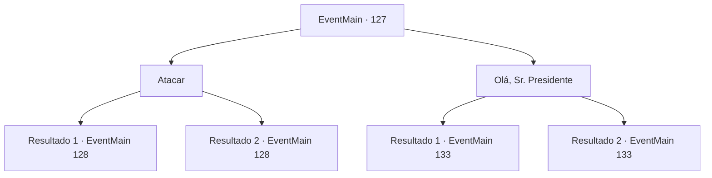

# Eventos principais · 127

[Índice da tabela](index.md) · [Índice geral](../index.md)

ID: `pt:EventMain:127` · Fonte: `EventMain4` · Versão: 1.2.47.

Mapeamento estático dos arquivos; a disponibilidade e a execução dependem do estado da run.

## Texto do evento

*Sem texto no arquivo.*

## Dados de entrada

```json
{
  "id": 127,
  "grade": 1,
  "normalGoal": "",
  "required": ""
}
```

## Mapa das escolhas



## Escolhas e resultados

### Escolha 1

Atacar

Requisitos e outros campos da escolha:

```json
{
  "required": ""
}
```

#### Resultado 1.1

Você se sente mal olhando para tantas larvas. Você vomita no chão antes de balançar sua arma no enxame.

Continuação registrada: [Evento 128](0128.md) na mesma tabela.

```json
{
  "required": "",
  "chance": "11",
  "nextEvent": 128,
  "type": 1,
  "reward": "6_0_80|0_1_-1",
  "place": 10
}
```

#### Resultado 1.2

Mesmo antes da visão medonha das larvas, você conseguiu manter a calma e atacar o enxame.

Continuação registrada: [Evento 128](0128.md) na mesma tabela.

```json
{
  "required": "",
  "chance": "1|0_14_1",
  "nextEvent": 128,
  "type": 0,
  "reward": "6_0_80",
  "place": 10
}
```

### Escolha 2

Olá, Sr. Presidente

Requisitos e outros campos da escolha:

```json
{
  "required": "1_14_12"
}
```

#### Resultado 2.1

Você calmamente cumprimenta o enxame abominável. Eles acenam e falam devagar. 

 "Siga-nos. Temos algo para lhe mostrar."

 Halad exige saber o que eles estão fazendo. Em vez de responder, o enxame pisa em sua varinha e imediatamente a consome. Então eles tocam uma estante para revelar uma sala escondida atrás dela.

Continuação registrada: [Evento 133](0133.md) na mesma tabela.

```json
{
  "required": "10_135_1",
  "chance": "1",
  "nextEvent": 133,
  "type": 2,
  "reward": ""
}
```

#### Resultado 2.2

Você calmamente cumprimenta o enxame abominável. Eles acenam e falam devagar. 

 "Siga-nos. Temos algo para lhe mostrar."

 A gripe está em negação como ele exclama nitidamente. 

 "Isso... não pode ser! Como essa abominação pode ser Edmond...?!"

 O enxame responde: 'Bem, você se transformou em um rato, não foi?' A gripe não responde, seus bigodes tremendo. Halad exige saber o que eles estão fazendo. Em vez de responder, o enxame pisa em sua varinha e imediatamente a consome. Então eles tocam uma estante para revelar uma sala escondida atrás dela.

Continuação registrada: [Evento 133](0133.md) na mesma tabela.

```json
{
  "required": "8_135_1",
  "chance": "1",
  "nextEvent": 133,
  "type": 2,
  "reward": ""
}
```

## Referências que chegam a este evento

- [Evento 126 · escolha 1 · resultado 2](0126.md#escolha-1)
- [Evento 126 · escolha 1 · resultado 5](0126.md#escolha-1)
- [Evento 212 · escolha 1 · resultado 2](0212.md#escolha-1)
- [Evento 212 · escolha 2 · resultado 1](0212.md#escolha-2)
