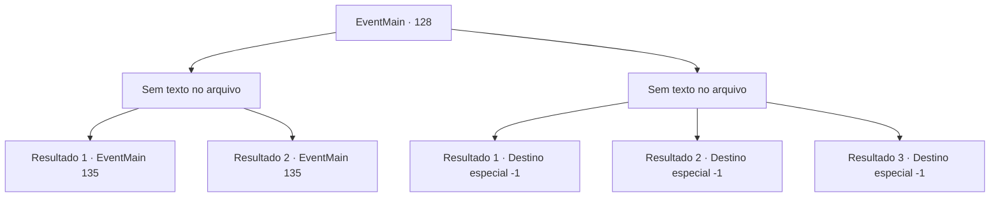

# Eventos principais · 128

[Índice da tabela](index.md) · [Índice geral](../index.md)

ID: `pt:EventMain:128` · Fonte: `EventMain4` · Versão: 1.2.47.

Mapeamento estático dos arquivos; a disponibilidade e a execução dependem do estado da run.

## Texto do evento

*Sem texto no arquivo.*

## Dados de entrada

```json
{
  "id": 128,
  "grade": 1,
  "normalGoal": "",
  "required": ""
}
```

## Mapa das escolhas



## Escolhas e resultados

### Escolha 1

*Sem texto no arquivo; o papel dessa opção depende da interface do jogo.*

Requisitos e outros campos da escolha:

```json
{
  "required": ""
}
```

#### Resultado 1.1

Você derrota o enxame. Os vermes se espalham em diferentes direções. Halad olha para você impotente. Ela está muito chocada para continuar lutando. 

 "Droga... me mate, me prenda, faça o que quiser."

 Então você se lembra do texto proibido que Halad roubou para si mesma.

Continuação registrada: [Evento 135](0135.md) na mesma tabela.

```json
{
  "required": "13_1_11",
  "chance": "1",
  "nextEvent": 135,
  "type": 2,
  "reward": ""
}
```

#### Resultado 1.2

Você derrota o enxame. Os vermes se espalham em diferentes direções. Halad olha para você impotente. Ela está muito chocada para continuar lutando. 

 "Droga... me mate, me prenda, faça o que quiser."

 Os estudiosos agradecem e acorrentam Halad para selar sua mana. Então você se lembra do texto proibido que Halad roubou para si mesma.

Continuação registrada: [Evento 135](0135.md) na mesma tabela.

```json
{
  "required": "13_1_14",
  "chance": "1",
  "nextEvent": 135,
  "type": 2,
  "reward": ""
}
```

### Escolha 2

*Sem texto no arquivo; o papel dessa opção depende da interface do jogo.*

Requisitos e outros campos da escolha:

```json
{
  "required": ""
}
```

#### Resultado 2.1

O enxame está armado com o conhecimento do presidente e você não é páreo para eles. É incerto se eles realmente são uma reencarnação do presidente, mas suas habilidades certamente vêm dele. 

 "Bom, bom... Vou me certificar de que você nunca mais fique no meu caminho. Dominato Geass!"

 E assim, você perde o controle do seu corpo.

Continuação registrada: [Destino especial `-1`](../destinos-especiais.md).

```json
{
  "required": "13_1_11",
  "chance": "1",
  "nextEvent": -1,
  "type": 2,
  "reward": "15_2_0"
}
```

#### Resultado 2.2

A enxurrada é armada com o conhecimento do Diretor, e você não é páreo para eles. Não é certo se eles realmente são uma reencarnação do Diretor, mas suas habilidades certamente são dele. Halad se aproxima de você com toda a sua fúria. 

 "Retorne à poeira! Disintegrati..."

 A enxurrada a impede de terminar seu feitiço. 

 "Não. Não há necessidade de matar."

 Halad range os dentes. Então ela recupera a compostura. 

 "Certo... Eu não vou matar você. Mas vou garantir que você nunca mais fique no meu caminho. Dominato Geass!"

 E com isso, você perde o controle sobre seu corpo.

Continuação registrada: [Destino especial `-1`](../destinos-especiais.md).

```json
{
  "required": "5_76_2",
  "chance": "1",
  "nextEvent": -1,
  "type": 2,
  "reward": "15_2_0"
}
```

#### Resultado 2.3

O enxame está armado com o conhecimento do presidente e você não é páreo para eles. É incerto se eles realmente são uma reencarnação do presidente, mas suas habilidades são certamente dele. Os estudiosos continuam a lutar contra o enxame enquanto você entra em colapso. Essa é a última coisa que você vê antes de desmaiar.

Continuação registrada: [Destino especial `-1`](../destinos-especiais.md).

```json
{
  "required": "13_1_14",
  "chance": "1",
  "nextEvent": -1,
  "type": 2,
  "reward": "15_2_2"
}
```

## Referências que chegam a este evento

- [Evento 126 · escolha 1 · resultado 6](0126.md#escolha-1)
- [Evento 127 · escolha 1 · resultado 1](0127.md#escolha-1)
- [Evento 127 · escolha 1 · resultado 2](0127.md#escolha-1)
