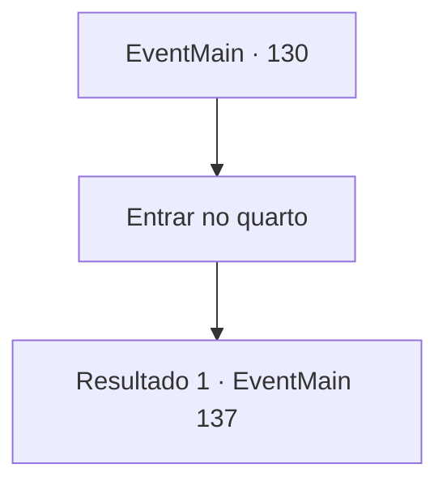

# Eventos principais · 130

[Índice da tabela](index.md) · [Índice geral](../index.md)

ID: `pt:EventMain:130` · Fonte: `EventMain4` · Versão: 1.2.47.

Mapeamento estático dos arquivos; a disponibilidade e a execução dependem do estado da run.

## Texto do evento

*Sem texto no arquivo.*

## Dados de entrada

```json
{
  "id": 130,
  "grade": 1,
  "normalGoal": "",
  "required": ""
}
```

## Mapa das escolhas



## Escolhas e resultados

### Escolha 1

Entrar no quarto

Requisitos e outros campos da escolha:

```json
{
  "required": ""
}
```

#### Resultado 1.1

|drawing_forbidenBook| Dentro da pequena sala há uma escrivaninha e cadeira de madeira, uma pequena vela e um livro aberto velho e surrado. Você imediatamente o reconhece como o texto proibido de Halad. Você está prestes a rasgá-lo quando ele começa a falar. 

 "E-espere! Por favor, não me mate! Eu... eu não fiz nada, fui manipulado! S-poupe-me e eu lhe darei poder!"

 Você sente que o livro contém as almas de todos os encantados por Halad.

Continuação registrada: [Evento 137](0137.md) na mesma tabela.

```json
{
  "required": "",
  "chance": "1",
  "nextEvent": 137,
  "type": 2,
  "reward": ""
}
```

## Referências que chegam a este evento

- [Evento 126 · escolha 2 · resultado 6](0126.md#escolha-2)
