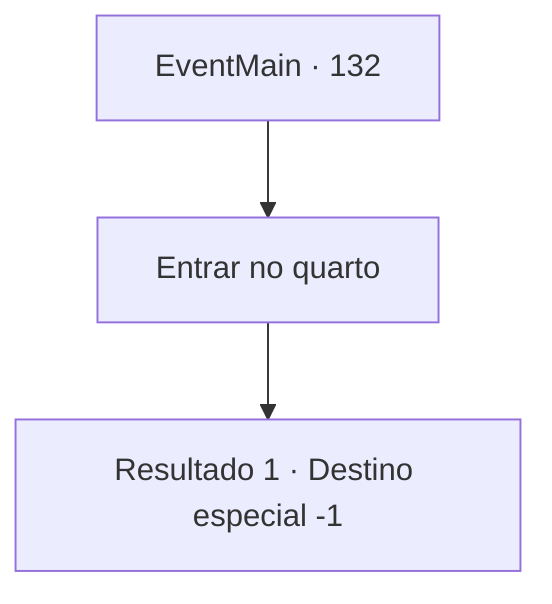

# Eventos principais · 132

[Índice da tabela](index.md) · [Índice geral](../index.md)

ID: `pt:EventMain:132` · Fonte: `EventMain4` · Versão: 1.2.47.

Mapeamento estático dos arquivos; a disponibilidade e a execução dependem do estado da run.

## Texto do evento

*Sem texto no arquivo.*

## Dados de entrada

```json
{
  "id": 132,
  "grade": 1,
  "normalGoal": "",
  "required": ""
}
```

## Mapa das escolhas



## Escolhas e resultados

### Escolha 1

Entrar no quarto

Requisitos e outros campos da escolha:

```json
{
  "required": ""
}
```

#### Resultado 1.1

Dentro da pequena sala há uma mesa de madeira e cadeira, uma pequena vela e um livro aberto velho e surrado. Você imediatamente o reconhece como o texto proibido de Halad. Flu aponta sua varinha para ele, e Halad aponta a dela para ele. Ambos gritam o mesmo feitiço. <link=shake>

 "Retorne ao pó! Desintegrações!"

</link> Os dois bastões brilham com uma luz verde assassina. Halad desmaia, desmaiando no local. Pó branco cai em seu roupão.

Continuação registrada: [Destino especial `-1`](../destinos-especiais.md).

```json
{
  "required": "",
  "chance": "1",
  "nextEvent": -1,
  "type": 2,
  "reward": "15_2_3|15_2_8"
}
```

## Referências que chegam a este evento

- [Evento 126 · escolha 2 · resultado 7](0126.md#escolha-2)
