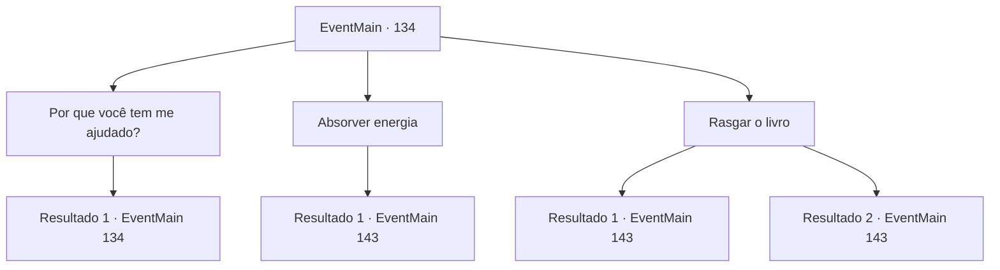

# Eventos principais · 134

[Índice da tabela](index.md) · [Índice geral](../index.md)

ID: `pt:EventMain:134` · Fonte: `EventMain4` · Versão: 1.2.47.

Mapeamento estático dos arquivos; a disponibilidade e a execução dependem do estado da run.

## Texto do evento

*Sem texto no arquivo.*

## Dados de entrada

```json
{
  "id": 134,
  "grade": 1,
  "normalGoal": "",
  "required": ""
}
```

## Mapa das escolhas



## Escolhas e resultados

### Escolha 1

Por que você tem me ajudado?

Requisitos e outros campos da escolha:

```json
{
  "required": "5_78_0"
}
```

#### Resultado 1.1

Eles parecem animados ao responder. Quase parece que eles estão rindo um pouco. 

 "Eu só estou fazendo o que o Geass de Halad está me obrigando a fazer, e o dela é 'Ajude seu aluno'."

 Ele explica ainda por que ela fez essa escolha. 

 "Geass tem suas restrições, você vê. Ainda mais quando os adversários são fortes de espírito e numerosos. E quanto mais específico for, menor a probabilidade de seu sucesso. É por isso que ela lançou um Geass tão brando em mim."


Continuação registrada: [Evento 134](0134.md) na mesma tabela.

```json
{
  "required": "",
  "chance": "1",
  "nextEvent": 134,
  "type": 2,
  "reward": "5_78_1"
}
```

### Escolha 2

Absorver energia

Requisitos e outros campos da escolha:

```json
{
  "required": ""
}
```

#### Resultado 2.1

Você diz ao livro que absorverá sua energia. Ele solta um suspiro de alívio. 

 "Ufa... que bom que você está sendo razoável! Aqui, coloque sua mão em mim. Eu vou... AHHHH!"

 O enxame coloca a mão em vez de você. Eles comem o livro em questão de segundos. Então eles se aproximam de você. 

 "Escancarar. Isso não será fácil."

 O enxame corre pela sua boca. É absolutamente repulsivo quando os vermes com gosto de sujeira se contorcem em sua garganta e em seu estômago. Mas, ao mesmo tempo, você sente a energia carregando dentro de você. Parece uma eternidade, mas também um momento fugaz, antes que todo o enxame desapareça em seu corpo. Apenas um pequeno verme está na sua frente e fala. 

 "Está tudo feito. Bom trabalho."

 Agora você tem que decidir o que fazer com Halad.

Continuação registrada: [Evento 143](0143.md) na mesma tabela.

```json
{
  "required": "",
  "chance": "1",
  "nextEvent": 143,
  "type": 2,
  "reward": "0_3_-20|5_77_2"
}
```

### Escolha 3

Rasgar o livro

Requisitos e outros campos da escolha:

```json
{
  "required": ""
}
```

#### Resultado 3.1

Você rasga o livro ao meio. Ele solta um grito penetrante enquanto toda a sua energia explode em várias direções. O enxame parece desapontado, mas não diz muito. 

 "Está tudo feito. Bom trabalho."

 Agora você tem que decidir o que fazer com Halad.

Continuação registrada: [Evento 143](0143.md) na mesma tabela.

```json
{
  "required": "1_5_13",
  "chance": "1",
  "nextEvent": 143,
  "type": 2,
  "reward": "0_3_20|5_77_3"
}
```

#### Resultado 3.2

Você tenta rasgar o livro ao meio. É mais difícil do que parece, e continua a gritar. <link=shake>

 "AHHHHH!! ME MATEM JÁ! MATE-ME AGORA!!!"

</link> Finalmente, o livro se despedaça e toda a sua energia explode em múltiplas direções. O enxame parece desapontado, mas não diz muito. 

 "Está tudo feito. Bom trabalho."

 Agora você tem que decidir o que fazer com Halad.

Continuação registrada: [Evento 143](0143.md) na mesma tabela.

```json
{
  "required": "2_5_13",
  "chance": "1",
  "nextEvent": 143,
  "type": 2,
  "reward": "0_3_20|5_77_3"
}
```

## Referências que chegam a este evento

- [Evento 133 · escolha 2 · resultado 1](0133.md#escolha-2)
- [Evento 134 · escolha 1 · resultado 1](0134.md#escolha-1)
