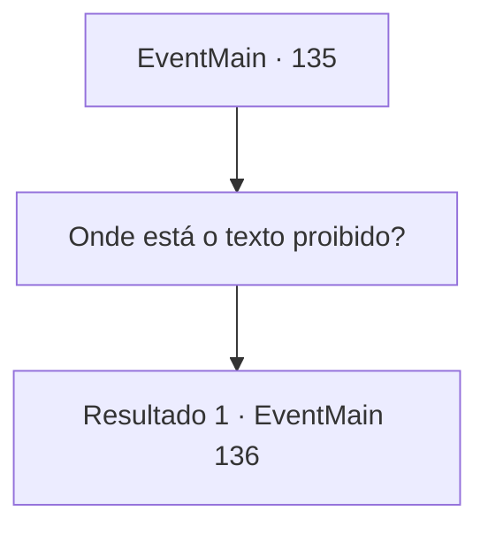

# Eventos principais · 135

[Índice da tabela](index.md) · [Índice geral](../index.md)

ID: `pt:EventMain:135` · Fonte: `EventMain4` · Versão: 1.2.47.

Mapeamento estático dos arquivos; a disponibilidade e a execução dependem do estado da run.

## Texto do evento

*Sem texto no arquivo.*

## Dados de entrada

```json
{
  "id": 135,
  "grade": 1,
  "normalGoal": "",
  "required": ""
}
```

## Mapa das escolhas



## Escolhas e resultados

### Escolha 1

Onde está o texto proibido? 

Requisitos e outros campos da escolha:

```json
{
  "required": ""
}
```

#### Resultado 1.1

Você pergunta a Halad onde está o texto proibido. Ela abaixa a cabeça e murmura baixinho. 

 "Lá. Atrás da estante. Na sala escondida."

 Você empurra a estante de lado e com certeza, há uma sala escondida.

Continuação registrada: [Evento 136](0136.md) na mesma tabela.

```json
{
  "required": "",
  "chance": "1",
  "nextEvent": 136,
  "type": 2,
  "reward": ""
}
```

## Referências que chegam a este evento

- [Evento 128 · escolha 1 · resultado 1](0128.md#escolha-1)
- [Evento 128 · escolha 1 · resultado 2](0128.md#escolha-1)
