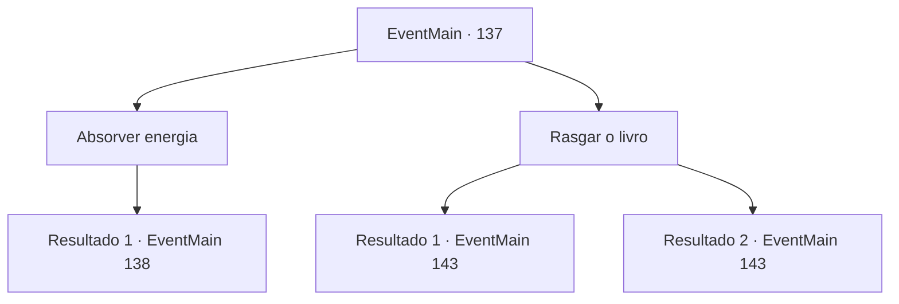

# Eventos principais · 137

[Índice da tabela](index.md) · [Índice geral](../index.md)

ID: `pt:EventMain:137` · Fonte: `EventMain4` · Versão: 1.2.47.

Mapeamento estático dos arquivos; a disponibilidade e a execução dependem do estado da run.

## Texto do evento

*Sem texto no arquivo.*

## Dados de entrada

```json
{
  "id": 137,
  "grade": 1,
  "normalGoal": "",
  "required": ""
}
```

## Mapa das escolhas



## Escolhas e resultados

### Escolha 1

Absorver energia

Requisitos e outros campos da escolha:

```json
{
  "required": ""
}
```

#### Resultado 1.1

Você diz ao livro que absorverá sua energia. Ele solta um suspiro de alívio. 

 "Ufa... que bom que você está sendo razoável! Aqui, coloque sua mão em mim. Eu lhe darei meu poder."

 No momento em que sua mão toca o livro, você vê algo que nunca viu antes. Você está parado no meio de uma terra estéril, e na sua frente está um cérebro gigante acorrentado ao chão. |drawing_evilBrain| Quatro olhos injetados de sangue te encaram, espalhados por sua superfície, e abaixo deles está uma boca meio derretida, flanqueado por dois grandes braços de cada lado. 

 "Aqui, venha."

 Ele abre a boca e gesticula para você entrar.

Continuação registrada: [Evento 138](0138.md) na mesma tabela.

```json
{
  "required": "",
  "chance": "1",
  "nextEvent": 138,
  "type": 2,
  "reward": ""
}
```

### Escolha 2

Rasgar o livro

Requisitos e outros campos da escolha:

```json
{
  "required": ""
}
```

#### Resultado 2.1

Você rasga o livro ao meio. Ele solta um grito penetrante enquanto toda a sua energia explode em várias direções. 

 "Bom trabalho, pequena."

 Terria corre até você e dá um tapinha na sua bunda. Ela diz para você fazer o que quiser e desaparece em um portal. Você é deixado para decidir o que fazer com Halad. Halad olha para você impotente.

Continuação registrada: [Evento 143](0143.md) na mesma tabela.

```json
{
  "required": "1_5_13",
  "chance": "1",
  "nextEvent": 143,
  "type": 2,
  "reward": "0_3_20"
}
```

#### Resultado 2.2

Você tenta rasgar o livro ao meio. É mais difícil do que parece, e continua a gritar. <link=shake>

 "AHHHHH!! ME MATEM JÁ! MATE-ME AGORA!!!"

</link> Finalmente, o livro se despedaça e toda a sua energia explode em múltiplas direções. 

 "Bom trabalho, pequena."

 Terria corre até você e dá um tapinha na sua bunda. Ela diz para você fazer o que quiser e desaparece em um portal. Você é deixado para decidir o que fazer com Halad. Halad olha para você impotente.

Continuação registrada: [Evento 143](0143.md) na mesma tabela.

```json
{
  "required": "2_5_13",
  "chance": "1",
  "nextEvent": 143,
  "type": 2,
  "reward": "0_3_20"
}
```

## Referências que chegam a este evento

- [Evento 130 · escolha 1 · resultado 1](0130.md#escolha-1)
