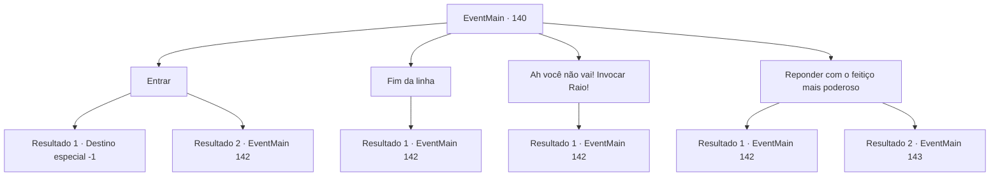

# Eventos principais · 140

[Índice da tabela](index.md) · [Índice geral](../index.md)

ID: `pt:EventMain:140` · Fonte: `EventMain4` · Versão: 1.2.47.

Mapeamento estático dos arquivos; a disponibilidade e a execução dependem do estado da run.

## Texto do evento

*Sem texto no arquivo.*

## Dados de entrada

```json
{
  "id": 140,
  "grade": 1,
  "normalGoal": "",
  "required": ""
}
```

## Mapa das escolhas



## Escolhas e resultados

### Escolha 1

Entrar

Requisitos e outros campos da escolha:

```json
{
  "required": ""
}
```

#### Resultado 1.1

Você quase consegue não vomitar enquanto entra em sua boca repulsiva. Dentes afiados de repente saem de dentro. A boca se fecha atrás de você, e essa é a última coisa que você vê.

Continuação registrada: [Destino especial `-1`](../destinos-especiais.md).

```json
{
  "required": "10_111_1",
  "chance": "1",
  "nextEvent": -1,
  "type": 2,
  "reward": "15_2_7|25_8_1"
}
```

#### Resultado 1.2

À medida que você se aproxima, sua varinha grita para o cérebro. 

 "Ouça sua bolha de carne doente, a única coisa que vem em sua direção é isso!"

 Ele começa a disparar chamas de sua boca. O cérebro pega fogo, fumaça saindo de todos os buracos. <link=shake>

 "GRHEEEAAAAAAH!!!"

</link> Ele solta um grito perturbador enquanto treme violentamente. Sua superfície enrugada cheira a carne e sangue apodrecidos e queimados. Você está convencido de que está morto até que comece a disparar lasers de seus quatro olhos.

Continuação registrada: [Evento 142](0142.md) na mesma tabela.

```json
{
  "required": "8_111_1",
  "chance": "1",
  "nextEvent": 142,
  "type": 2,
  "reward": "6_2_81",
  "place": 2
}
```

### Escolha 2

Fim da linha

Requisitos e outros campos da escolha:

```json
{
  "required": ""
}
```

#### Resultado 2.1

Você se recusa imediatamente. Ele responde com uma voz que soa como os gritos de milhares. 

 "Como quiser."

 O cérebro gigante começa a disparar lasers de seus quatro olhos.

Continuação registrada: [Evento 142](0142.md) na mesma tabela.

```json
{
  "required": "",
  "chance": "1",
  "nextEvent": 142,
  "type": 2,
  "reward": "6_0_81",
  "place": 2
}
```

### Escolha 3

Ah você não vai! Invocar Raio!

Requisitos e outros campos da escolha:

```json
{
  "required": "1_7_14|20_0_2"
}
```

#### Resultado 3.1

Você se lembra do feitiço do relâmpago. Hastes de relâmpagos azuis ofuscantes de cima. <link=shake>

 "GRHEEEAAAAAAH!!!"

</link> Ele solta um grito perturbador enquanto treme violentamente. Sua superfície enrugada cheira a carne e sangue podres chamuscados. Você está convencido de que está morto até que comece a disparar lasers de seus quatro olhos.

Continuação registrada: [Evento 142](0142.md) na mesma tabela.

```json
{
  "required": "",
  "chance": "1",
  "nextEvent": 142,
  "type": 2,
  "reward": "6_2_81",
  "place": 2
}
```

### Escolha 4

Reponder com o feitiço mais poderoso

Requisitos e outros campos da escolha:

```json
{
  "required": "1_7_20|1_1_3"
}
```

#### Resultado 4.1

Você se lembra do feitiço mais poderoso. Você decide usá-lo no cérebro em vez de responder. Você tenta executar um conjunto de movimentos complexo em cima de um feitiço ainda mais complexo, mas é interrompido por uma gagueira. O cérebro observa tudo antes de cair na gargalhada 

 "Hahaha! Mortal bobo. Hora de morrer!!"

 Ele começa a disparar lasers de seus quatro olhos.

Continuação registrada: [Evento 142](0142.md) na mesma tabela.

```json
{
  "required": "",
  "chance": "20",
  "nextEvent": 142,
  "type": 1,
  "reward": "6_0_81",
  "place": 2
}
```

#### Resultado 4.2

Você se lembra do feitiço mais poderoso.  Você decide usá-lo no cérebro em vez de responder.  Você executa com sucesso uma sequência complexa de movimentos sobre um feitiço ainda mais complexo.  Uma esfera negra e lisa se materializa diante de você.  Lentamente, ela flutua em direção ao cérebro gigante.  

 "Ah- m**da!"

  O cérebro entra em desespero  enquanto dispara lasers, feitiços e maldições de seus quatro olhos.  Mas a esfera engole todos os ataques que vêm em sua direção.  Ela não para até alcançar o cérebro. Então começa lentamente a devorar sua carne.  <link=shake><color=red>

 "AHHHHH! PARE! APENAS ME MATE!! GRYAAAAAAAHHH!!!"

</color></link>  Enquanto a esfera negra consome o último dos gritos do monstro, você sente a energia dele se acumulando dentro de você.  Você pisca, e de repente está de volta à torre.  Halad olha para você, impotente.

Continuação registrada: [Evento 143](0143.md) na mesma tabela.

```json
{
  "required": "",
  "chance": "1|0_7_1",
  "nextEvent": 143,
  "type": 0,
  "reward": "5_79_1"
}
```

## Referências que chegam a este evento

- [Evento 139 · escolha 1 · resultado 1](0139.md#escolha-1)
