# Eventos principais · 143

[Índice da tabela](index.md) · [Índice geral](../index.md)

ID: `pt:EventMain:143` · Fonte: `EventMain4` · Versão: 1.2.47.

Mapeamento estático dos arquivos; a disponibilidade e a execução dependem do estado da run.

## Texto do evento

*Sem texto no arquivo.*

## Dados de entrada

```json
{
  "id": 143,
  "grade": 1,
  "normalGoal": "",
  "required": ""
}
```

## Mapa das escolhas

```mermaid
flowchart TD
  E["EventMain · 143"]
  C0["Exilá-la"]
  E --> C0
  R0_0["Resultado 1 · Destino especial -1"]
  C0 --> R0_0
  R0_1["Resultado 2 · Destino especial -1"]
  C0 --> R0_1
  R0_2["Resultado 3 · Destino especial -1"]
  C0 --> R0_2
  R0_3["Resultado 4 · Destino especial -1"]
  C0 --> R0_3
  R0_4["Resultado 5 · Destino especial -1"]
  C0 --> R0_4
  R0_5["Resultado 6 · Destino especial -1"]
  C0 --> R0_5
  C1["Perdoa-la"]
  E --> C1
  R1_0["Resultado 1 · Destino especial -1"]
  C1 --> R1_0
  R1_1["Resultado 2 · Destino especial -1"]
  C1 --> R1_1
  R1_2["Resultado 3 · Destino especial -1"]
  C1 --> R1_2
  R1_3["Resultado 4 · EventMain 144"]
  C1 --> R1_3
  R1_4["Resultado 5 · Destino especial -1"]
  C1 --> R1_4
  R1_5["Resultado 6 · Destino especial -1"]
  C1 --> R1_5
  C2["Há outra forma"]
  E --> C2
  R2_0["Resultado 1 · Destino especial -2"]
  C2 --> R2_0
```



## Escolhas e resultados

### Escolha 1

Exilá-la

Requisitos e outros campos da escolha:

```json
{
  "required": ""
}
```

#### Resultado 1.1

Você decide banir Halad como ela fez anos atrás. Você conseguiu sua doce vingança.

Continuação registrada: [Destino especial `-1`](../destinos-especiais.md).

```json
{
  "required": "13_1_11|18_79_1|18_77_2|18_77_3",
  "chance": "1",
  "nextEvent": -1,
  "type": 2,
  "reward": "15_2_8"
}
```

#### Resultado 1.2

Você decide banir Halad como ela fez anos atrás. Você conseguiu sua doce vingança.

Continuação registrada: [Destino especial `-1`](../destinos-especiais.md).

```json
{
  "required": "5_79_1|18_77_2|18_77_3",
  "chance": "1",
  "nextEvent": -1,
  "type": 2,
  "reward": "15_2_9"
}
```

#### Resultado 1.3

Você decide banir Halad como ela fez anos atrás. Você conseguiu sua doce vingança.

Continuação registrada: [Destino especial `-1`](../destinos-especiais.md).

```json
{
  "required": "13_1_12|18_79_1|18_77_2|18_77_3",
  "chance": "1",
  "nextEvent": -1,
  "type": 2,
  "reward": "15_2_10|15_2_20"
}
```

#### Resultado 1.4

Você diz ao professor Halad que precisa ser banido da torre. Flu acena com a cabeça em concordância. O conselho de anciãos decide excomungá-la. Você conseguiu sua doce vingança.

Continuação registrada: [Destino especial `-1`](../destinos-especiais.md).

```json
{
  "required": "13_1_13|18_79_1|18_77_2|18_77_3",
  "chance": "1",
  "nextEvent": -1,
  "type": 2,
  "reward": "15_2_11"
}
```

#### Resultado 1.5

Você diz que Edmond Halad precisa ser banido da torre. Ele balança a cabeça concordando. O conselho de anciãos decide excomungá-la. Você conseguiu sua doce vingança.

Continuação registrada: [Destino especial `-1`](../destinos-especiais.md).

```json
{
  "required": "5_77_2|18_79_1",
  "chance": "1",
  "nextEvent": -1,
  "type": 2,
  "reward": "15_2_9|15_2_5"
}
```

#### Resultado 1.6

Você diz que Edmond Halad precisa ser banido da torre. Ele balança a cabeça concordando. O conselho de anciãos decide excomungá-la. Você conseguiu sua doce vingança.

Continuação registrada: [Destino especial `-1`](../destinos-especiais.md).

```json
{
  "required": "5_77_3|18_79_1",
  "chance": "1",
  "nextEvent": -1,
  "type": 2,
  "reward": "15_2_5|15_2_10"
}
```

### Escolha 2

Perdoa-la

Requisitos e outros campos da escolha:

```json
{
  "required": "5_68_4|1_3_0"
}
```

#### Resultado 2.1

Você decide não se vingar de Halad, nem fazê-la pagar pelo que fez. Você só pede a ela para ajudá-lo a restaurar a Torre da Magia à sua antiga glória. Seus olhos se arregalam. Ela não pode acreditar. Então ela olha para baixo e grita. 

 "Eu... eu ia fazer isso de qualquer maneira!"

 Ela soa um pouco agitada. Então ela murmura um 'obrigado' baixinho e sai do escritório.

Continuação registrada: [Destino especial `-1`](../destinos-especiais.md).

```json
{
  "required": "13_1_11|18_79_1|18_77_2|18_77_3",
  "chance": "1",
  "nextEvent": -1,
  "type": 2,
  "reward": "15_2_10|15_2_12"
}
```

#### Resultado 2.2

Você decide não se vingar de Halad, nem fazê-la pagar pelo que fez. Você só pede a ela para ajudá-lo a restaurar a Torre da Magia à sua antiga glória. Seus olhos se arregalam. Ela não pode acreditar. Então ela olha para baixo e grita. 

 "Eu... eu ia fazer isso de qualquer maneira!"

 Ela soa um pouco agitada. Então ela murmura um 'obrigado' baixinho e sai do escritório.

Continuação registrada: [Destino especial `-1`](../destinos-especiais.md).

```json
{
  "required": "5_79_1|18_77_2|18_77_3",
  "chance": "1",
  "nextEvent": -1,
  "type": 2,
  "reward": "15_2_13"
}
```

#### Resultado 2.3

Você decide não se vingar de Halad, nem fazê-la pagar pelo que fez. Você só pede a ela para ajudá-lo a restaurar a Torre da Magia à sua antiga glória. Seus olhos se arregalam. Ela não pode acreditar. Então ela olha para baixo e grita. 

 "Eu... eu ia fazer isso de qualquer maneira!"

 Ela soa um pouco agitada. Então ela murmura um 'obrigado' baixinho e sai do escritório.

Continuação registrada: [Destino especial `-1`](../destinos-especiais.md).

```json
{
  "required": "13_1_12|18_79_1|18_77_2|18_77_3",
  "chance": "1",
  "nextEvent": -1,
  "type": 2,
  "reward": "15_2_13|15_2_20"
}
```

#### Resultado 2.4

Você sugere ao professor que deve perdoar Halad. Ele balança a cabeça com um olhar sombrio em seu rosto. 

 "O texto proibido com certeza a encantou, mas nada disso teria acontecido se ela não o roubasse em primeiro lugar. Ela deve pagar por fazer tantas pessoas sofrerem."

 Halad olha para você, surpreso com o quão perdoador você é.

Continuação registrada: [Evento 144](0144.md) na mesma tabela.

```json
{
  "required": "13_1_13|18_79_1|18_77_2|18_77_3",
  "chance": "1",
  "nextEvent": 144,
  "type": 2,
  "reward": ""
}
```

#### Resultado 2.5

Você sugere que deve perdoar Halad. Edmond assente. 

 "Claro. Faça como quiser."

 Halad olha para você, surpreso com o quanto você perdoa. Você pede a ela para ajudá-lo a restaurar a Torre da Magia à sua antiga glória. Seus olhos se arregalam. Ela não pode acreditar. Então ela olha para baixo e grita. 

 "Eu... eu ia fazer isso de qualquer maneira!"

 Ela soa um pouco agitada. Então ela murmura um 'obrigado' baixinho e sai do escritório.

Continuação registrada: [Destino especial `-1`](../destinos-especiais.md).

```json
{
  "required": "5_77_2|18_79_1",
  "chance": "1",
  "nextEvent": -1,
  "type": 2,
  "reward": "15_2_13|15_2_5"
}
```

#### Resultado 2.6

Você sugere que deve perdoar Halad. Edmond assente. 

 "Claro. Faça como quiser."

 Halad olha para você, surpreso com o quanto você perdoa. Você pede a ela para ajudá-lo a restaurar a Torre da Magia à sua antiga glória. Seus olhos se arregalam. Ela não pode acreditar. Então ela olha para baixo e grita. 

 "Eu... eu ia fazer isso de qualquer maneira!"

 Ela soa um pouco agitada. Então ela murmura um 'obrigado' baixinho e sai do escritório.

Continuação registrada: [Destino especial `-1`](../destinos-especiais.md).

```json
{
  "required": "5_77_3|18_79_1",
  "chance": "1",
  "nextEvent": -1,
  "type": 2,
  "reward": "15_2_10|15_2_12|15_2_5"
}
```

### Escolha 3

Há outra forma

Requisitos e outros campos da escolha:

```json
{
  "required": "1_3_0|1_14_10"
}
```

#### Resultado 3.1

Você tem uma ideia para fazer Halad pagar, e levá-la para fora da torre. Assustado, Halad pergunta. 

 "O que você vai fazer comigo?"


Continuação registrada: [Destino especial `-2`](../destinos-especiais.md).

```json
{
  "required": "",
  "chance": "1",
  "nextEvent": -2,
  "type": 2,
  "reward": "13_1_26"
}
```

## Referências que chegam a este evento

- [Evento 129 · escolha 1 · resultado 1](0129.md#escolha-1)
- [Evento 131 · escolha 1 · resultado 1](0131.md#escolha-1)
- [Evento 134 · escolha 2 · resultado 1](0134.md#escolha-2)
- [Evento 134 · escolha 3 · resultado 1](0134.md#escolha-3)
- [Evento 134 · escolha 3 · resultado 2](0134.md#escolha-3)
- [Evento 137 · escolha 2 · resultado 1](0137.md#escolha-2)
- [Evento 137 · escolha 2 · resultado 2](0137.md#escolha-2)
- [Evento 138 · escolha 4 · resultado 2](0138.md#escolha-4)
- [Evento 139 · escolha 2 · resultado 1](0139.md#escolha-2)
- [Evento 139 · escolha 2 · resultado 2](0139.md#escolha-2)
- [Evento 140 · escolha 4 · resultado 2](0140.md#escolha-4)
- [Evento 141 · escolha 1 · resultado 1](0141.md#escolha-1)
- [Evento 142 · escolha 1 · resultado 1](0142.md#escolha-1)
