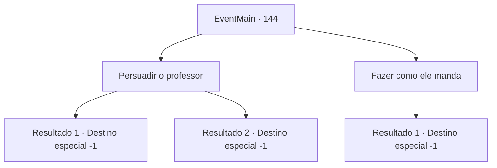

# Eventos principais · 144

[Índice da tabela](index.md) · [Índice geral](../index.md)

ID: `pt:EventMain:144` · Fonte: `EventMain4` · Versão: 1.2.47.

Mapeamento estático dos arquivos; a disponibilidade e a execução dependem do estado da run.

## Texto do evento

*Sem texto no arquivo.*

## Dados de entrada

```json
{
  "id": 144,
  "grade": 1,
  "normalGoal": "",
  "required": ""
}
```

## Mapa das escolhas



## Escolhas e resultados

### Escolha 1

Persuadir o professor

Requisitos e outros campos da escolha:

```json
{
  "required": "1_7_9"
}
```

#### Resultado 1.1

Você não consegue convencer o professor. Ele coloca Halad para dormir usando magia, e a leva para o calabouço da torre.

Continuação registrada: [Destino especial `-1`](../destinos-especiais.md).

```json
{
  "required": "",
  "chance": "10",
  "nextEvent": -1,
  "type": 1,
  "reward": "15_2_11"
}
```

#### Resultado 1.2

Você convenceu com sucesso o professor. Ele diz 'Faça o que quiser, se você insiste' com uma amargura inconfundível em sua voz. Você pede a Halad para ajudá-lo a restaurar a Torre da Magia à sua antiga glória. Seus olhos se arregalam. Ela não pode acreditar. Então ela olha para baixo e grita. 

 "Eu... eu ia fazer isso de qualquer maneira!"

 Ela soa um pouco agitada. Então ela murmura um 'obrigado' baixinho e sai do escritório.

Continuação registrada: [Destino especial `-1`](../destinos-especiais.md).

```json
{
  "required": "",
  "chance": "1|0_7_1",
  "nextEvent": -1,
  "type": 0,
  "reward": "15_2_10|15_2_12"
}
```

### Escolha 2

Fazer como ele manda

Requisitos e outros campos da escolha:

```json
{
  "required": ""
}
```

#### Resultado 2.1

Você decide seguir em frente com o plano do Flu. Ele coloca Halad para dormir usando magia, e a leva para o calabouço da torre.

Continuação registrada: [Destino especial `-1`](../destinos-especiais.md).

```json
{
  "required": "",
  "chance": "1",
  "nextEvent": -1,
  "type": 2,
  "reward": "15_2_11"
}
```

## Referências que chegam a este evento

- [Evento 143 · escolha 2 · resultado 4](0143.md#escolha-2)
