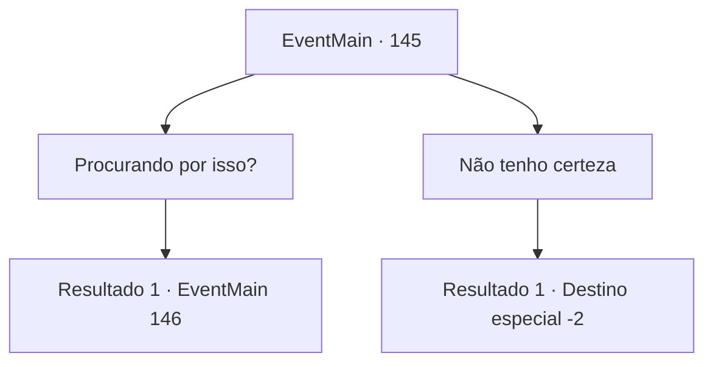

# Eventos principais · 145

[Índice da tabela](index.md) · [Índice geral](../index.md)

ID: `pt:EventMain:145` · Fonte: `EventMain4` · Versão: 1.2.47.

Mapeamento estático dos arquivos; a disponibilidade e a execução dependem do estado da run.

## Texto do evento

Você está descansando ao lado de uma tenda perto de um oásis no meio do deserto. Um velho de monóculo se aproxima, enxugando o suor. Ele se apresenta como 'Agis', o arqueólogo. Ele lhe diz que está a caminho dos restos de uma antiga civilização, que é protegida por uma esfinge. 

 "Estou procurando o túmulo de Saqqara. Você viu alguns detritos pelas proximidades?"


## Dados de entrada

```json
{
  "id": 145,
  "grade": 1,
  "normalGoal": "",
  "required": "5_82_0|8_132_1|13_1_5"
}
```

## Mapa das escolhas



## Escolhas e resultados

### Escolha 1

Procurando por isso?

Requisitos e outros campos da escolha:

```json
{
  "required": "8_132_1"
}
```

#### Resultado 1.1

Você pega a tábua de pedra que a Bruxa Índigo disse para você trazer de volta. O arqueólogo o examina e seus olhos se arregalam de excitação. 

 "Mas... mas como? Como você tem isso em você ..? Não, isso não importa. Você se importaria de me vender? Eu vou te pagar generosamente."

 

Continuação registrada: [Evento 146](0146.md) na mesma tabela.

```json
{
  "required": "",
  "chance": "1",
  "nextEvent": 146,
  "type": 2,
  "reward": ""
}
```

### Escolha 2

Não tenho certeza

Requisitos e outros campos da escolha:

```json
{
  "required": ""
}
```

#### Resultado 2.1

Você dá de ombros e diz a ele que não sabe muito sobre túmulos antigos. Ele assente e responde. 

 "Certo. É um site particularmente difícil de encontrar também. É bom falar com outra pessoa depois de tanto tempo. Obrigado por isso, estarei a caminho."

 Ele enche sua garrafa de água do oásis e vai embora.

Continuação registrada: [Destino especial `-2`](../destinos-especiais.md).

```json
{
  "required": "",
  "chance": "1",
  "nextEvent": -2,
  "type": 2,
  "reward": "5_82_2"
}
```

## Referências que chegam a este evento

Nenhum `nextEvent` positivo da mesma tabela aponta para este nó. Isso não prova que seja inacessível: sorteio e estado de história podem selecioná-lo.

