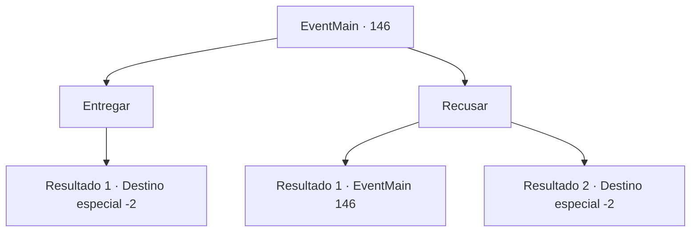

# Eventos principais · 146

[Índice da tabela](index.md) · [Índice geral](../index.md)

ID: `pt:EventMain:146` · Fonte: `EventMain4` · Versão: 1.2.47.

Mapeamento estático dos arquivos; a disponibilidade e a execução dependem do estado da run.

## Texto do evento

*Sem texto no arquivo.*

## Dados de entrada

```json
{
  "id": 146,
  "grade": 1,
  "normalGoal": "",
  "required": ""
}
```

## Mapa das escolhas



## Escolhas e resultados

### Escolha 1

Entregar

Requisitos e outros campos da escolha:

```json
{
  "required": ""
}
```

#### Resultado 1.1

Você entrega a tábua de pedra. O arqueólogo expressa gratidão genuína enquanto as lágrimas escorrem por seus olhos. 

 "Venha até minha casa, por favor. Como eu disse, devo pagar-lhe adequadamente. Não tenho palavras para agradecer... esta é a maior descoberta da minha vida. Obrigada!"

 Ele embrulha o tablet em tecido fino e o enfia na bolsa. Ele convida você para casa, dá a localização de sua casa e sai educadamente.

Continuação registrada: [Destino especial `-2`](../destinos-especiais.md).

```json
{
  "required": "",
  "chance": "1",
  "nextEvent": -2,
  "type": 2,
  "reward": "0_3_1|5_82_3|4_132_1"
}
```

### Escolha 2

Recusar

Requisitos e outros campos da escolha:

```json
{
  "required": ""
}
```

#### Resultado 2.1

Você recusa a oferta de Agis. Ele cai de joelhos na areia quente e implora enquanto segura suas calças. 

 "Por favor por favor! É a relíquia mais importante da minha vida. Eu vaguei pelo deserto por anos para encontrá-lo! Vou pagar bem, prometo em meu próprio nome!"


Continuação registrada: [Evento 146](0146.md) na mesma tabela.

```json
{
  "required": "18_82_1",
  "chance": "1",
  "nextEvent": 146,
  "type": 2,
  "reward": "5_82_1"
}
```

#### Resultado 2.2

Você diz não de novo. Sua cabeça cai em decepção. Você não tem certeza da importância do tablet para o velho, mas não tem intenção de entregá-lo. Você deixa o arqueólogo frustrado para trás e atravessa o deserto escaldante.

Continuação registrada: [Destino especial `-2`](../destinos-especiais.md).

```json
{
  "required": "5_82_1",
  "chance": "1",
  "nextEvent": -2,
  "type": 2,
  "reward": "5_82_2"
}
```

## Referências que chegam a este evento

- [Evento 145 · escolha 1 · resultado 1](0145.md#escolha-1)
- [Evento 146 · escolha 2 · resultado 1](0146.md#escolha-2)
