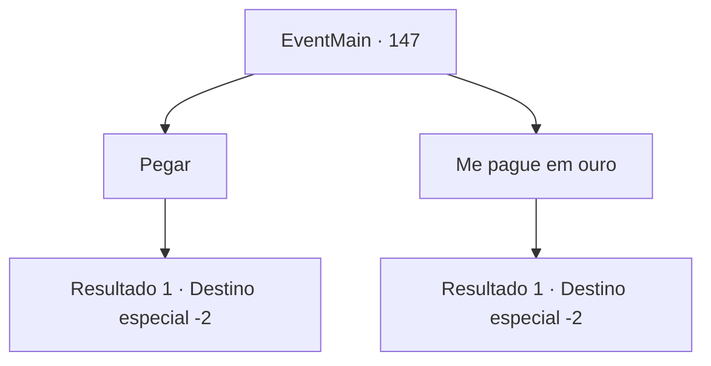

# Eventos principais · 147

[Índice da tabela](index.md) · [Índice geral](../index.md)

ID: `pt:EventMain:147` · Fonte: `EventMain4` · Versão: 1.2.47.

Mapeamento estático dos arquivos; a disponibilidade e a execução dependem do estado da run.

## Texto do evento

Você vai até a casa de Agis. Não é muito grande, mas bem decorada e clássica. Agis está regando seu jardim. Ele está feliz em ver você. 

 "Entre, entre. Eu estive esperando."

 Ele leva você para seu armazém. Relíquias como potes e espadas enferrujadas enchem o interior, e no meio encontra-se uma mística peça de armadura. Ele pega e entrega para você.

## Dados de entrada

```json
{
  "id": 147,
  "grade": 1,
  "normalGoal": "",
  "required": "5_82_3"
}
```

## Mapa das escolhas



## Escolhas e resultados

### Escolha 1

Pegar

Requisitos e outros campos da escolha:

```json
{
  "required": ""
}
```

#### Resultado 1.1

Você pega a armadura, que irradia com energia mística. Agis explica detalhadamente o que faz. Essencialmente, é feito de ossos de dragão e, portanto, mais duro do que qualquer metal. Você agradece a ele e continua sua jornada.

Continuação registrada: [Destino especial `-2`](../destinos-especiais.md).

```json
{
  "required": "",
  "chance": "1",
  "nextEvent": -2,
  "type": 2,
  "reward": "3_97_1|0_2_1|5_82_4"
}
```

### Escolha 2

Me pague em ouro

Requisitos e outros campos da escolha:

```json
{
  "required": ""
}
```

#### Resultado 2.1

Você recusa o presente dele e pede que ele pague em ouro. Agis parece um pouco desapontado enquanto acena com a cabeça. 

 "É um dos melhores que eu tenho... ah, se você insiste..."

 Ele tira um punhado de ouro do pote e o entrega a você. Você agradece a ele e continua sua jornada.

Continuação registrada: [Destino especial `-2`](../destinos-especiais.md).

```json
{
  "required": "",
  "chance": "1",
  "nextEvent": -2,
  "type": 2,
  "reward": "0_2_1|0_4_250|5_82_4"
}
```

## Referências que chegam a este evento

Nenhum `nextEvent` positivo da mesma tabela aponta para este nó. Isso não prova que seja inacessível: sorteio e estado de história podem selecioná-lo.

