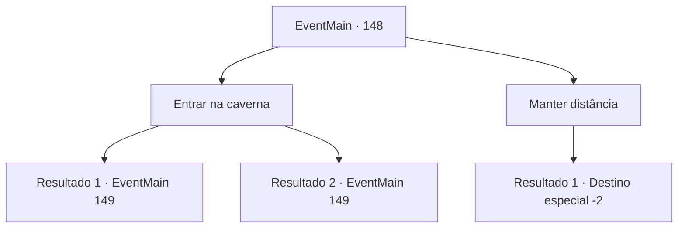

# Eventos principais · 148

[Índice da tabela](index.md) · [Índice geral](../index.md)

ID: `pt:EventMain:148` · Fonte: `EventMain4` · Versão: 1.2.47.

Mapeamento estático dos arquivos; a disponibilidade e a execução dependem do estado da run.

## Texto do evento

Você está escalando uma montanha rochosa quando ouve alguém cantando com uma voz soluçante. Ele parece um herbalista normal, exceto por estar cantando a melodia mais bizarra e chorando ao mesmo tempo. Ele olha para você como se tivesse encontrado seu salvador. 

 "Obrigado! Finalmente... finalmente estou salvo..."

 Ele lhe diz que estava procurando por ervas ao longo da montanha como de costume quando encontrou uma nova caverna e decidiu entrar. Ele encontrou 'algo'  lá dentro. Aquilo o fez cantar a canção medonha até que outra pessoa apareceu,  e ele estava cantando e tremendo de medo até te conhecer.

## Dados de entrada

```json
{
  "id": 148,
  "grade": 1,
  "normalGoal": "",
  "required": "13_1_10|1_2_35"
}
```

## Mapa das escolhas



## Escolhas e resultados

### Escolha 1

Entrar na caverna

Requisitos e outros campos da escolha:

```json
{
  "required": ""
}
```

#### Resultado 1.1

Você fica intrigado com o 'algo' no conto do herborista e entra na caverna. O interior está coberto de algas vermelhas e o chão está cheio de ossos de pequenos animais e monstros. Depois de uma longa caminhada, você sente o chão tremer e cheira a algo horrível. Você sente que algo enorme está rolando em sua direção.

Continuação registrada: [Evento 149](0149.md) na mesma tabela.

```json
{
  "required": "",
  "chance": "8",
  "nextEvent": 149,
  "type": 1,
  "reward": ""
}
```

#### Resultado 1.2

Você fica intrigado com o 'algo' no conto do herborista e entra na caverna. O interior está coberto de algas vermelhas e o chão está cheio de ossos de pequenos animais e monstros. Você encontra cogumelos trollar crescendo entre eles. Você os embolsa, encantado com a descoberta inesperada. Depois de uma longa caminhada, você sente o chão tremer e cheira a algo horrível. Você sente que algo enorme está rolando em sua direção.

Continuação registrada: [Evento 149](0149.md) na mesma tabela.

```json
{
  "required": "",
  "chance": "1|0_7_1",
  "nextEvent": 149,
  "type": 0,
  "reward": "0_1_1|3_134_1"
}
```

### Escolha 2

Manter distância

Requisitos e outros campos da escolha:

```json
{
  "required": ""
}
```

#### Resultado 2.1

Você acha a caverna sinistra depois da história do herborista. Você o acalma e segue na direção oposta.

Continuação registrada: [Destino especial `-2`](../destinos-especiais.md).

```json
{
  "required": "",
  "chance": "1",
  "nextEvent": -2,
  "type": 2,
  "reward": "13_1_17"
}
```

## Referências que chegam a este evento

Nenhum `nextEvent` positivo da mesma tabela aponta para este nó. Isso não prova que seja inacessível: sorteio e estado de história podem selecioná-lo.

