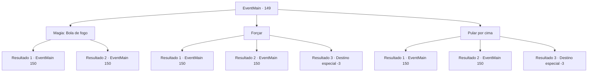

# Eventos principais · 149

[Índice da tabela](index.md) · [Índice geral](../index.md)

ID: `pt:EventMain:149` · Fonte: `EventMain4` · Versão: 1.2.47.

Mapeamento estático dos arquivos; a disponibilidade e a execução dependem do estado da run.

## Texto do evento

*Sem texto no arquivo.*

## Dados de entrada

```json
{
  "id": 149,
  "grade": 1,
  "normalGoal": "",
  "required": ""
}
```

## Mapa das escolhas



## Escolhas e resultados

### Escolha 1

Magia: Bola de fogo

Requisitos e outros campos da escolha:

```json
{
  "required": "20_0_2|1_1_2"
}
```

#### Resultado 1.1

Você se lembra do feitiço de bola de fogo que você pegou na Torre da Magia. Uma bola de fogo se materializa e atira na massa rolando em sua direção. Isso cria uma explosão maior do que você esperava. O cheiro de restos queimados lhe diz o que estava vindo em sua direção. São cadáveres digeridos, esterco. Você evita as fezes em chamas e continua para dentro. 

 Depois de algum tempo, você chega a uma abertura. O teto é forrado com inúmeras estalactites. Um grande lago sem fundo está diante de você. O próximo pedaço de terra fica a 50 metros de distância.

Continuação registrada: [Evento 150](0150.md) na mesma tabela.

```json
{
  "required": "",
  "chance": "10",
  "nextEvent": 150,
  "type": 2,
  "reward": "0_1_-1|0_1_1"
}
```

#### Resultado 1.2

Você se lembra do feitiço de bola de fogo que você pegou na Torre da Magia. Mas você entra em pânico e não consegue invocar uma bola de fogo. A bolha colide com você e se quebra em pedaços, após o que você percebe o que é. São cadáveres digeridos, esterco. Você continua dentro, sentindo-se muito sujo. 

 Depois de algum tempo, você chega a uma abertura. O teto é forrado com inúmeras estalactites. Um grande lago sem fundo está diante de você. O próximo pedaço de terra fica a 50 metros de distância.

Continuação registrada: [Evento 150](0150.md) na mesma tabela.

```json
{
  "required": "",
  "chance": "1|0_7_1",
  "nextEvent": 150,
  "type": 2,
  "reward": "0_1_-1"
}
```

### Escolha 2

Forçar

Requisitos e outros campos da escolha:

```json
{
  "required": ""
}
```

#### Resultado 2.1

Você balança sua arma na bolha fedorenta enquanto ela rola em sua direção, mas ela fica presa. Ele colide com você e se quebra em pedaços, após o que você percebe o que é. São cadáveres digeridos, esterco. Você continua dentro, sentindo-se muito sujo. 

 Depois de algum tempo, você chega a uma abertura. O teto é forrado com inúmeras estalactites. Um grande lago sem fundo está diante de você. O próximo pedaço de terra fica a 50 metros de distância.

Continuação registrada: [Evento 150](0150.md) na mesma tabela.

```json
{
  "required": "1_1_2",
  "chance": "8",
  "nextEvent": 150,
  "type": 1,
  "reward": "0_1_-1"
}
```

#### Resultado 2.2

Você quebra a bolha fedorenta em pedaços enquanto ela rola em sua direção. É muito mais frágil do que você esperava. Restos dispersos dizem o que é. São cadáveres digeridos, esterco. Você continua dentro, sentindo-se muito sujo. 

 Depois de algum tempo, você chega a uma abertura. O teto é forrado com inúmeras estalactites. Um grande lago sem fundo está diante de você. O próximo pedaço de terra fica a 50 metros de distância.

Continuação registrada: [Evento 150](0150.md) na mesma tabela.

```json
{
  "required": "",
  "chance": "1|0_5_1",
  "nextEvent": 150,
  "type": 0,
  "reward": ""
}
```

#### Resultado 2.3

Você balança sua arma na bolha fedorenta enquanto ela rola em sua direção, mas ela fica presa. A bolha te atropela e você sufoca.

Continuação registrada: [Destino especial `-3`](../destinos-especiais.md).

```json
{
  "required": "2_1_2",
  "chance": "8",
  "nextEvent": -3,
  "type": 1,
  "reward": "0_1_-1"
}
```

### Escolha 3

Pular por cima

Requisitos e outros campos da escolha:

```json
{
  "required": ""
}
```

#### Resultado 3.1

Você tenta se esquivar da bolha fedorenta enquanto ela rola em sua direção. Mas seu salto não é bem sucedido e você colide com ele diretamente. A bolha gigante quebra em pedaços, após o que você percebe o que é. São cadáveres digeridos, esterco. Você continua dentro, sentindo-se muito sujo. 

 Depois de algum tempo, você chega a uma abertura. O teto é forrado com inúmeras estalactites. Um grande lago sem fundo está diante de você. O próximo pedaço de terra fica a 50 metros de distância.

Continuação registrada: [Evento 150](0150.md) na mesma tabela.

```json
{
  "required": "",
  "chance": "10",
  "nextEvent": 150,
  "type": 1,
  "reward": "0_1_-1"
}
```

#### Resultado 3.2

Você se esquiva com sucesso da bolha fedorenta enquanto ela rola em sua direção. Ele continua rolando até cair para fora da caverna. Você segura o nariz e continua para dentro. 

 Depois de algum tempo, você chega a uma abertura. O teto é forrado com inúmeras estalactites. Um grande lago sem fundo está diante de você. O próximo pedaço de terra fica a 50 metros de distância.

Continuação registrada: [Evento 150](0150.md) na mesma tabela.

```json
{
  "required": "",
  "chance": "1|0_6_1",
  "nextEvent": 150,
  "type": 0,
  "reward": ""
}
```

#### Resultado 3.3

Você tenta desviar da bolha fedorenta enquanto ela rola em sua direção, mas fica presa nela. A bolha te atropela e você sufoca.

Continuação registrada: [Destino especial `-3`](../destinos-especiais.md).

```json
{
  "required": "2_1_2",
  "chance": "10",
  "nextEvent": -3,
  "type": 1,
  "reward": "0_1_-1"
}
```

## Referências que chegam a este evento

- [Evento 148 · escolha 1 · resultado 1](0148.md#escolha-1)
- [Evento 148 · escolha 1 · resultado 2](0148.md#escolha-1)
