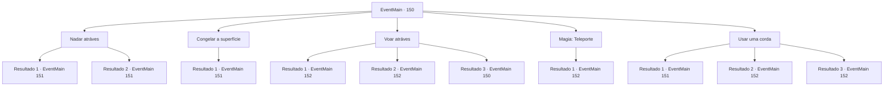

# Eventos principais · 150

[Índice da tabela](index.md) · [Índice geral](../index.md)

ID: `pt:EventMain:150` · Fonte: `EventMain4` · Versão: 1.2.47.

Mapeamento estático dos arquivos; a disponibilidade e a execução dependem do estado da run.

## Texto do evento

*Sem texto no arquivo.*

## Dados de entrada

```json
{
  "id": 150,
  "grade": 1,
  "normalGoal": "",
  "required": ""
}
```

## Mapa das escolhas



## Escolhas e resultados

### Escolha 1

Nadar atráves

Requisitos e outros campos da escolha:

```json
{
  "required": ""
}
```

#### Resultado 1.1

Você mergulha. A água é surpreendentemente fria. Você continua nadando enquanto o frio atravessa sua pele. De repente, algo morde sua manga e o arrasta para debaixo d'água. É um gato marinho raivoso, que obviamente não pertence a essas águas.

Continuação registrada: [Evento 151](0151.md) na mesma tabela.

```json
{
  "required": "",
  "chance": "11",
  "nextEvent": 151,
  "type": 1,
  "reward": "0_0_-1|6_0_44",
  "place": 3
}
```

#### Resultado 1.2

Você mergulha. A água está fria, mas você se sente revigorado por ela. De repente, algo morde sua manga e o arrasta para debaixo d'água. É um gato marinho raivoso, que obviamente não pertence a essas águas.

Continuação registrada: [Evento 151](0151.md) na mesma tabela.

```json
{
  "required": "",
  "chance": "1|0_13_1",
  "nextEvent": 151,
  "type": 0,
  "reward": "0_1_1|6_0_44",
  "place": 3
}
```

### Escolha 2

Congelar a superfície

Requisitos e outros campos da escolha:

```json
{
  "required": "20_0_1|1_1_2"
}
```

#### Resultado 2.1

Você foca sua mente e congela a superfície do lago. Cuidadosamente, você tenta andar sobre ele. No meio do caminho, você ouve um estrondo e o gelo começa a rachar. Você ouve outro estrondo antes de um gato marinho romper o gelo. Ele rosna, sangue escorrendo de sua testa.

Continuação registrada: [Evento 151](0151.md) na mesma tabela.

```json
{
  "required": "",
  "chance": "1",
  "nextEvent": 151,
  "type": 2,
  "reward": "0_1_-1|6_2_44",
  "place": 6
}
```

### Escolha 3

Voar atráves

Requisitos e outros campos da escolha:

```json
{
  "required": "5_113_0"
}
```

#### Resultado 3.1

Você usa a magia para voar para o outro lado. Você continua na caverna. |drawing_staffInCave| Você chega no final da caverna. Um raio de sol brilha do teto em uma varinha de aparência estranha, que emite uma energia sinistra, mas misteriosa. Você se aproxima e ele abre a boca para falar. 

 "Caramba. Eu deveria ter feito mais armadilhas. As pessoas vêm e vão como convidados da festa."

 Ele resmunga e pergunta por que você está aqui.

Continuação registrada: [Evento 152](0152.md) na mesma tabela.

```json
{
  "required": "-1|8_106_1|8_147_1",
  "chance": "1",
  "nextEvent": 152,
  "type": 2,
  "reward": ""
}
```

#### Resultado 3.2

Você para voar para o outro lado. Você continua na caverna. |drawing_staffInCave| Você chega no final da caverna. Um raio de sol brilha do teto em uma varinha de aparência estranha, que emite uma energia sinistra, mas misteriosa. Você se aproxima e ele abre a boca para falar. 

 "Caramba. Eu deveria ter feito mais armadilhas. As pessoas vêm e vão como convidados da festa."

 Ele resmunga e pergunta por que você está aqui.

Continuação registrada: [Evento 152](0152.md) na mesma tabela.

```json
{
  "required": "20_10_1",
  "chance": "1",
  "nextEvent": 152,
  "type": 2,
  "reward": ""
}
```

#### Resultado 3.3

Você acha que vai conseguir chegar ao outro lado voando, mas não tem nenhum item apropriado. Você decide procurar outras opções.

Continuação registrada: [Evento 150](0150.md) na mesma tabela.

```json
{
  "required": "10_106_1|10_147_1|21_10_1",
  "chance": "1",
  "nextEvent": 150,
  "type": 2,
  "reward": "5_113_1"
}
```

### Escolha 4

Magia: Teleporte

Requisitos e outros campos da escolha:

```json
{
  "required": "20_0_4|1_1_2"
}
```

#### Resultado 4.1

Você foca sua mente e se teletransporta para o outro lado. Você continua na caverna. |drawing_staffInCave| Você chega no final da caverna. Um raio de sol brilha do teto em uma varinha de aparência estranha, que emite uma energia sinistra, mas misteriosa. Você se aproxima e ele abre a boca para falar. 

 "Caramba. Eu deveria ter feito mais armadilhas. As pessoas vêm e vão como convidados da festa."

 Ele resmunga e pergunta por que você está aqui.

Continuação registrada: [Evento 152](0152.md) na mesma tabela.

```json
{
  "required": "",
  "chance": "1",
  "nextEvent": 152,
  "type": 2,
  "reward": "0_1_-1"
}
```

### Escolha 5

Usar uma corda

Requisitos e outros campos da escolha:

```json
{
  "required": "8_39_3"
}
```

#### Resultado 5.1

Você amarra 3 cordas e as joga do outro lado do lago em uma estalagmite. Mas a corda não consegue alcançar o outro lado e mergulha na água. Você tenta puxá-lo para fora, quando de repente algo o puxa com grande força. Você é arrastado para a água e um gato marinho nada em sua direção com as mandíbulas bem abertas.

Continuação registrada: [Evento 151](0151.md) na mesma tabela.

```json
{
  "required": "21_0_1",
  "chance": "13",
  "nextEvent": 151,
  "type": 1,
  "reward": "4_39_3|6_0_44",
  "place": 3
}
```

#### Resultado 5.2

Você amarra 3 cordas e as joga do outro lado do lago em uma estalagmite. Ele gira com sucesso ao redor da rocha e você pode chegar com segurança do outro lado. Você continua na caverna. |drawing_staffInCave| Você logo chega ao final da caverna. Um raio de sol brilha do teto em uma varinha de aparência estranha, que emite uma energia sinistra, mas misteriosa. Você se aproxima e ele abre a boca para falar. 

 "Caramba. Eu deveria ter feito mais armadilhas. As pessoas vêm e vão como convidados da festa."

 Ele resmunga e pergunta por que você está aqui.

Continuação registrada: [Evento 152](0152.md) na mesma tabela.

```json
{
  "required": "21_0_1",
  "chance": "1|0_5_1",
  "nextEvent": 152,
  "type": 0,
  "reward": "4_39_3"
}
```

#### Resultado 5.3

Você amarra 3 cordas juntas, use um feitiço para animá-lo e enrole-o em torno de uma estalagmite do outro lado. |drawing_staffInCave| Você logo chega ao final da caverna. Um raio de sol brilha do teto em uma varinha de aparência estranha, que emite uma energia sinistra, mas misteriosa. Você se aproxima e ele abre a boca para falar. 

 "Caramba. Eu deveria ter feito mais armadilhas. As pessoas vêm e vão como convidados da festa."

 Ele resmunga e pergunta por que você está aqui.

Continuação registrada: [Evento 152](0152.md) na mesma tabela.

```json
{
  "required": "20_0_1",
  "chance": "1",
  "nextEvent": 152,
  "type": 2,
  "reward": "4_39_3"
}
```

## Referências que chegam a este evento

- [Evento 149 · escolha 1 · resultado 1](0149.md#escolha-1)
- [Evento 149 · escolha 1 · resultado 2](0149.md#escolha-1)
- [Evento 149 · escolha 2 · resultado 1](0149.md#escolha-2)
- [Evento 149 · escolha 2 · resultado 2](0149.md#escolha-2)
- [Evento 149 · escolha 3 · resultado 1](0149.md#escolha-3)
- [Evento 149 · escolha 3 · resultado 2](0149.md#escolha-3)
- [Evento 150 · escolha 3 · resultado 3](0150.md#escolha-3)
