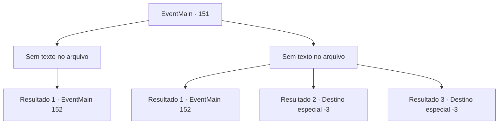

# Eventos principais · 151

[Índice da tabela](index.md) · [Índice geral](../index.md)

ID: `pt:EventMain:151` · Fonte: `EventMain4` · Versão: 1.2.47.

Mapeamento estático dos arquivos; a disponibilidade e a execução dependem do estado da run.

## Texto do evento

*Sem texto no arquivo.*

## Dados de entrada

```json
{
  "id": 151,
  "grade": 1,
  "normalGoal": "",
  "required": ""
}
```

## Mapa das escolhas



## Escolhas e resultados

### Escolha 1

*Sem texto no arquivo; o papel dessa opção depende da interface do jogo.*

Requisitos e outros campos da escolha:

```json
{
  "required": ""
}
```

#### Resultado 1.1

Você bate no gato do mar e ele nada fundo na água. Você nada para o outro lado, encharcado e pingando. Você continua na caverna. |drawing_staffInCave| Você logo chega ao final da caverna. Um raio de sol brilha do teto em uma varinha de aparência estranha, que emite uma energia sinistra, mas misteriosa. Você se aproxima e ele abre a boca para falar. 

 "Caramba. Eu deveria ter feito mais armadilhas. As pessoas vêm e vão como convidados da festa."

 Ele resmunga e pergunta por que você está aqui.

Continuação registrada: [Evento 152](0152.md) na mesma tabela.

```json
{
  "required": "",
  "chance": "1",
  "nextEvent": 152,
  "type": 2,
  "reward": "3_127_1"
}
```

### Escolha 2

*Sem texto no arquivo; o papel dessa opção depende da interface do jogo.*

Requisitos e outros campos da escolha:

```json
{
  "required": ""
}
```

#### Resultado 2.1

Você perde um pouco de carne para o gato marinho antes de chegar ao outro lado. Você continua na caverna, pingando água e sangue. |drawing_staffInCave| Você chega no final da caverna. Um raio de sol brilha do teto em uma varinha de aparência estranha, que emite uma energia sinistra, mas misteriosa. Você se aproxima e ele abre a boca para falar. 

 "Caramba. Eu deveria ter feito mais armadilhas. As pessoas vêm e vão como convidados da festa."

 Ele resmunga e pergunta por que você está aqui.

Continuação registrada: [Evento 152](0152.md) na mesma tabela.

```json
{
  "required": "1_0_2|1_1_2",
  "chance": "1",
  "nextEvent": 152,
  "type": 2,
  "reward": "0_0_-1|0_1_-1|0_2_1"
}
```

#### Resultado 2.2

O gato do mar arrasta você para as profundezas do lago.

Continuação registrada: [Destino especial `-3`](../destinos-especiais.md).

```json
{
  "required": "2_0_2",
  "chance": "1",
  "nextEvent": -3,
  "type": 2,
  "reward": "0_0_-1|0_1_-1"
}
```

#### Resultado 2.3

O gato do mar arrasta você para as profundezas do lago.

Continuação registrada: [Destino especial `-3`](../destinos-especiais.md).

```json
{
  "required": "2_1_2",
  "chance": "1",
  "nextEvent": -3,
  "type": 2,
  "reward": "0_0_-1|0_1_-1"
}
```

## Referências que chegam a este evento

- [Evento 150 · escolha 1 · resultado 1](0150.md#escolha-1)
- [Evento 150 · escolha 1 · resultado 2](0150.md#escolha-1)
- [Evento 150 · escolha 2 · resultado 1](0150.md#escolha-2)
- [Evento 150 · escolha 5 · resultado 1](0150.md#escolha-5)
