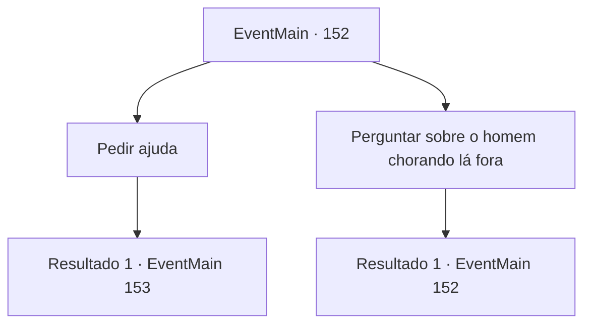

# Eventos principais · 152

[Índice da tabela](index.md) · [Índice geral](../index.md)

ID: `pt:EventMain:152` · Fonte: `EventMain4` · Versão: 1.2.47.

Mapeamento estático dos arquivos; a disponibilidade e a execução dependem do estado da run.

## Texto do evento

*Sem texto no arquivo.*

## Dados de entrada

```json
{
  "id": 152,
  "grade": 1,
  "normalGoal": "",
  "required": ""
}
```

## Mapa das escolhas



## Escolhas e resultados

### Escolha 1

Pedir ajuda

Requisitos e outros campos da escolha:

```json
{
  "required": ""
}
```

#### Resultado 1.1

Você conta a varinha sua história, que você está procurando um verdadeiro mestre para torná-lo mais forte que Halad. A varinha limpa a garganta e responde com uma voz severa. 

 "Multar. Mas você precisará passar por um teste primeiro."


Continuação registrada: [Evento 153](0153.md) na mesma tabela.

```json
{
  "required": "",
  "chance": "1",
  "nextEvent": 153,
  "type": 2,
  "reward": ""
}
```

### Escolha 2

Perguntar sobre o homem chorando lá fora

Requisitos e outros campos da escolha:

```json
{
  "required": "5_80_0"
}
```

#### Resultado 2.1

Você pergunta à varinha sobre o herborista chorando lá fora. Ele ri enquanto explica. 

 "Hehe... Isso é o que você ganha por entrar na casa de outra pessoa. Ele também colheu cogumelos que eu estava guardando para mais tarde. Então eu o amaldiçoei. Ele teria perdido todo o cabelo se não parasse de cantar até conhecer alguém."

 Então a varinha aponta que você não parece estar aqui para fazer uma pergunta estúpida.

Continuação registrada: [Evento 152](0152.md) na mesma tabela.

```json
{
  "required": "",
  "chance": "1",
  "nextEvent": 152,
  "type": 2,
  "reward": "5_80_1"
}
```

## Referências que chegam a este evento

- [Evento 150 · escolha 3 · resultado 1](0150.md#escolha-3)
- [Evento 150 · escolha 3 · resultado 2](0150.md#escolha-3)
- [Evento 150 · escolha 4 · resultado 1](0150.md#escolha-4)
- [Evento 150 · escolha 5 · resultado 2](0150.md#escolha-5)
- [Evento 150 · escolha 5 · resultado 3](0150.md#escolha-5)
- [Evento 151 · escolha 1 · resultado 1](0151.md#escolha-1)
- [Evento 151 · escolha 2 · resultado 1](0151.md#escolha-2)
- [Evento 152 · escolha 2 · resultado 1](0152.md#escolha-2)
