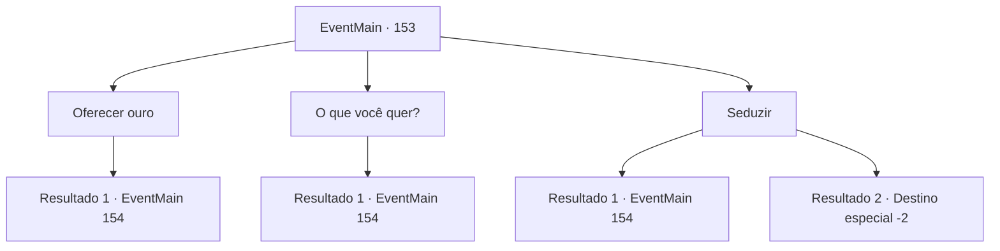

# Eventos principais · 153

[Índice da tabela](index.md) · [Índice geral](../index.md)

ID: `pt:EventMain:153` · Fonte: `EventMain4` · Versão: 1.2.47.

Mapeamento estático dos arquivos; a disponibilidade e a execução dependem do estado da run.

## Texto do evento

*Sem texto no arquivo.*

## Dados de entrada

```json
{
  "id": 153,
  "grade": 1,
  "normalGoal": "",
  "required": ""
}
```

## Mapa das escolhas



## Escolhas e resultados

### Escolha 1

Oferecer ouro

Requisitos e outros campos da escolha:

```json
{
  "required": "1_4_100"
}
```

#### Resultado 1.1

A varinha vê seu ouro e grita com raiva. 

 "Você está tentando me subornar com um pouco de dinheiro?"

 Em seguida, ele diz que só vai te ensinar se você responder a um teste simples. 

 "Certo, selecione um elemento NÃO necessário para lançar um feitiço. 1. Movimento. 2. Voz. 3. Matéria. 4. Foco."


Continuação registrada: [Evento 154](0154.md) na mesma tabela.

```json
{
  "required": "",
  "chance": "1",
  "nextEvent": 154,
  "type": 2,
  "reward": ""
}
```

### Escolha 2

O que você quer?

Requisitos e outros campos da escolha:

```json
{
  "required": ""
}
```

#### Resultado 2.1

Ele diz que só vai te ensinar se você responder a um teste simples. 

 "Certo, selecione um elemento NÃO necessário para lançar um feitiço. 1. Movimento. 2. Voz. 3. Matéria. 4. Foco."


Continuação registrada: [Evento 154](0154.md) na mesma tabela.

```json
{
  "required": "",
  "chance": "1",
  "nextEvent": 154,
  "type": 2,
  "reward": ""
}
```

### Escolha 3

Seduzir

Requisitos e outros campos da escolha:

```json
{
  "required": "11_0_1"
}
```

#### Resultado 3.1

A varinha geme de dor. 

 "Eu... eu ainda não terminei, então pare com isso e ouça."

 Em seguida, ele diz que só vai te ensinar se você responder a um teste simples. 

 "Certo, selecione um elemento NÃO necessário para lançar um feitiço. 1. Movimento. 2. Voz. 3. Matéria. 4. Foco."


Continuação registrada: [Evento 154](0154.md) na mesma tabela.

```json
{
  "required": "",
  "chance": "15",
  "nextEvent": 154,
  "type": 2,
  "reward": ""
}
```

#### Resultado 3.2

A varinha ri alto, mostrando os dentes. Ele tenta se conter, mas simplesmente não consegue evitar. Depois de um tempo, ele limpa a garganta e continua. 

 "A-hem! Tudo bem. Eu ajudo. Me leve com você."

 Você embala a varinha de aparência estranha em sua mochila e continue sua jornada.

Continuação registrada: [Destino especial `-2`](../destinos-especiais.md).

```json
{
  "required": "",
  "chance": "1|0_12_1",
  "nextEvent": -2,
  "type": 2,
  "reward": "13_1_16|3_111_1"
}
```

## Referências que chegam a este evento

- [Evento 152 · escolha 1 · resultado 1](0152.md#escolha-1)
