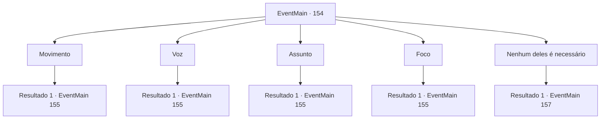

# Eventos principais · 154

[Índice da tabela](index.md) · [Índice geral](../index.md)

ID: `pt:EventMain:154` · Fonte: `EventMain4` · Versão: 1.2.47.

Mapeamento estático dos arquivos; a disponibilidade e a execução dependem do estado da run.

## Texto do evento

*Sem texto no arquivo.*

## Dados de entrada

```json
{
  "id": 154,
  "grade": 1,
  "normalGoal": "",
  "required": ""
}
```

## Mapa das escolhas



## Escolhas e resultados

### Escolha 1

Movimento

Requisitos e outros campos da escolha:

```json
{
  "required": ""
}
```

#### Resultado 1.1

A varinha está visivelmente desapontada. 

 "Você é ignorante além de ensinar... errado! Agora saia, eu preciso dormir."

 A varinha abaixa a cabeça e fica em silêncio. Ele perdeu a vontade de ajudá-lo de qualquer maneira.

Continuação registrada: [Evento 155](0155.md) na mesma tabela.

```json
{
  "required": "",
  "chance": "1",
  "nextEvent": 155,
  "type": 2,
  "reward": ""
}
```

### Escolha 2

Voz

Requisitos e outros campos da escolha:

```json
{
  "required": ""
}
```

#### Resultado 2.1

A varinha está visivelmente desapontada. 

 "Você é ignorante além de ensinar... errado! Agora saia, eu preciso dormir."

 A varinha abaixa a cabeça e fica em silêncio. Ele perdeu a vontade de ajudá-lo de qualquer maneira.

Continuação registrada: [Evento 155](0155.md) na mesma tabela.

```json
{
  "required": "",
  "chance": "1",
  "nextEvent": 155,
  "type": 2,
  "reward": ""
}
```

### Escolha 3

Assunto

Requisitos e outros campos da escolha:

```json
{
  "required": ""
}
```

#### Resultado 3.1

A varinha está visivelmente desapontada. 

 "Você é ignorante além de ensinar... errado! Agora saia, eu preciso dormir."

 A varinha abaixa a cabeça e fica em silêncio. Ele perdeu a vontade de ajudá-lo de qualquer maneira.

Continuação registrada: [Evento 155](0155.md) na mesma tabela.

```json
{
  "required": "",
  "chance": "1",
  "nextEvent": 155,
  "type": 2,
  "reward": ""
}
```

### Escolha 4

Foco

Requisitos e outros campos da escolha:

```json
{
  "required": ""
}
```

#### Resultado 4.1

A varinha está visivelmente desapontada. 

 "Você é ignorante além de ensinar... errado! Agora saia, eu preciso dormir."

 A varinha abaixa a cabeça e fica em silêncio. Ele perdeu a vontade de ajudá-lo de qualquer maneira.

Continuação registrada: [Evento 155](0155.md) na mesma tabela.

```json
{
  "required": "",
  "chance": "1",
  "nextEvent": 155,
  "type": 2,
  "reward": ""
}
```

### Escolha 5

Nenhum deles é necessário

Requisitos e outros campos da escolha:

```json
{
  "required": ""
}
```

#### Resultado 5.1

Você está ciente de que não há resposta. A varinha assente e passa para a próxima pergunta. 

 "Multar. Agora preciso ver como você lida com meu míssil mágico."

 Antes que você possa responder, ele dispara um míssil direto em seu rosto.

Continuação registrada: [Evento 157](0157.md) na mesma tabela.

```json
{
  "required": "",
  "chance": "1",
  "nextEvent": 157,
  "type": 2,
  "reward": ""
}
```

## Referências que chegam a este evento

- [Evento 153 · escolha 1 · resultado 1](0153.md#escolha-1)
- [Evento 153 · escolha 2 · resultado 1](0153.md#escolha-2)
- [Evento 153 · escolha 3 · resultado 1](0153.md#escolha-3)
