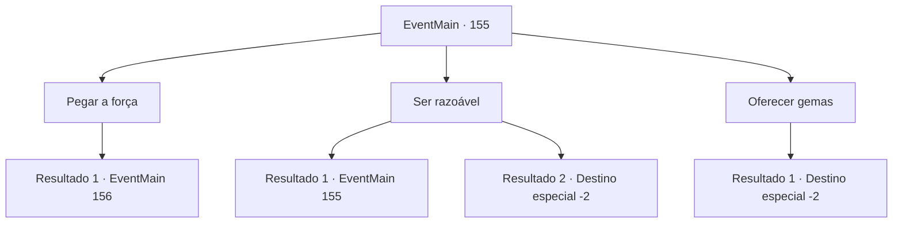

# Eventos principais · 155

[Índice da tabela](index.md) · [Índice geral](../index.md)

ID: `pt:EventMain:155` · Fonte: `EventMain4` · Versão: 1.2.47.

Mapeamento estático dos arquivos; a disponibilidade e a execução dependem do estado da run.

## Texto do evento

*Sem texto no arquivo.*

## Dados de entrada

```json
{
  "id": 155,
  "grade": 1,
  "normalGoal": "",
  "required": ""
}
```

## Mapa das escolhas



## Escolhas e resultados

### Escolha 1

Pegar a força

Requisitos e outros campos da escolha:

```json
{
  "required": ""
}
```

#### Resultado 1.1

Você decide que essa varinha arrogante e grotesca vem com você. Você saca sua arma, e a varinha murmura que você vai se arrepender.

Continuação registrada: [Evento 156](0156.md) na mesma tabela.

```json
{
  "required": "",
  "chance": "1",
  "nextEvent": 156,
  "type": 2,
  "reward": "6_0_82",
  "place": 6
}
```

### Escolha 2

Ser razoável

Requisitos e outros campos da escolha:

```json
{
  "required": "1_7_10|18_80_2"
}
```

#### Resultado 2.1

Você pede ajuda à varinha. Ele ouve enquanto boceja. 

 "Você pode... ir agora? Eu preciso dormir."


Continuação registrada: [Evento 155](0155.md) na mesma tabela.

```json
{
  "required": "",
  "chance": "15",
  "nextEvent": 155,
  "type": 1,
  "reward": "5_80_2"
}
```

#### Resultado 2.2

Você sugere que a varinha vá explorar o mundo com você ao invés de ficar preso nesta caverna Ele pensa um pouco antes de assentir. 

 "Não soa tão ruim. Acho que meu tédio realmente aparece."

 A varinha oferece assistência em troca de tomá-la. Você continua sua jornada com a varinha estranha.

Continuação registrada: [Destino especial `-2`](../destinos-especiais.md).

```json
{
  "required": "",
  "chance": "1|0_7_1",
  "nextEvent": -2,
  "type": 0,
  "reward": "13_1_16|3_111_1"
}
```

### Escolha 3

Oferecer gemas

Requisitos e outros campos da escolha:

```json
{
  "required": "17_0_5"
}
```

#### Resultado 3.1

A varinha olha para a gema e abafa um grito. 

 "A-hem... muito bem. Varinha ao seu serviço, bom senhor."

 Em seguida, ele salta para dentro de sua mochila. Você continua sua jornada com a varinha estranha.

Continuação registrada: [Destino especial `-2`](../destinos-especiais.md).

```json
{
  "required": "",
  "chance": "1",
  "nextEvent": -2,
  "type": 2,
  "reward": "3_111_1|13_1_16|5_80_3"
}
```

## Referências que chegam a este evento

- [Evento 154 · escolha 1 · resultado 1](0154.md#escolha-1)
- [Evento 154 · escolha 2 · resultado 1](0154.md#escolha-2)
- [Evento 154 · escolha 3 · resultado 1](0154.md#escolha-3)
- [Evento 154 · escolha 4 · resultado 1](0154.md#escolha-4)
- [Evento 155 · escolha 2 · resultado 1](0155.md#escolha-2)
