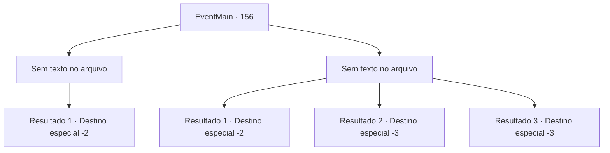

# Eventos principais · 156

[Índice da tabela](index.md) · [Índice geral](../index.md)

ID: `pt:EventMain:156` · Fonte: `EventMain4` · Versão: 1.2.47.

Mapeamento estático dos arquivos; a disponibilidade e a execução dependem do estado da run.

## Texto do evento

*Sem texto no arquivo.*

## Dados de entrada

```json
{
  "id": 156,
  "grade": 1,
  "normalGoal": "",
  "required": ""
}
```

## Mapa das escolhas



## Escolhas e resultados

### Escolha 1

*Sem texto no arquivo; o papel dessa opção depende da interface do jogo.*

Requisitos e outros campos da escolha:

```json
{
  "required": ""
}
```

#### Resultado 1.1

Você dá uma boa surra na varinha arrogante. Ele cai no chão e treme enquanto fala. 

 "P-pare... Por favor... tudo bem, eu te ajudo, droga!"

 Enquanto a varinha reclama e amaldiçoa, você casualmente o pega e o coloca em sua mochila. Então você continua sua jornada.

Continuação registrada: [Destino especial `-2`](../destinos-especiais.md).

```json
{
  "required": "",
  "chance": "1",
  "nextEvent": -2,
  "type": 2,
  "reward": "13_1_16|3_111_1|5_80_4"
}
```

### Escolha 2

*Sem texto no arquivo; o papel dessa opção depende da interface do jogo.*

Requisitos e outros campos da escolha:

```json
{
  "required": ""
}
```

#### Resultado 2.1

A magia da varinha domina você. Ele ri em uma gargalhada enlouquecedora enquanto vomita todos os tipos de magia em você. Você não tem escolha a não ser correr de volta por onde veio.

Continuação registrada: [Destino especial `-2`](../destinos-especiais.md).

```json
{
  "required": "1_0_2|1_1_2",
  "chance": "1",
  "nextEvent": -2,
  "type": 2,
  "reward": "13_1_17|0_0_-1|0_1_-1|0_2_1"
}
```

#### Resultado 2.2

A varinha grotesca tira sua vida.

Continuação registrada: [Destino especial `-3`](../destinos-especiais.md).

```json
{
  "required": "2_0_2",
  "chance": "1",
  "nextEvent": -3,
  "type": 2,
  "reward": "0_0_-1|0_1_-1"
}
```

#### Resultado 2.3

A varinha grotesca tira sua vida.

Continuação registrada: [Destino especial `-3`](../destinos-especiais.md).

```json
{
  "required": "2_1_2",
  "chance": "1",
  "nextEvent": -3,
  "type": 2,
  "reward": "0_0_-1|0_1_-1"
}
```

## Referências que chegam a este evento

- [Evento 155 · escolha 1 · resultado 1](0155.md#escolha-1)
