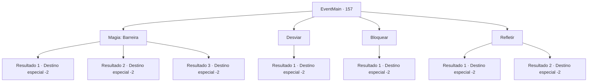

# Eventos principais · 157

[Índice da tabela](index.md) · [Índice geral](../index.md)

ID: `pt:EventMain:157` · Fonte: `EventMain4` · Versão: 1.2.47.

Mapeamento estático dos arquivos; a disponibilidade e a execução dependem do estado da run.

## Texto do evento

*Sem texto no arquivo.*

## Dados de entrada

```json
{
  "id": 157,
  "grade": 1,
  "normalGoal": "",
  "required": ""
}
```

## Mapa das escolhas



## Escolhas e resultados

### Escolha 1

Magia: Barreira

Requisitos e outros campos da escolha:

```json
{
  "required": "20_0_2|1_1_2"
}
```

#### Resultado 1.1

Você tenta bloquear o míssil com magia de barreira. Mas o míssil dispara em direção ao seu pescoço antes que você possa criar um, parando a poucos centímetros da pele. 

 "Você estaria morto se eu quisesse que você estivesse. Mas já que você parece saber o básico... eu poderia te fazer melhor."

 A varinha diz que vê algum potencial em você enquanto pula em sua mochila. Você continua sua jornada com a varinha estranha.

Continuação registrada: [Destino especial `-2`](../destinos-especiais.md).

```json
{
  "required": "",
  "chance": "20",
  "nextEvent": -2,
  "type": 1,
  "reward": "13_1_16|3_111_1|0_1_-1"
}
```

#### Resultado 1.2

Você cria uma barreira, bloqueando sem esforço o míssil mágico. Ele desaparece no ar. A varinha acena com a cabeça (*a parte ao redor da boca) e sorri com satisfação. 

 "Excelente. Eu vou te ajudar."

 Você continua sua jornada com a varinha estranha.

Continuação registrada: [Destino especial `-2`](../destinos-especiais.md).

```json
{
  "required": "",
  "chance": "1|0_7_1",
  "nextEvent": -2,
  "type": 0,
  "reward": "13_1_16|3_111_1|0_2_1|0_1_-1"
}
```

#### Resultado 1.3

Você cria uma barreira, bloqueando sem esforço o míssil mágico. Ele desaparece no ar. A varinha acena com a cabeça (*a parte ao redor da boca) e sorri com satisfação. 

 "Excelente. Eu vou te ajudar."

 Você continua sua jornada com a varinha estranha.

Continuação registrada: [Destino especial `-2`](../destinos-especiais.md).

```json
{
  "required": "",
  "chance": "1|0_12_1",
  "nextEvent": -2,
  "type": 0,
  "reward": "13_1_16|3_111_1|0_2_1|0_1_-1"
}
```

### Escolha 2

Desviar

Requisitos e outros campos da escolha:

```json
{
  "required": ""
}
```

#### Resultado 2.1

Você tenta evitar o míssil mágico. Mas ele rastreia você persistentemente até parar a poucos centímetros do seu olho. A varinha está visivelmente desapontada. 

 "É um míssil 'mágico', pelo amor de Deus. Você deveria ter bloqueado. Eu pensei que você fosse um Mago, mas acho que você é apenas um estudante patético."

 Ele se recusa a ajudá-lo e desaparece. Você não tem escolha a não ser voltar e sair da caverna.

Continuação registrada: [Destino especial `-2`](../destinos-especiais.md).

```json
{
  "required": "",
  "chance": "1",
  "nextEvent": -2,
  "type": 2,
  "reward": "13_1_17"
}
```

### Escolha 3

Bloquear 

Requisitos e outros campos da escolha:

```json
{
  "required": "20_9_1"
}
```

#### Resultado 3.1

Você bloqueia o míssil mágico. Ele desaparece no ar. A varinha acena com a cabeça (*a parte ao redor da boca) e sorri com satisfação. 

 "Excelente. Eu vou te ajudar."

 Você continua sua jornada com a varinha estranha.

Continuação registrada: [Destino especial `-2`](../destinos-especiais.md).

```json
{
  "required": "",
  "chance": "1",
  "nextEvent": -2,
  "type": 2,
  "reward": "13_1_16|3_111_1|0_2_1"
}
```

### Escolha 4

Refletir

Requisitos e outros campos da escolha:

```json
{
  "required": ""
}
```

#### Resultado 4.1

Você balança sua arma no míssil que está chegando. Você erra e o míssil atinge seu pulso. Fica dormente de dor. A varinha está visivelmente desapontada. 

 "É um míssil 'mágico', pelo amor de Deus. Você deveria ter bloqueado. Eu pensei que você fosse um Mago, mas acho que você é apenas um estudante patético."

 Ele se recusa a ajudá-lo e desaparece. Você não tem escolha a não ser voltar e sair da caverna.

Continuação registrada: [Destino especial `-2`](../destinos-especiais.md).

```json
{
  "required": "",
  "chance": "11",
  "nextEvent": -2,
  "type": 1,
  "reward": "13_1_17"
}
```

#### Resultado 4.2

Você balança sua arma no míssil que está chegando. Ele desaparece no ar. A varinha acena com a cabeça (*a parte ao redor da boca) e sorri com satisfação. 

 "Essa foi uma maneira estranha de fazer isso, mas uma promessa é uma promessa. Eu vou te ajudar."

 Você continua sua jornada com a varinha estranha.

Continuação registrada: [Destino especial `-2`](../destinos-especiais.md).

```json
{
  "required": "",
  "chance": "1|0_5_1",
  "nextEvent": -2,
  "type": 0,
  "reward": "13_1_16|3_111_1|0_2_1"
}
```

## Referências que chegam a este evento

- [Evento 154 · escolha 5 · resultado 1](0154.md#escolha-5)
