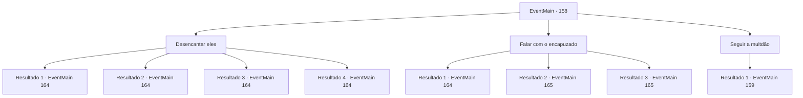

# Eventos principais · 158

[Índice da tabela](index.md) · [Índice geral](../index.md)

ID: `pt:EventMain:158` · Fonte: `EventMain4` · Versão: 1.2.47.

Mapeamento estático dos arquivos; a disponibilidade e a execução dependem do estado da run.

## Texto do evento

|drawing_harbor|  Você para em Wagonmountain, uma cidade próxima ao curso mais baixo de Falleast River.  Costumava ser um dos maiores portos marítimos, sempre lotado de embarcações de todas as formas e tamanhos.  Agora é uma cidade fantasma.  Você acha isso estranho e procura por sinais de pessoas.  

  As trilhas levam a uma montanha atrás da cidade,  onde você encontra um grupo de pessoas indo embora.  Eles estão sendo liderados por uma figura encapuzada em um manto.  Eles andam como ghouls.

## Dados de entrada

```json
{
  "id": 158,
  "grade": 1,
  "normalGoal": "",
  "required": "13_1_16|1_2_50"
}
```

## Mapa das escolhas



## Escolhas e resultados

### Escolha 1

Desencantar eles

Requisitos e outros campos da escolha:

```json
{
  "required": ""
}
```

#### Resultado 1.1

Você tenta desencantar a multidão. Mas o feitiço resiste ferozmente. A figura encapuzada corre em sua direção. Ele aponta sua varinha torta para você e grita. 

 "Você não deve intervir... Curve-se diante do Mestre Halad!"


Continuação registrada: [Evento 164](0164.md) na mesma tabela.

```json
{
  "required": "10_111_1",
  "chance": "12",
  "nextEvent": 164,
  "type": 1,
  "reward": "6_0_71",
  "place": 1
}
```

#### Resultado 1.2

Você desencanta com sucesso a multidão. As pessoas voltam a si e olham ao redor, confusas. A figura encapuzada parece assustada. Então ele vê você e saca sua varinha torta. 

 "Malditos hereges... Curvem-se diante do Mestre Halad!"


Continuação registrada: [Evento 164](0164.md) na mesma tabela.

```json
{
  "required": "10_111_1",
  "chance": "1|0_7_1",
  "nextEvent": 164,
  "type": 0,
  "reward": "6_2_71",
  "place": 1
}
```

#### Resultado 1.3

Você pede à varinha para desencantar a multidão. 

 "Nisso, senhor."

 A varinha se curva educadamente e entoa um feitiço estranho. As pessoas voltam a si e olham ao redor, confusas. A figura encapuzada parece assustada. Então ele vê você e saca sua varinha torta. 

 "Malditos hereges... Curvem-se diante do Mestre Halad!"


Continuação registrada: [Evento 164](0164.md) na mesma tabela.

```json
{
  "required": "8_111_1|5_80_3",
  "chance": "1",
  "nextEvent": 164,
  "type": 2,
  "reward": "6_2_71",
  "place": 1
}
```

#### Resultado 1.4

Você pede à varinha para desencantar a multidão. 

 "Mole-mole."

 A varinha começa a entoar um feitiço estranho. As pessoas voltam a si e olham ao redor, confusas. A figura encapuzada parece assustada. Então ele vê você e saca sua varinha torta. 

 "Droga, herege... Curve-se diante do Mestre Halad!"


Continuação registrada: [Evento 164](0164.md) na mesma tabela.

```json
{
  "required": "8_111_1|18_80_3",
  "chance": "1",
  "nextEvent": 164,
  "type": 2,
  "reward": "6_2_71",
  "place": 1
}
```

### Escolha 2

Falar com o encapuzado

Requisitos e outros campos da escolha:

```json
{
  "required": ""
}
```

#### Resultado 2.1

Você se aproxima da figura encapuzada e tenta falar com ele. Ele se vira e saca sua varinha torta. 

 "Você não deve intervir... Curve-se diante do Mestre Halad!"


Continuação registrada: [Evento 164](0164.md) na mesma tabela.

```json
{
  "required": "",
  "chance": "25",
  "nextEvent": 164,
  "type": 1,
  "reward": "6_0_71",
  "place": 1
}
```

#### Resultado 2.2

Você se aproxima da figura encapuzada e tenta falar com ele. Ele fica impressionado com sua presença carismática enquanto pergunta com a voz trêmula. 

 "Posso... posso ajudá-lo?"


Continuação registrada: [Evento 165](0165.md) na mesma tabela.

```json
{
  "required": "",
  "chance": "1|0_12_1",
  "nextEvent": 165,
  "type": 0,
  "reward": ""
}
```

#### Resultado 2.3

Você se aproxima da figura encapuzada e tenta falar com ele. Ele fica impressionado com sua presença carismática enquanto pergunta com a voz trêmula. 

 "Posso... posso ajudá-lo?"


Continuação registrada: [Evento 165](0165.md) na mesma tabela.

```json
{
  "required": "20_1_3",
  "chance": "1|0_12_1",
  "nextEvent": 165,
  "type": 0,
  "reward": ""
}
```

### Escolha 3

Seguir a multdão

Requisitos e outros campos da escolha:

```json
{
  "required": ""
}
```

#### Resultado 3.1

Você decide descobrir para onde a figura encapuzada está levando as pessoas da cidade. Você se mistura à multidão e os segue silenciosamente. A figura encapuzada os leva a um santuário no topo da montanha.

 O seu interior é forrado a mármore: o chão, os pilares, o tecto alto e várias esculturas. Você também vê várias outras figuras encapuzadas vestindo mantos idênticos. Mas mais notavelmente, um grande retrato de Halad está pendurado no centro do salão principal. As pessoas começam a rezar para o retrato quando as figuras encapuzadas as fazem.

Continuação registrada: [Evento 159](0159.md) na mesma tabela.

```json
{
  "required": "",
  "chance": "1",
  "nextEvent": 159,
  "type": 2,
  "reward": ""
}
```

## Referências que chegam a este evento

Nenhum `nextEvent` positivo da mesma tabela aponta para este nó. Isso não prova que seja inacessível: sorteio e estado de história podem selecioná-lo.

