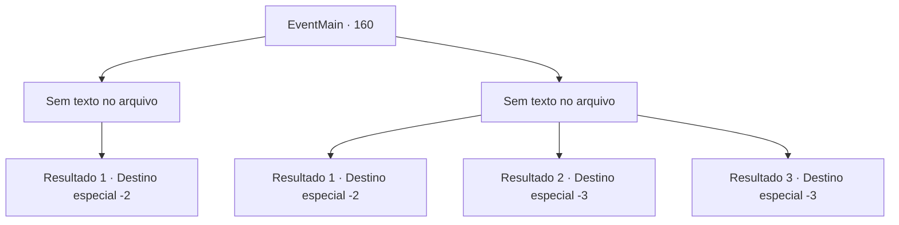

# Eventos principais · 160

[Índice da tabela](index.md) · [Índice geral](../index.md)

ID: `pt:EventMain:160` · Fonte: `EventMain4` · Versão: 1.2.47.

Mapeamento estático dos arquivos; a disponibilidade e a execução dependem do estado da run.

## Texto do evento

*Sem texto no arquivo.*

## Dados de entrada

```json
{
  "id": 160,
  "grade": 1,
  "normalGoal": "",
  "required": ""
}
```

## Mapa das escolhas



## Escolhas e resultados

### Escolha 1

*Sem texto no arquivo; o papel dessa opção depende da interface do jogo.*

Requisitos e outros campos da escolha:

```json
{
  "required": ""
}
```

#### Resultado 1.1

Você derrota as figuras encapuzadas. As pessoas voltam a si e olham ao redor, confusas. Você prossegue para saquear os caídos. Entre suas posses está um pergaminho. Ele revela detalhes do plano de Halad para assumir a Torre da Magia. Seu primeiro passo envolve encantar as pessoas e colher suas energias. Você embolsa o pergaminho e sai do santuário.

Continuação registrada: [Destino especial `-2`](../destinos-especiais.md).

```json
{
  "required": "",
  "chance": "1",
  "nextEvent": -2,
  "type": 2,
  "reward": "13_1_18|3_141_1"
}
```

### Escolha 2

*Sem texto no arquivo; o papel dessa opção depende da interface do jogo.*

Requisitos e outros campos da escolha:

```json
{
  "required": ""
}
```

#### Resultado 2.1

Você mal escapa dos maníacos encapuzados. Embora você não tenha certeza de qual é exatamente o plano deles, eles estão definitivamente relacionados a Halad de uma forma ou de outra. Você deixa o santuário para trás e continua sua jornada.

Continuação registrada: [Destino especial `-2`](../destinos-especiais.md).

```json
{
  "required": "1_0_2|1_1_2",
  "chance": "1",
  "nextEvent": -2,
  "type": 2,
  "reward": "13_1_18|0_0_-1|0_1_-1|0_2_1"
}
```

#### Resultado 2.2

Os maníacos encapuzados tiram sua vida.

Continuação registrada: [Destino especial `-3`](../destinos-especiais.md).

```json
{
  "required": "2_0_2",
  "chance": "1",
  "nextEvent": -3,
  "type": 2,
  "reward": "0_0_-1|0_1_-1"
}
```

#### Resultado 2.3

Os maníacos encapuzados tiram sua vida.

Continuação registrada: [Destino especial `-3`](../destinos-especiais.md).

```json
{
  "required": "2_1_2",
  "chance": "1",
  "nextEvent": -3,
  "type": 2,
  "reward": "0_0_-1|0_1_-1"
}
```

## Referências que chegam a este evento

- [Evento 159 · escolha 1 · resultado 1](0159.md#escolha-1)
- [Evento 159 · escolha 2 · resultado 1](0159.md#escolha-2)
- [Evento 159 · escolha 2 · resultado 3](0159.md#escolha-2)
