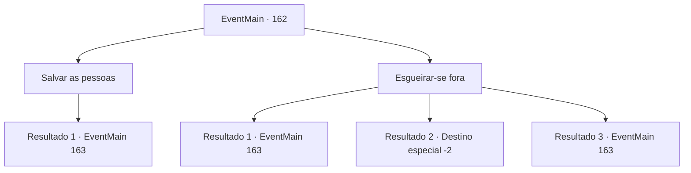

# Eventos principais · 162

[Índice da tabela](index.md) · [Índice geral](../index.md)

ID: `pt:EventMain:162` · Fonte: `EventMain4` · Versão: 1.2.47.

Mapeamento estático dos arquivos; a disponibilidade e a execução dependem do estado da run.

## Texto do evento

*Sem texto no arquivo.*

## Dados de entrada

```json
{
  "id": 162,
  "grade": 1,
  "normalGoal": "",
  "required": ""
}
```

## Mapa das escolhas



## Escolhas e resultados

### Escolha 1

Salvar as pessoas

Requisitos e outros campos da escolha:

```json
{
  "required": ""
}
```

#### Resultado 1.1

Você decide salvar as pessoas encantadas. Você se levanta e se aproxima da figura encapuzada. Ele te olha direto nos olhos e grita. 

 "Em... intruso! Intruso!"

 Mais figuras em mantos e capuzes se juntam a ele, cercando você enquanto eles sacam suas armas.

Continuação registrada: [Evento 163](0163.md) na mesma tabela.

```json
{
  "required": "",
  "chance": "1",
  "nextEvent": 163,
  "type": 2,
  "reward": "6_3_71",
  "place": 10
}
```

### Escolha 2

Esgueirar-se fora

Requisitos e outros campos da escolha:

```json
{
  "required": ""
}
```

#### Resultado 2.1

Você tenta escapar do santuário. Mas uma das figuras encapuzadas vê você, saca sua arma e grita. 

 "Não, você não, intruso!"

 Mais figuras em mantos e capuzes se juntam a ele, cercando você enquanto eles sacam suas armas.

Continuação registrada: [Evento 163](0163.md) na mesma tabela.

```json
{
  "required": "",
  "chance": "12",
  "nextEvent": 163,
  "type": 1,
  "reward": "6_3_71",
  "place": 10
}
```

#### Resultado 2.2

Você conseguiu escapar do santuário com sucesso. Embora você não tenha certeza de qual é exatamente o plano deles, eles estão definitivamente relacionados a Halad de uma forma ou de outra. Você decide voltar para a Torre da Magia com a notícia.

Continuação registrada: [Destino especial `-2`](../destinos-especiais.md).

```json
{
  "required": "",
  "chance": "1|0_6_1",
  "nextEvent": -2,
  "type": 0,
  "reward": "13_1_18"
}
```

#### Resultado 2.3

Você tenta escapar do santuário. Mas a varinha faz um ruído sibilante com a boca, e a figura encapuzada vê você. Ele te olha direto nos olhos e grita. 

 "Em... intruso! Intruso!"

 Mais figuras em mantos e capuzes se juntam a ele, cercando você enquanto eles sacam suas armas. A varinha mostra a língua e sussurra se desculpando. 

 "Opa, foi mal. Ele Ele."


Continuação registrada: [Evento 163](0163.md) na mesma tabela.

```json
{
  "required": "8_111_1|5_80_4",
  "chance": "1",
  "nextEvent": 163,
  "type": 2,
  "reward": "6_3_71",
  "place": 10
}
```

## Referências que chegam a este evento

- [Evento 161 · escolha 3 · resultado 1](0161.md#escolha-3)
