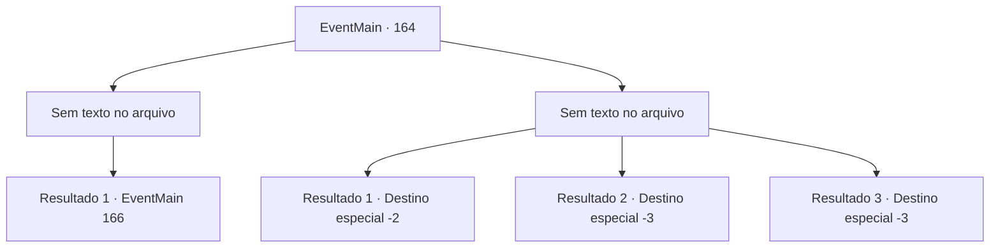

# Eventos principais · 164

[Índice da tabela](index.md) · [Índice geral](../index.md)

ID: `pt:EventMain:164` · Fonte: `EventMain4` · Versão: 1.2.47.

Mapeamento estático dos arquivos; a disponibilidade e a execução dependem do estado da run.

## Texto do evento

*Sem texto no arquivo.*

## Dados de entrada

```json
{
  "id": 164,
  "grade": 1,
  "normalGoal": "",
  "required": ""
}
```

## Mapa das escolhas



## Escolhas e resultados

### Escolha 1

*Sem texto no arquivo; o papel dessa opção depende da interface do jogo.*

Requisitos e outros campos da escolha:

```json
{
  "required": ""
}
```

#### Resultado 1.1

Você bate no fanático encapuzado. O encantamento desaparece assim que ele atinge o chão. As pessoas voltam a si e olham ao redor, confusas. Então eles avistam o fanático no chão e o cercam. 

 "Não consigo me lembrar de nada... O que você fez conosco?"

 "Eu juro que estava lavando roupa, por que diabos estou aqui?"

 Você acalma a multidão enfurecida e fica entre eles e o fanático. Então você pergunta a ele por que ele fez o que fez. Ele balança a cabeça, e começa a murmurar seu absurdo: 'Mestre Halad é o primeiro e único...' A multidão está perdendo a paciência. Você precisa descobrir outra maneira de fazê-lo falar.

Continuação registrada: [Evento 166](0166.md) na mesma tabela.

```json
{
  "required": "",
  "chance": "1",
  "nextEvent": 166,
  "type": 2,
  "reward": ""
}
```

### Escolha 2

*Sem texto no arquivo; o papel dessa opção depende da interface do jogo.*

Requisitos e outros campos da escolha:

```json
{
  "required": ""
}
```

#### Resultado 2.1

O fanático encapuzado bate em você, e você não tem escolha a não ser fugir. Ele se levanta e olha para você decolar, sem tentar persegui-lo.

Continuação registrada: [Destino especial `-2`](../destinos-especiais.md).

```json
{
  "required": "1_0_2|1_1_2",
  "chance": "1",
  "nextEvent": -2,
  "type": 2,
  "reward": "0_0_-1|0_1_-1|0_2_1|13_1_18"
}
```

#### Resultado 2.2

O fantasma tira sua vida.

Continuação registrada: [Destino especial `-3`](../destinos-especiais.md).

```json
{
  "required": "2_0_2",
  "chance": "1",
  "nextEvent": -3,
  "type": 2,
  "reward": "0_0_-1|0_1_-1"
}
```

#### Resultado 2.3

O fantasma tira sua vida.

Continuação registrada: [Destino especial `-3`](../destinos-especiais.md).

```json
{
  "required": "2_1_2",
  "chance": "1",
  "nextEvent": -3,
  "type": 2,
  "reward": "0_0_-1|0_1_-1"
}
```

## Referências que chegam a este evento

- [Evento 158 · escolha 1 · resultado 1](0158.md#escolha-1)
- [Evento 158 · escolha 1 · resultado 2](0158.md#escolha-1)
- [Evento 158 · escolha 1 · resultado 3](0158.md#escolha-1)
- [Evento 158 · escolha 1 · resultado 4](0158.md#escolha-1)
- [Evento 158 · escolha 2 · resultado 1](0158.md#escolha-2)
- [Evento 161 · escolha 1 · resultado 1](0161.md#escolha-1)
- [Evento 161 · escolha 1 · resultado 2](0161.md#escolha-1)
- [Evento 161 · escolha 2 · resultado 1](0161.md#escolha-2)
