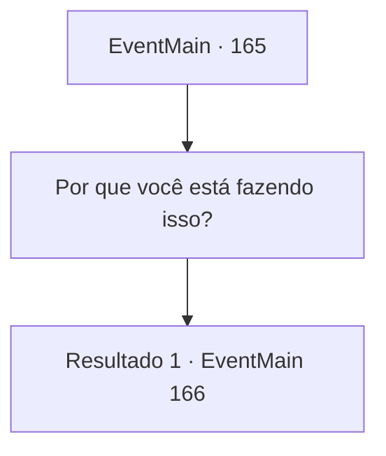

# Eventos principais · 165

[Índice da tabela](index.md) · [Índice geral](../index.md)

ID: `pt:EventMain:165` · Fonte: `EventMain4` · Versão: 1.2.47.

Mapeamento estático dos arquivos; a disponibilidade e a execução dependem do estado da run.

## Texto do evento

*Sem texto no arquivo.*

## Dados de entrada

```json
{
  "id": 165,
  "grade": 1,
  "normalGoal": "",
  "required": ""
}
```

## Mapa das escolhas



## Escolhas e resultados

### Escolha 1

Por que você está fazendo isso?

Requisitos e outros campos da escolha:

```json
{
  "required": ""
}
```

#### Resultado 1.1

Ele está intimidado por você, e imediatamente começa a falar. 

 "Eu... eu estava reunindo pessoas para Halad."

 Então, em um último e minúsculo gesto de resistência, ele diz 'Agora vá embora' em uma voz quase inaudível.

Continuação registrada: [Evento 166](0166.md) na mesma tabela.

```json
{
  "required": "",
  "chance": "1",
  "nextEvent": 166,
  "type": 2,
  "reward": ""
}
```

## Referências que chegam a este evento

- [Evento 158 · escolha 2 · resultado 2](0158.md#escolha-2)
- [Evento 158 · escolha 2 · resultado 3](0158.md#escolha-2)
- [Evento 161 · escolha 2 · resultado 2](0161.md#escolha-2)
- [Evento 161 · escolha 2 · resultado 3](0161.md#escolha-2)
