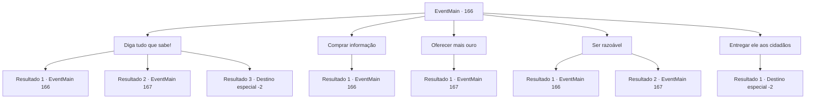

# Eventos principais · 166

[Índice da tabela](index.md) · [Índice geral](../index.md)

ID: `pt:EventMain:166` · Fonte: `EventMain4` · Versão: 1.2.47.

Mapeamento estático dos arquivos; a disponibilidade e a execução dependem do estado da run.

## Texto do evento

*Sem texto no arquivo.*

## Dados de entrada

```json
{
  "id": 166,
  "grade": 1,
  "normalGoal": "",
  "required": ""
}
```

## Mapa das escolhas



## Escolhas e resultados

### Escolha 1

Diga tudo que sabe!

Requisitos e outros campos da escolha:

```json
{
  "required": "5_25_0"
}
```

#### Resultado 1.1

Você ameaça o fanático, exigindo saber onde Halad está. Ele balança a cabeça. 

 "Pare... Por favor, pare de me perguntar mais."

 Ele parece intimidado, mas não o suficiente para derramar qualquer informação importante. Você precisa descobrir outra maneira de fazê-lo falar.

Continuação registrada: [Evento 166](0166.md) na mesma tabela.

```json
{
  "required": "",
  "chance": "27",
  "nextEvent": 166,
  "type": 1,
  "reward": "5_25_1"
}
```

#### Resultado 1.2

Você ameaça o fanático, exigindo saber onde Halad está. Ele responde, tremendo de medo. 

 "Eu... eu estava reunindo pessoas para Halad. Eu... ela precisa de mais crentes. Ela prometeu salvar seus seguidores mais leais da morte assim que ascender à divindade."

 Ele também lhe diz que Halad pretende assumir a Torre da Magia. Ele explica que esse é o segundo passo do plano dela. Ele tenta fazer um acordo com você depois de terminar. As pessoas estão olhando para ele como se pudessem comê-lo vivo.

Continuação registrada: [Evento 167](0167.md) na mesma tabela.

```json
{
  "required": "",
  "chance": "1|0_12_1",
  "nextEvent": 167,
  "type": 0,
  "reward": "13_1_18"
}
```

#### Resultado 1.3

Você ameaça o fanático, exigindo saber onde Halad está. Aterrorizado, ele tenta falar, mas nada sai de sua boca. Então, de repente, ele agarra o peito e cai de joelhos. 

 "Krurgh...urrrgh..."

 A asfixia torna-se suas palavras finais. Você não consegue obter nenhuma informação útil e decide deixar o local.

Continuação registrada: [Destino especial `-2`](../destinos-especiais.md).

```json
{
  "required": "20_1_3",
  "chance": "1|0_12_1",
  "nextEvent": -2,
  "type": 0,
  "reward": "13_1_19"
}
```

### Escolha 2

Comprar informação

Requisitos e outros campos da escolha:

```json
{
  "required": "1_4_150|18_25_2"
}
```

#### Resultado 2.1

Você tira uma grande soma de ouro, oferecendo-se para comprar informações. Ele balança a cabeça e diz: 'Você não pode me subornar'.

Continuação registrada: [Evento 166](0166.md) na mesma tabela.

```json
{
  "required": "",
  "chance": "1",
  "nextEvent": 166,
  "type": 2,
  "reward": "5_25_2"
}
```

### Escolha 3

Oferecer mais ouro

Requisitos e outros campos da escolha:

```json
{
  "required": "1_4_300|5_25_2"
}
```

#### Resultado 3.1

Você oferece a ele o dobro do ouro e pede novamente. Ele olha para o ouro por um momento. Seus olhos brilham com ganância quando ele começa a falar. 

 "Eu estava reunindo pessoas para Halad. Eu... ela precisa de mais crentes. Ela prometeu salvar seus seguidores mais leais da morte assim que ascender à divindade."

 Ele também lhe diz que Halad pretende assumir a Torre da Magia. Ele explica que esse é o segundo passo do plano dela. Ele tenta fazer um acordo com você depois de terminar. As pessoas estão olhando para ele como se pudessem comê-lo vivo.

Continuação registrada: [Evento 167](0167.md) na mesma tabela.

```json
{
  "required": "",
  "chance": "1",
  "nextEvent": 167,
  "type": 2,
  "reward": "5_25_3|13_1_18|0_4_-300"
}
```

### Escolha 4

Ser razoável

Requisitos e outros campos da escolha:

```json
{
  "required": "1_7_9|5_25_0"
}
```

#### Resultado 4.1

Você tenta argumentar com ele, mas deixar de fazê-lo. Ele balança a cabeça, completamente imóvel. Você precisa encontrar outra maneira de fazê-lo falar.

Continuação registrada: [Evento 166](0166.md) na mesma tabela.

```json
{
  "required": "",
  "chance": "18",
  "nextEvent": 166,
  "type": 1,
  "reward": "5_25_1"
}
```

#### Resultado 4.2

Você ameaça o fanático, exigindo saber onde Halad está. Ele responde, tremendo de medo. 

 "Eu... eu estava reunindo pessoas para Halad. Eu... ela precisa de mais crentes. Ela prometeu salvar seus seguidores mais leais da morte assim que ascender ao panteão dos deuses."

 Ele também lhe diz que Halad pretende assumir a Torre da Magia. Ele explica que esse é o segundo passo do plano dela. Ele tenta fazer um acordo com você depois de terminar. As pessoas estão olhando para ele como se pudessem comê-lo vivo.

Continuação registrada: [Evento 167](0167.md) na mesma tabela.

```json
{
  "required": "",
  "chance": "1|0_7_1",
  "nextEvent": 167,
  "type": 0,
  "reward": "13_1_18"
}
```

### Escolha 5

Entregar ele aos cidadãos

Requisitos e outros campos da escolha:

```json
{
  "required": ""
}
```

#### Resultado 5.1

Você entrega o fanático aos habitantes da cidade.  O destino dele agora está nas mãos deles.  

 "Venha aqui, garoto! Não se debata!"

  A multidão o ameaça enquanto o arrasta para longe.  Um velho fica para trás para lhe agradecer.  

 "Você salvou nossas almas, jovem... Obrigado."

  Ele lhe entrega um pouco de ouro como sinal de gratidão.  Você pega o ouro e continua sua jornada.

Continuação registrada: [Destino especial `-2`](../destinos-especiais.md).

```json
{
  "required": "",
  "chance": "1",
  "nextEvent": -2,
  "type": 2,
  "reward": "13_1_19|0_4_50|0_2_1|0_3_1"
}
```

## Referências que chegam a este evento

- [Evento 164 · escolha 1 · resultado 1](0164.md#escolha-1)
- [Evento 165 · escolha 1 · resultado 1](0165.md#escolha-1)
- [Evento 166 · escolha 1 · resultado 1](0166.md#escolha-1)
- [Evento 166 · escolha 2 · resultado 1](0166.md#escolha-2)
- [Evento 166 · escolha 4 · resultado 1](0166.md#escolha-4)
