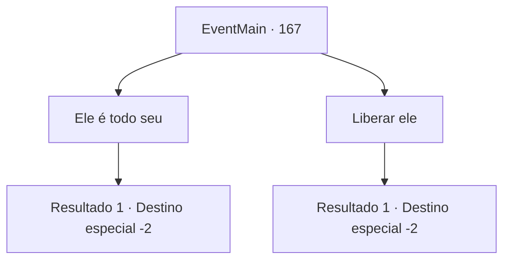

# Eventos principais · 167

[Índice da tabela](index.md) · [Índice geral](../index.md)

ID: `pt:EventMain:167` · Fonte: `EventMain4` · Versão: 1.2.47.

Mapeamento estático dos arquivos; a disponibilidade e a execução dependem do estado da run.

## Texto do evento

*Sem texto no arquivo.*

## Dados de entrada

```json
{
  "id": 167,
  "grade": 1,
  "normalGoal": "",
  "required": ""
}
```

## Mapa das escolhas



## Escolhas e resultados

### Escolha 1

Ele é todo seu

Requisitos e outros campos da escolha:

```json
{
  "required": ""
}
```

#### Resultado 1.1

Você entrega o fanático para as pessoas da cidade, dizendo-lhes para fazerem o que quiserem com ele. 

 "Venha aqui, garoto! Não se contorça!"

 A multidão o ameaça enquanto o arrastam para longe. Um velho fica para trás para agradecer. 

 "Você salvou nossas almas, jovem... Obrigado."

 Ele lhe entrega um pouco de ouro como sinal de sua gratidão. Você pega e continua sua jornada.

Continuação registrada: [Destino especial `-2`](../destinos-especiais.md).

```json
{
  "required": "",
  "chance": "1",
  "nextEvent": -2,
  "type": 2,
  "reward": "0_4_50|0_2_1|0_3_1"
}
```

### Escolha 2

Liberar ele

Requisitos e outros campos da escolha:

```json
{
  "required": ""
}
```

#### Resultado 2.1

Você pede ao povo da cidade para libertar o homem encapuzado. Eles murmuram entre si por um momento. Então um homem grande de meia-idade responde a você. 

 "Não é exatamente o que tínhamos em mente, mas por que não."

 A multidão volta para a cidade, deixando você e o fanático para trás. Ele agradece e lhe entrega um amuleto antes de sair.

Continuação registrada: [Destino especial `-2`](../destinos-especiais.md).

```json
{
  "required": "",
  "chance": "1",
  "nextEvent": -2,
  "type": 2,
  "reward": "0_2_1|0_3_1|3_70_1"
}
```

## Referências que chegam a este evento

- [Evento 166 · escolha 1 · resultado 2](0166.md#escolha-1)
- [Evento 166 · escolha 3 · resultado 1](0166.md#escolha-3)
- [Evento 166 · escolha 4 · resultado 2](0166.md#escolha-4)
