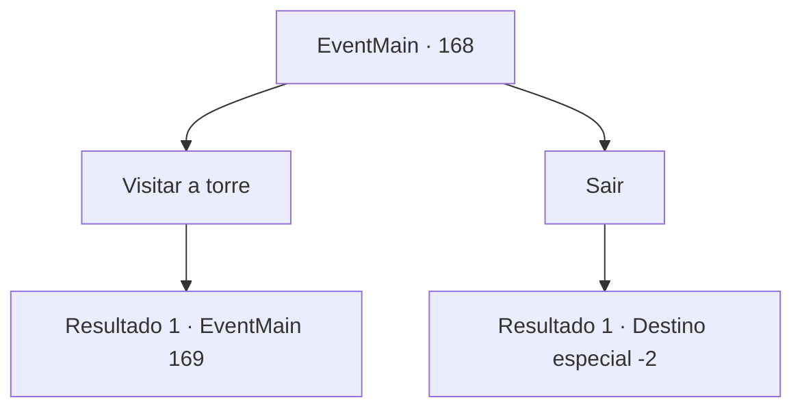

# Eventos principais · 168

[Índice da tabela](index.md) · [Índice geral](../index.md)

ID: `pt:EventMain:168` · Fonte: `EventMain4` · Versão: 1.2.47.

Mapeamento estático dos arquivos; a disponibilidade e a execução dependem do estado da run.

## Texto do evento

Acontece de você passar pela Torre da Magia. Você para, ou porque isso ainda te incomoda ou porque você só quer saber como todos que você conhecia estão indo. Você olha para a torre iminente por um longo tempo. Parece exatamente a mesma desde o dia em que te baniram.

## Dados de entrada

```json
{
  "id": 168,
  "grade": 1,
  "normalGoal": "",
  "required": "13_1_18|1_2_70"
}
```

## Mapa das escolhas



## Escolhas e resultados

### Escolha 1

Visitar a torre

Requisitos e outros campos da escolha:

```json
{
  "required": ""
}
```

#### Resultado 1.1

Você visita a Torre da Magia pela primeira vez em anos. Quando você está na entrada, você vê alguém que parece familiar. |drawing_edmond| Ele é Edmond, o presidente. 

 "Você está... {1}? Hmm... vamos entrar primeiro."

 Ele abre um portal para seu escritório. Ele se senta em um sofá e pergunta por que você está aqui.

Continuação registrada: [Evento 169](0169.md) na mesma tabela.

```json
{
  "required": "",
  "chance": "1",
  "nextEvent": 169,
  "type": 2,
  "reward": ""
}
```

### Escolha 2

Sair

Requisitos e outros campos da escolha:

```json
{
  "required": ""
}
```

#### Resultado 2.1

Você se afasta da torre. Eles estão sozinhos, assim como você.

Continuação registrada: [Destino especial `-2`](../destinos-especiais.md).

```json
{
  "required": "",
  "chance": "1",
  "nextEvent": -2,
  "type": 2,
  "reward": "13_1_19"
}
```

## Referências que chegam a este evento

Nenhum `nextEvent` positivo da mesma tabela aponta para este nó. Isso não prova que seja inacessível: sorteio e estado de história podem selecioná-lo.

