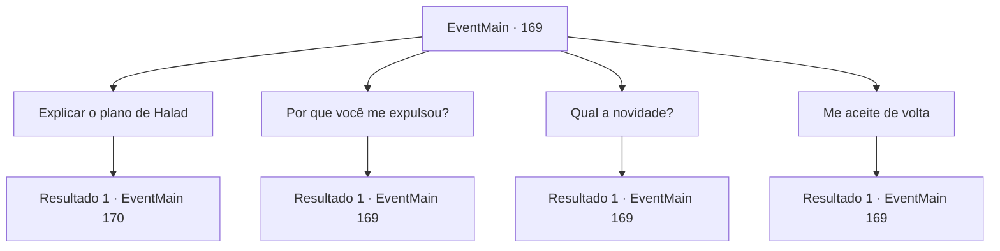

# Eventos principais · 169

[Índice da tabela](index.md) · [Índice geral](../index.md)

ID: `pt:EventMain:169` · Fonte: `EventMain4` · Versão: 1.2.47.

Mapeamento estático dos arquivos; a disponibilidade e a execução dependem do estado da run.

## Texto do evento

*Sem texto no arquivo.*

## Dados de entrada

```json
{
  "id": 169,
  "grade": 1,
  "normalGoal": "",
  "required": ""
}
```

## Mapa das escolhas



## Escolhas e resultados

### Escolha 1

Explicar o plano de Halad

Requisitos e outros campos da escolha:

```json
{
  "required": ""
}
```

#### Resultado 1.1

Você diz a ele que Halad está encantando as pessoas para guerrear na Torre da Magia. Edmond ouve e acena com a cabeça. 

 "Eu vejo. Achei que haveria uma razão para você voltar depois de todos esses anos. Mas você também trouxe provas?"


Continuação registrada: [Evento 170](0170.md) na mesma tabela.

```json
{
  "required": "",
  "chance": "1",
  "nextEvent": 170,
  "type": 2,
  "reward": ""
}
```

### Escolha 2

Por que você me expulsou?

Requisitos e outros campos da escolha:

```json
{
  "required": "5_84_0"
}
```

#### Resultado 2.1

Edmond franze a testa um pouco enquanto responde. 

 "Nós lamentamos. Tanto o corpo docente quanto eu somos culpados por isso."

 Ele toma um gole de seu copo. Então ele continua. 

 "Halad... era um aluno talentoso que todos os professores notaram. Nós simplesmente não queríamos acreditar que ela tentou roubar o texto proibido. Estávamos além de tolos. No final, não conseguimos impedi-la de fugir com ele."

 Ele bebe o copo seco e o coloca sobre a mesa.

Continuação registrada: [Evento 169](0169.md) na mesma tabela.

```json
{
  "required": "",
  "chance": "1",
  "nextEvent": 169,
  "type": 2,
  "reward": "5_84_1"
}
```

### Escolha 3

Qual a novidade?

Requisitos e outros campos da escolha:

```json
{
  "required": "5_84_0"
}
```

#### Resultado 3.1

Edmond levanta uma sobrancelha ao responder. 

 "Seus colegas se formaram recentemente... incluindo Halad, é claro. O bibliotecário nos contatou logo depois para nos dizer que o texto proibido estava faltando."

 Ele toma um gole de seu copo. Então ele continua. 

 "Halad... era um aluno talentoso que todos os professores notaram. Nós simplesmente não queríamos acreditar que ela tentou roubar o texto proibido. Estávamos além de tolos. No final, não conseguimos impedi-la de fugir com ele."

 Ele bebeu o copo seco e colocou-o sobre a mesa.

Continuação registrada: [Evento 169](0169.md) na mesma tabela.

```json
{
  "required": "",
  "chance": "1",
  "nextEvent": 169,
  "type": 2,
  "reward": "5_84_1"
}
```

### Escolha 4

Me aceite de volta

Requisitos e outros campos da escolha:

```json
{
  "required": "5_84_1"
}
```

#### Resultado 4.1

Você pede a Edmond para deixá-lo voltar para a torre, mas ele balança a cabeça. 

 "Isso não é algo para eu decidir sozinho... Mais da metade dos professores precisa concordar. Alguns ainda acreditam... que você motivou Halad a roubar o livro ao tentar fazê-lo antes dela. Você precisará convencê-los do contrário."


Continuação registrada: [Evento 169](0169.md) na mesma tabela.

```json
{
  "required": "",
  "chance": "1",
  "nextEvent": 169,
  "type": 2,
  "reward": "5_84_2"
}
```

## Referências que chegam a este evento

- [Evento 168 · escolha 1 · resultado 1](0168.md#escolha-1)
- [Evento 169 · escolha 2 · resultado 1](0169.md#escolha-2)
- [Evento 169 · escolha 3 · resultado 1](0169.md#escolha-3)
- [Evento 169 · escolha 4 · resultado 1](0169.md#escolha-4)
