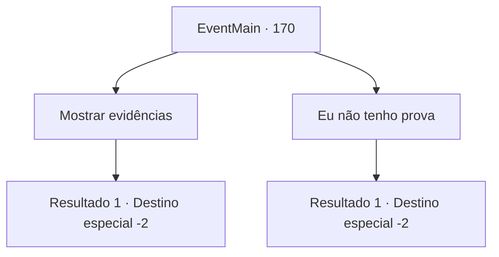

# Eventos principais · 170

[Índice da tabela](index.md) · [Índice geral](../index.md)

ID: `pt:EventMain:170` · Fonte: `EventMain4` · Versão: 1.2.47.

Mapeamento estático dos arquivos; a disponibilidade e a execução dependem do estado da run.

## Texto do evento

*Sem texto no arquivo.*

## Dados de entrada

```json
{
  "id": 170,
  "grade": 1,
  "normalGoal": "",
  "required": ""
}
```

## Mapa das escolhas



## Escolhas e resultados

### Escolha 1

Mostrar evidências

Requisitos e outros campos da escolha:

```json
{
  "required": "8_141_1"
}
```

#### Resultado 1.1

Você pega o pergaminho e entrega ao presidente. Suas mãos tremem levemente enquanto ele lê. Seu rosto está sombrio enquanto ele geme e fala. 

 "Hmm... obrigado por me avisar. Eu vou chegar até você em um futuro próximo. Por favor, saia por agora."

 Ele sai apressadamente do escritório e você volta pelo mesmo caminho que veio pelo portal.

Continuação registrada: [Destino especial `-2`](../destinos-especiais.md).

```json
{
  "required": "",
  "chance": "1",
  "nextEvent": -2,
  "type": 2,
  "reward": "4_141_1|13_1_20|0_2_1"
}
```

### Escolha 2

Eu não tenho prova

Requisitos e outros campos da escolha:

```json
{
  "required": ""
}
```

#### Resultado 2.1

Você diz a ele que não tem nenhuma prova tangível. Edmond aponta que você vai precisar de um. 

 "Mas eu acho a coisa toda muito convincente. E é certamente uma notícia desastrosa se for verdade. Então aqui está uma coisinha que pode ajudar."

 Ele prende um pequeno botão à sua manga. É redondo e feito de prata. 

 "Esta será a sua prova."

 Você sai da torre com o botão.

Continuação registrada: [Destino especial `-2`](../destinos-especiais.md).

```json
{
  "required": "",
  "chance": "1",
  "nextEvent": -2,
  "type": 2,
  "reward": "13_1_21|0_2_1"
}
```

## Referências que chegam a este evento

- [Evento 169 · escolha 1 · resultado 1](0169.md#escolha-1)
