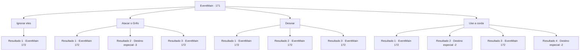

# Eventos principais · 171

[Índice da tabela](index.md) · [Índice geral](../index.md)

ID: `pt:EventMain:171` · Fonte: `EventMain4` · Versão: 1.2.47.

Mapeamento estático dos arquivos; a disponibilidade e a execução dependem do estado da run.

## Texto do evento

Você está no meio de um deserto,  se escondendo do sol sob uma rocha em forma de cogumelo.  De repente, uma criatura que não deveria estar em um deserto voa em sua direção.  É uma coruja branca que segura um pequeno pergaminho em sua garra.  E um grifo está perseguindo-a por trás.  |drawing_owlAndGriffin|

## Dados de entrada

```json
{
  "id": 171,
  "grade": 1,
  "normalGoal": "",
  "required": "13_1_20|1_2_80"
}
```

## Mapa das escolhas



## Escolhas e resultados

### Escolha 1

Ignorar eles

Requisitos e outros campos da escolha:

```json
{
  "required": ""
}
```

#### Resultado 1.1

Você decide ignorá-los, mas você realmente não tem escolha. A coruja voa direto para você e pousa na sua cabeça. O grifo vem voando logo depois.

Continuação registrada: [Evento 172](0172.md) na mesma tabela.

```json
{
  "required": "",
  "chance": "1",
  "nextEvent": 172,
  "type": 2,
  "reward": "6_0_53",
  "place": 5
}
```

### Escolha 2

Atacar o Grifo

Requisitos e outros campos da escolha:

```json
{
  "required": ""
}
```

#### Resultado 2.1

Você se esquiva da coruja e aponta sua arma para o grifo. Leva um golpe na cabeça, mas bate direto em você de qualquer maneira. Seu bico metálico cava em seu estômago. Você cai para trás e mal consegue se levantar. O grifo guincha no topo de seus pulmões enquanto ele imediatamente ataca você.

Continuação registrada: [Evento 172](0172.md) na mesma tabela.

```json
{
  "required": "1_0_2",
  "chance": "20",
  "nextEvent": 172,
  "type": 1,
  "reward": "6_0_53|0_0_-1",
  "place": 5
}
```

#### Resultado 2.2

Você se esquiva da coruja e aponta sua arma para o grifo. Leva um golpe na cabeça, mas bate direto em você de qualquer maneira. Seu bico metálico cava em seu estômago. Você cai para trás enquanto o mundo fica preto.

Continuação registrada: [Destino especial `-3`](../destinos-especiais.md).

```json
{
  "required": "2_0_2",
  "chance": "20",
  "nextEvent": -3,
  "type": 1,
  "reward": "0_0_-1"
}
```

#### Resultado 2.3

Você se esquiva da coruja e aponta sua arma para o grifo. Leva um golpe na cabeça e cai no chão. Por um momento você pensa que está morto, mas os grifos nunca morrem tão facilmente. Ele balança a cabeça e se levanta. Então ele grita a plenos pulmões e ataca direto em você.

Continuação registrada: [Evento 172](0172.md) na mesma tabela.

```json
{
  "required": "",
  "chance": "1|0_5_1",
  "nextEvent": 172,
  "type": 0,
  "reward": "6_2_53",
  "place": 5
}
```

### Escolha 3

Desviar

Requisitos e outros campos da escolha:

```json
{
  "required": ""
}
```

#### Resultado 3.1

Você tenta se esconder atrás da rocha em forma de cogumelo, mas o grifo é muito mais rápido do que você. Ele balança sua garra na coruja, mas erra e acerta você em vez disso. Você cai para trás e mal consegue se levantar. O grifo se vira e vê você. Ele grita no topo de seus pulmões e vem atacando.

Continuação registrada: [Evento 172](0172.md) na mesma tabela.

```json
{
  "required": "1_0_2",
  "chance": "15",
  "nextEvent": 172,
  "type": 1,
  "reward": "6_0_53|0_0_-1",
  "place": 5
}
```

#### Resultado 3.2

Você tenta se esconder atrás da rocha em forma de cogumelo, mas o grifo é muito mais rápido do que você. Ele balança sua garra na coruja, mas erra e acerta você em vez disso. Você cai para trás enquanto o mundo fica escuro.

Continuação registrada: [Evento 172](0172.md) na mesma tabela.

```json
{
  "required": "2_0_2",
  "chance": "15",
  "nextEvent": 172,
  "type": 1,
  "reward": "0_0_-1"
}
```

#### Resultado 3.3

Você rapidamente se esconde atrás da rocha em forma de cogumelo. o grifo balança sua garra na coruja, mas erra e acerta a rocha em vez disso. Ele desmorona sobre a besta. Por um momento você pensa que está morto, mas os grifos nunca morrem tão facilmente. Ele balança a cabeça e se levanta. Então ele grita a plenos pulmões e ataca direto em você.

Continuação registrada: [Evento 172](0172.md) na mesma tabela.

```json
{
  "required": "",
  "chance": "1|0_6_1",
  "nextEvent": 172,
  "type": 0,
  "reward": "6_2_53",
  "place": 5
}
```

### Escolha 4

Use a corda

Requisitos e outros campos da escolha:

```json
{
  "required": "8_39_1"
}
```

#### Resultado 4.1

Você rapidamente pega uma corda e a joga em torno de uma das garras dianteiras do grifo. Mas a fera é muito rápida e você se agarra à corda enquanto ela o arrasta no chão. O grifo devora a coruja e vem correndo em sua direção.

Continuação registrada: [Evento 172](0172.md) na mesma tabela.

```json
{
  "required": "21_0_1",
  "chance": "15",
  "nextEvent": 172,
  "type": 1,
  "reward": "4_39_1|6_0_53",
  "place": 5
}
```

#### Resultado 4.2

Você rapidamente pega uma corda e a joga em torno de uma das garras dianteiras do grifo. Você convoca toda a sua força para balançar a fera contra o chão. O grifo bate na rocha em forma de cogumelo a uma velocidade vertiginosa. Ele se quebra em pedaços com um estrondo alto, desmoronando sobre a cabeça do grifo. A fera estremece um momento antes de cair morta. 

 Você percebe que a coruja branca se sentou em seu ombro. Você desamarra o pergaminho de sua garra e começa a ler. Ele detalha onde Halad está se escondendo, e incentiva você a se juntar ao escritor nesse local. Você embolsa o pergaminho e continua sua jornada.

Continuação registrada: [Destino especial `-2`](../destinos-especiais.md).

```json
{
  "required": "21_0_1",
  "chance": "1|0_5_1",
  "nextEvent": -2,
  "type": 0,
  "reward": "0_2_4|4_39_1|3_142_1|13_1_22"
}
```

#### Resultado 4.3

Você rapidamente pega uma corda e a encanta. A corda se joga em torno de uma das garras dianteiras do grifo. Mas a fera é muito rápida e se liberta. Ele devora a coruja e vem atacando você.

Continuação registrada: [Evento 172](0172.md) na mesma tabela.

```json
{
  "required": "20_0_1",
  "chance": "11",
  "nextEvent": 172,
  "type": 1,
  "reward": "4_39_1|6_0_53",
  "place": 5
}
```

#### Resultado 4.4

Você rapidamente pega uma corda e a encanta. A corda se joga em torno de uma das garras dianteiras do grifo. O grifo bate na rocha em forma de cogumelo a uma velocidade vertiginosa. Ele se quebra em pedaços com um estrondo alto, desmoronando sobre a cabeça do grifo. A fera estremece um momento antes de cair morta. 

 Você percebe que a coruja branca se sentou em seu ombro. Você desamarra o pergaminho de sua garra e começa a ler. Ele detalha onde Halad está se escondendo, e incentiva você a se juntar ao escritor nesse local. Você embolsa o pergaminho e continua sua jornada.

Continuação registrada: [Destino especial `-2`](../destinos-especiais.md).

```json
{
  "required": "20_0_1",
  "chance": "1|0_7_1",
  "nextEvent": -2,
  "type": 0,
  "reward": "0_2_4|4_39_1|3_142_1|13_1_22"
}
```

## Referências que chegam a este evento

Nenhum `nextEvent` positivo da mesma tabela aponta para este nó. Isso não prova que seja inacessível: sorteio e estado de história podem selecioná-lo.

