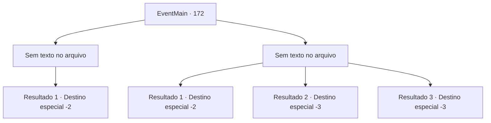

# Eventos principais · 172

[Índice da tabela](index.md) · [Índice geral](../index.md)

ID: `pt:EventMain:172` · Fonte: `EventMain4` · Versão: 1.2.47.

Mapeamento estático dos arquivos; a disponibilidade e a execução dependem do estado da run.

## Texto do evento

*Sem texto no arquivo.*

## Dados de entrada

```json
{
  "id": 172,
  "grade": 1,
  "normalGoal": "",
  "required": ""
}
```

## Mapa das escolhas



## Escolhas e resultados

### Escolha 1

*Sem texto no arquivo; o papel dessa opção depende da interface do jogo.*

Requisitos e outros campos da escolha:

```json
{
  "required": ""
}
```

#### Resultado 1.1

O grifo grita e desmaia. Você fica exausto ao notar a coruja branca sentada em seu ombro. Você desamarra o pergaminho de sua garra e começa a ler. Ele detalha onde Halad está se escondendo, e incentiva você a se juntar ao escritor nesse local. Você embolsa o pergaminho e continua sua jornada.

Continuação registrada: [Destino especial `-2`](../destinos-especiais.md).

```json
{
  "required": "",
  "chance": "1",
  "nextEvent": -2,
  "type": 2,
  "reward": "3_142_1|13_1_22"
}
```

### Escolha 2

*Sem texto no arquivo; o papel dessa opção depende da interface do jogo.*

Requisitos e outros campos da escolha:

```json
{
  "required": ""
}
```

#### Resultado 2.1

Você é encurralado pelo grifo quando a coruja branca arranha o olho da fera. O pergaminho na garra da coruja cai no chão, e o grifo guincha enquanto tenta pegar o pássaro. Você pega o pergaminho e sai correndo. 

 Você manca para longe, ferido e exausto, e abra o pergaminho enquanto recupera o fôlego. Ele detalha onde Halad está se escondendo, e incentiva você a se juntar ao escritor nesse local. Você embolsa o pergaminho e continua sua jornada.

Continuação registrada: [Destino especial `-2`](../destinos-especiais.md).

```json
{
  "required": "1_0_2|1_1_2",
  "chance": "1",
  "nextEvent": -2,
  "type": 2,
  "reward": "0_0_-1|0_1_-1|3_142_1|13_1_22|0_2_1"
}
```

#### Resultado 2.2

O grifo te despedaça com seu bico e garras. A coruja branca tenta atacá-lo, apenas para cair ao seu lado com um golpe. Você sente que está ficando mais frio enquanto está deitado no deserto escaldante.

Continuação registrada: [Destino especial `-3`](../destinos-especiais.md).

```json
{
  "required": "2_0_2",
  "chance": "1",
  "nextEvent": -3,
  "type": 2,
  "reward": "0_0_-1|0_1_-1"
}
```

#### Resultado 2.3

O grifo te despedaça com seu bico e garras. A coruja branca tenta atacá-lo, apenas para cair ao seu lado com um golpe. Você sente que está ficando mais frio enquanto está deitado no deserto escaldante.

Continuação registrada: [Destino especial `-3`](../destinos-especiais.md).

```json
{
  "required": "2_1_2",
  "chance": "1",
  "nextEvent": -3,
  "type": 2,
  "reward": "0_0_-1|0_1_-1"
}
```

## Referências que chegam a este evento

- [Evento 171 · escolha 1 · resultado 1](0171.md#escolha-1)
- [Evento 171 · escolha 2 · resultado 1](0171.md#escolha-2)
- [Evento 171 · escolha 2 · resultado 3](0171.md#escolha-2)
- [Evento 171 · escolha 3 · resultado 1](0171.md#escolha-3)
- [Evento 171 · escolha 3 · resultado 2](0171.md#escolha-3)
- [Evento 171 · escolha 3 · resultado 3](0171.md#escolha-3)
- [Evento 171 · escolha 4 · resultado 1](0171.md#escolha-4)
- [Evento 171 · escolha 4 · resultado 3](0171.md#escolha-4)
