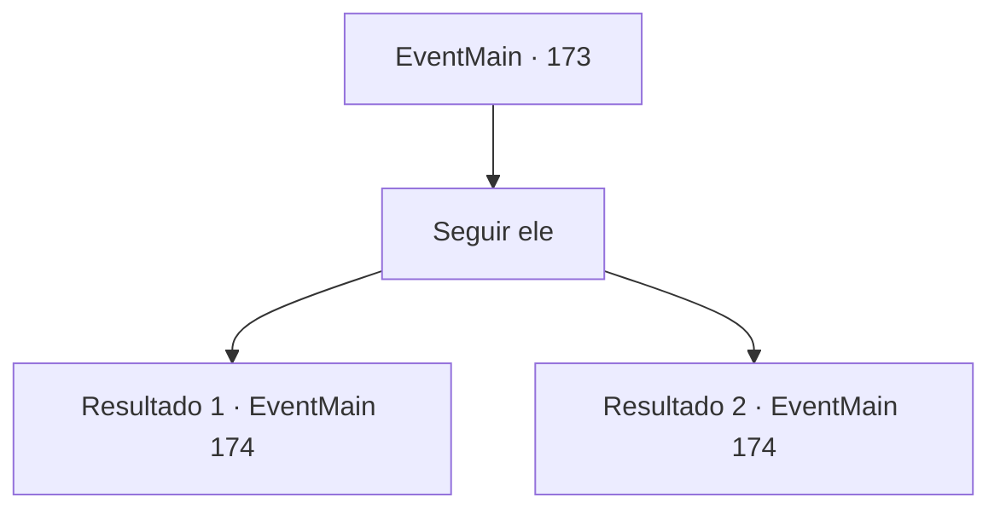

# Eventos principais · 173

[Índice da tabela](index.md) · [Índice geral](../index.md)

ID: `pt:EventMain:173` · Fonte: `EventMain4` · Versão: 1.2.47.

Mapeamento estático dos arquivos; a disponibilidade e a execução dependem do estado da run.

## Texto do evento

Você segue as instruções de Edmond no pergaminho e chega à pequena cidade de Perdant.  Está localizada no sopé da Montanha de Oito Círculos,  formado principalmente por lenhadores e caçadores.  Nem uma única alma pode ser vista,  até que uma porta de uma cabine se abre.  Dela sai Edmond.  

 "Bem-vindo, eu estava esperando por você."

  Ele começa a subir o caminho da montanha.

## Dados de entrada

```json
{
  "id": 173,
  "grade": 1,
  "normalGoal": "",
  "required": "13_1_22|1_2_100"
}
```

## Mapa das escolhas



## Escolhas e resultados

### Escolha 1

Seguir ele

Requisitos e outros campos da escolha:

```json
{
  "required": ""
}
```

#### Resultado 1.1

Você o segue até a montanha. Está estranhamente quieto. Depois de uma longa caminhada, vocês dois chegam em frente a um gigantesco muro de pedra. 

 "Estamos aqui."

 Você não encontra nada de peculiar nisso até que Edmond pega um pequeno botão prateado e acena com a mão. A parede derrete como aquarela, revelando uma caverna. 

 "É um truque iluminado."

 Ele explica como o feitiço funciona antes de entrar na caverna. É estreito e escuro perto da abertura, então ele produz um pequeno globo de luz da ponta de sua varinha. À medida que você viaja mais para dentro, você ouve as vozes das pessoas sussurrando à distância. Você chega a uma grande abertura encontrar-se em um mar de pessoas orando. |drawing_prayerInCave| Alguns fanáticos com tochas os cercam.

Continuação registrada: [Evento 174](0174.md) na mesma tabela.

```json
{
  "required": "",
  "chance": "1",
  "nextEvent": 174,
  "type": 2,
  "reward": ""
}
```

#### Resultado 1.2

Você o segue até a montanha. Está estranhamente quieto. Depois de uma longa caminhada, vocês dois chegam em frente a um gigantesco muro de pedra. 

 "Estamos aqui."

 Você não encontra nada de peculiar nisso até que Edmond pega um pequeno botão prateado e acena com a mão. A parede derrete como aquarela, revelando uma caverna. Sua varinha abre a boca. 

 "Então é um truque iluminado. Nada mal nada mal."

 O professor acena com a cabeça, pensando que você fez a observação. 

 "Eu vejo que você está ciente disso também. Venha agora."

 É estreito e escuro perto da abertura, então ele produz um pequeno globo de luz da ponta de sua varinha. À medida que você viaja mais para dentro, você ouve as vozes das pessoas sussurrando à distância. Você chega a uma grande abertura encontrar-se em um mar de pessoas orando. |drawing_prayerInCave| Alguns fanáticos com tochas os cercam.

Continuação registrada: [Evento 174](0174.md) na mesma tabela.

```json
{
  "required": "8_111_1",
  "chance": "1",
  "nextEvent": 174,
  "type": 2,
  "reward": ""
}
```

## Referências que chegam a este evento

Nenhum `nextEvent` positivo da mesma tabela aponta para este nó. Isso não prova que seja inacessível: sorteio e estado de história podem selecioná-lo.

