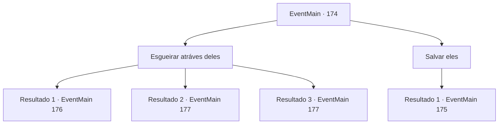

# Eventos principais · 174

[Índice da tabela](index.md) · [Índice geral](../index.md)

ID: `pt:EventMain:174` · Fonte: `EventMain4` · Versão: 1.2.47.

Mapeamento estático dos arquivos; a disponibilidade e a execução dependem do estado da run.

## Texto do evento

*Sem texto no arquivo.*

## Dados de entrada

```json
{
  "id": 174,
  "grade": 1,
  "normalGoal": "",
  "required": ""
}
```

## Mapa das escolhas



## Escolhas e resultados

### Escolha 1

Esgueirar atráves deles

Requisitos e outros campos da escolha:

```json
{
  "required": ""
}
```

#### Resultado 1.1

Você decide que seria um desperdício fazer uma cena. Edmond concorda com a cabeça. Ele sussurra um feitiço para torná-los invisíveis. 

 "Fique alerta. Eles ainda podem ouvir ou tocar você. Além disso, um forte contato físico pode desfazer esse feitiço."

 Você tenta se mover com cuidado, concentrando-se em cada passo. Mas o chão está escorregadio e você cai de bunda. Isso desfaz o feitiço em você e os fanáticos se voltam para olhar para você. 

 "Quem é Você!"

 Você olha para trás e descobre que Edmond se foi.

Continuação registrada: [Evento 176](0176.md) na mesma tabela.

```json
{
  "required": "",
  "chance": "10",
  "nextEvent": 176,
  "type": 1,
  "reward": "6_0_71",
  "place": 6
}
```

#### Resultado 1.2

Você decide que seria um desperdício fazer uma cena. Edmond concorda com a cabeça. Ele sussurra um feitiço para torná-los invisíveis. 

 "Fique alerta. Eles ainda podem ouvir ou tocar você. Além disso, um forte contato físico pode desfazer esse feitiço."

 Você se move com cuidado, concentrando-se em cada passo. A caverna se torna maior à medida que você viaja para dentro, e o fedor piora a cada passo. Edmond se vira para você e sussurra. 

 "Olhar. Bem ali."

 Você aperta os olhos para o que ele está apontando. Algo colossal está parado no escuro.

Continuação registrada: [Evento 177](0177.md) na mesma tabela.

```json
{
  "required": "",
  "chance": "1|0_6_1",
  "nextEvent": 177,
  "type": 0,
  "reward": ""
}
```

#### Resultado 1.3

Você decide que seria um desperdício fazer uma cena. Edmond concorda com a cabeça. Ele sussurra um feitiço para torná-los invisíveis. 

 "Fique alerta. Eles ainda podem ouvir ou tocar você. Além disso, um forte contato físico pode desfazer esse feitiço."

 Você se move com cuidado, concentrando-se em cada passo. A caverna se torna maior à medida que você viaja para dentro, e o fedor piora a cada passo. Edmond se vira para você e sussurra. 

 "Olhar. Bem ali."

 Você aperta os olhos para o que ele está apontando. Algo colossal está parado no escuro.

Continuação registrada: [Evento 177](0177.md) na mesma tabela.

```json
{
  "required": "20_5_1",
  "chance": "1|0_6_1",
  "nextEvent": 177,
  "type": 0,
  "reward": ""
}
```

### Escolha 2

Salvar eles

Requisitos e outros campos da escolha:

```json
{
  "required": ""
}
```

#### Resultado 2.1

Você afirma que precisa salvar os encantados. Edmond concorda com a cabeça. 

 "Você pega os da direita. Vou flanquear os da esquerda."

 Vocês dois sacam suas armas e atacam os fanáticos. Assustados, eles chamam os outros. 

 "Intrusos!!"


Continuação registrada: [Evento 175](0175.md) na mesma tabela.

```json
{
  "required": "",
  "chance": "1",
  "nextEvent": 175,
  "type": 2,
  "reward": "6_0_71",
  "place": 6
}
```

## Referências que chegam a este evento

- [Evento 173 · escolha 1 · resultado 1](0173.md#escolha-1)
- [Evento 173 · escolha 1 · resultado 2](0173.md#escolha-1)
