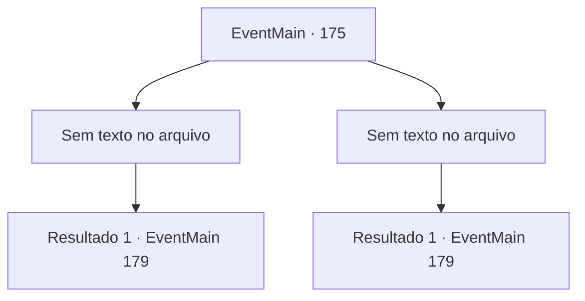

# Eventos principais · 175

[Índice da tabela](index.md) · [Índice geral](../index.md)

ID: `pt:EventMain:175` · Fonte: `EventMain4` · Versão: 1.2.47.

Mapeamento estático dos arquivos; a disponibilidade e a execução dependem do estado da run.

## Texto do evento

*Sem texto no arquivo.*

## Dados de entrada

```json
{
  "id": 175,
  "grade": 1,
  "normalGoal": "",
  "required": ""
}
```

## Mapa das escolhas



## Escolhas e resultados

### Escolha 1

*Sem texto no arquivo; o papel dessa opção depende da interface do jogo.*

Requisitos e outros campos da escolha:

```json
{
  "required": ""
}
```

#### Resultado 1.1

Você derruba os fanáticos. Edmond também o fez, e já está desencantando a multidão que ora. Quando Edmond desfaz o feitiço, eles começam a cair no chão um por um. 

 "Eles adormeceram. Ela os privou de energia. Vá em frente. Vou levar essas pessoas de volta à cidade."

 Edmond começa a desenhar um círculo mágico gigante no chão. Você o deixa com isso e continua mais na caverna. A caverna se torna maior à medida que você viaja para dentro, e o fedor piora a cada passo. Então você sente algo à frente. Você aperta os olhos e vê algo colossal parado no escuro.

Continuação registrada: [Evento 179](0179.md) na mesma tabela.

```json
{
  "required": "",
  "chance": "1",
  "nextEvent": 179,
  "type": 2,
  "reward": "5_85_1"
}
```

### Escolha 2

*Sem texto no arquivo; o papel dessa opção depende da interface do jogo.*

Requisitos e outros campos da escolha:

```json
{
  "required": ""
}
```

#### Resultado 2.1

Edmond salva você dos fanáticos bem a tempo. 

 "Bom trabalho. Vou desencantar essas pessoas agora."

 Edmond começa a trabalhar na multidão encantada e orando. Você o deixa com isso e continua mais na caverna. A caverna se torna maior à medida que você viaja para dentro, e o fedor piora a cada passo. Então você sente algo à frente. Você aperta os olhos e vê algo colossal parado no escuro.

Continuação registrada: [Evento 179](0179.md) na mesma tabela.

```json
{
  "required": "",
  "chance": "1",
  "nextEvent": 179,
  "type": 2,
  "reward": "5_85_1"
}
```

## Referências que chegam a este evento

- [Evento 174 · escolha 2 · resultado 1](0174.md#escolha-2)
