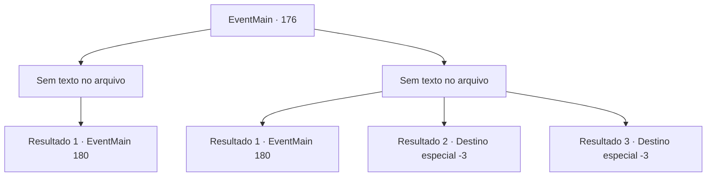

# Eventos principais · 176

[Índice da tabela](index.md) · [Índice geral](../index.md)

ID: `pt:EventMain:176` · Fonte: `EventMain4` · Versão: 1.2.47.

Mapeamento estático dos arquivos; a disponibilidade e a execução dependem do estado da run.

## Texto do evento

*Sem texto no arquivo.*

## Dados de entrada

```json
{
  "id": 176,
  "grade": 1,
  "normalGoal": "",
  "required": ""
}
```

## Mapa das escolhas



## Escolhas e resultados

### Escolha 1

*Sem texto no arquivo; o papel dessa opção depende da interface do jogo.*

Requisitos e outros campos da escolha:

```json
{
  "required": ""
}
```

#### Resultado 1.1

Você derrota todos os fanáticos. Então você começa a desencantar a multidão que ora. Um por um, eles mergulham em um sono há muito necessário enquanto caem no chão. Eles parecem estar drenados de sua energia. Você os deixa e segue Edmond mais fundo na caverna. Você o encontra lutando contra uma bolha gigante de carne. Ele está feliz em ver você. 

 "Você está aqui! Ajude-me com essa coisa horrível, sim?"


Continuação registrada: [Evento 180](0180.md) na mesma tabela.

```json
{
  "required": "",
  "chance": "1",
  "nextEvent": 180,
  "type": 2,
  "reward": ""
}
```

### Escolha 2

*Sem texto no arquivo; o papel dessa opção depende da interface do jogo.*

Requisitos e outros campos da escolha:

```json
{
  "required": ""
}
```

#### Resultado 2.1

Os fanáticos batem em você e você escapa ainda mais para dentro do cabo. Você espera que Edmond te ajude, mas ele está lutando contra uma bolha gigante de carne. Os fanáticos usam sorrisos maliciosos quando se aproximam de você. De repente, a bolha gigante bate seu punho neles. Em seguida, absorva seus restos polpudos. Edmond grita com você desesperadamente. 

 "Não fique aído, me ajude com essa coisa horrível!"


Continuação registrada: [Evento 180](0180.md) na mesma tabela.

```json
{
  "required": "1_0_2|1_1_2",
  "chance": "1",
  "nextEvent": 180,
  "type": 2,
  "reward": "0_0_-1|0_1_-1|0_2_1"
}
```

#### Resultado 2.2

Os fanáticos tiram sua vida.

Continuação registrada: [Destino especial `-3`](../destinos-especiais.md).

```json
{
  "required": "2_0_2",
  "chance": "1",
  "nextEvent": -3,
  "type": 2,
  "reward": "0_0_-1|0_1_-1"
}
```

#### Resultado 2.3

Os fanáticos tiram sua vida.

Continuação registrada: [Destino especial `-3`](../destinos-especiais.md).

```json
{
  "required": "2_1_2",
  "chance": "1",
  "nextEvent": -3,
  "type": 2,
  "reward": "0_0_-1|0_1_-1"
}
```

## Referências que chegam a este evento

- [Evento 174 · escolha 1 · resultado 1](0174.md#escolha-1)
