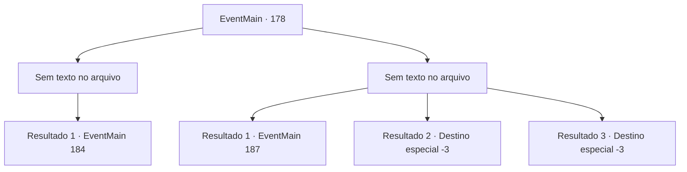

# Eventos principais · 178

[Índice da tabela](index.md) · [Índice geral](../index.md)

ID: `pt:EventMain:178` · Fonte: `EventMain4` · Versão: 1.2.47.

Mapeamento estático dos arquivos; a disponibilidade e a execução dependem do estado da run.

## Texto do evento

*Sem texto no arquivo.*

## Dados de entrada

```json
{
  "id": 178,
  "grade": 1,
  "normalGoal": "",
  "required": ""
}
```

## Mapa das escolhas



## Escolhas e resultados

### Escolha 1

*Sem texto no arquivo; o papel dessa opção depende da interface do jogo.*

Requisitos e outros campos da escolha:

```json
{
  "required": ""
}
```

#### Resultado 1.1

Você derrota o fanático de Halad. Edmond também está vencendo sua batalha contra Halad. Ela levanta e amaldiçoa enquanto luta de volta. 

 "Seu pedaço de merda inútil! Agora eu não tenho escolha a não ser-"

 Ela se teletransporta para o topo do colosso de carne. Então ela se torna um com ele. Seu grito perfura seus ouvidos. 

 "Eu vou esmagar vocês dois!!"

 O colosso fica de pé, ventos de fedor entorpecente soprando em todas as direções. Edmond explica a você sobre a fera por trás. 

 "Um colosso é imune à maioria das magias. Você precisa distraí-lo para mim enquanto eu preparo um longo feitiço."


Continuação registrada: [Evento 184](0184.md) na mesma tabela.

```json
{
  "required": "",
  "chance": "1",
  "nextEvent": 184,
  "type": 2,
  "reward": "6_0_83",
  "place": 6
}
```

### Escolha 2

*Sem texto no arquivo; o papel dessa opção depende da interface do jogo.*

Requisitos e outros campos da escolha:

```json
{
  "required": ""
}
```

#### Resultado 2.1

O fanático de Halad bate em você. Você cai no chão e ele se vira para atacar Edmond. De repente, você ouve a voz de Edmond em sua cabeça. 

 "Mana está fluindo daquela porta nos fundos. Halad perderá seus poderes se você se livrar de sua fonte. Eu cuido dessa bagunça, você entra naquela sala e a destrói."

 Você olha para cima e encontra uma porta com luz vindo de dentro. Você se esgueira para dentro antes que Halad e o Zealot percebam. |drawing_forbidenBook| Dentro da pequena sala há uma escrivaninha e cadeira de madeira, uma pequena vela e um livro aberto velho e surrado. Você imediatamente o reconhece como o texto proibido de Halad. Você está prestes a rasgá-lo quando ele começa a falar. 

 "Espere! Por favor, não me mate! Eu... eu não fiz nada, fui manipulado! S-poupe-me e eu lhe darei poder!"

 Você sente que o livro contém as almas de todos os encantados por Halad.

Continuação registrada: [Evento 187](0187.md) na mesma tabela.

```json
{
  "required": "1_0_2|1_1_2",
  "chance": "1",
  "nextEvent": 187,
  "type": 2,
  "reward": "0_0_-1|0_1_-1|0_2_1"
}
```

#### Resultado 2.2

O fanático tira sua vida.

Continuação registrada: [Destino especial `-3`](../destinos-especiais.md).

```json
{
  "required": "2_0_2",
  "chance": "1",
  "nextEvent": -3,
  "type": 2,
  "reward": "0_0_-1|0_1_-1"
}
```

#### Resultado 2.3

O fanático tira sua vida.

Continuação registrada: [Destino especial `-3`](../destinos-especiais.md).

```json
{
  "required": "2_1_2",
  "chance": "1",
  "nextEvent": -3,
  "type": 2,
  "reward": "0_0_-1|0_1_-1"
}
```

## Referências que chegam a este evento

- [Evento 177 · escolha 1 · resultado 1](0177.md#escolha-1)
- [Evento 177 · escolha 1 · resultado 3](0177.md#escolha-1)
- [Evento 177 · escolha 1 · resultado 4](0177.md#escolha-1)
- [Evento 177 · escolha 2 · resultado 1](0177.md#escolha-2)
- [Evento 177 · escolha 2 · resultado 3](0177.md#escolha-2)
- [Evento 177 · escolha 2 · resultado 4](0177.md#escolha-2)
- [Evento 181 · escolha 1 · resultado 1](0181.md#escolha-1)
- [Evento 181 · escolha 2 · resultado 1](0181.md#escolha-2)
- [Evento 181 · escolha 2 · resultado 2](0181.md#escolha-2)
