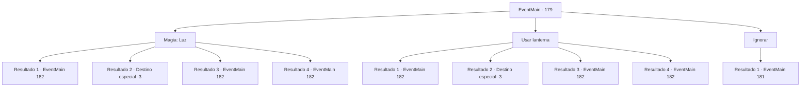

# Eventos principais · 179

[Índice da tabela](index.md) · [Índice geral](../index.md)

ID: `pt:EventMain:179` · Fonte: `EventMain4` · Versão: 1.2.47.

Mapeamento estático dos arquivos; a disponibilidade e a execução dependem do estado da run.

## Texto do evento

*Sem texto no arquivo.*

## Dados de entrada

```json
{
  "id": 179,
  "grade": 1,
  "normalGoal": "",
  "required": ""
}
```

## Mapa das escolhas



## Escolhas e resultados

### Escolha 1

Magia: Luz

Requisitos e outros campos da escolha:

```json
{
  "required": "20_0_1"
}
```

#### Resultado 1.1

Você produz uma bola de luz brilhante para dar uma olhada melhor na bolha. |drawing_colossalFlesh| É um colosso de carne feito dos cadáveres de centenas. Está inacabado, no entanto, e você pode ver que está faltando a cabeça, o ombro esquerdo e o braço. Incontáveis ​​batimentos cardíacos enchem seus tímpanos. Tantos rostos vazios pendem de sua pele esfarrapada. Cheira como a própria morte. 

 Você cai no chão, dominado pelo terror. Então você ouve uma voz familiar. 

 "O que...? Como diabos você chegou aqui?"

 Halad emerge de trás do colosso. Ela ordena que um de seus seguidores cuide de você. 

 "Como aquele idiota chegou até aqui, vá cuidar disso agora!"

 O fanático ataca você, olhos esbugalhados e cegos.

Continuação registrada: [Evento 182](0182.md) na mesma tabela.

```json
{
  "required": "1_1_2",
  "chance": "20",
  "nextEvent": 182,
  "type": 1,
  "reward": "0_1_-1|6_3_71",
  "place": 6
}
```

#### Resultado 1.2

Você produz uma bola de luz brilhante para dar uma olhada melhor na bolha. |drawing_colossalFlesh| É um colosso de carne feito dos cadáveres de centenas. Está inacabado, no entanto, e você pode ver que está faltando a cabeça, o ombro esquerdo e o braço. Incontáveis ​​batimentos cardíacos enchem seus tímpanos. Tantos rostos vazios pendem de sua pele esfarrapada. Cheira como a própria morte. 

 Você aperta o peito e cai no chão, tomado pelo terror. Lentamente, você se afasta da realidade.

Continuação registrada: [Destino especial `-3`](../destinos-especiais.md).

```json
{
  "required": "2_1_2",
  "chance": "20",
  "nextEvent": -3,
  "type": 1,
  "reward": "0_1_-1"
}
```

#### Resultado 1.3

Você produz uma bola de luz brilhante para dar uma olhada melhor na bolha. |drawing_colossalFlesh| É um colosso de carne feito dos cadáveres de centenas. Está inacabado, no entanto, e você pode ver que está faltando a cabeça, o ombro esquerdo e o braço. Incontáveis ​​batimentos cardíacos enchem seus tímpanos. Tantos rostos vazios pendem de sua pele esfarrapada. Cheira como a própria morte. 

 Você olha diretamente para ele, apesar de seus olhares horripilantes. Fica parado, como um autômato sem fonte de energia. Então você ouve uma voz familiar. 

 "O que...? Como diabos você chegou aqui?"

 Halad emerge de trás do colosso. Ela ordena que um de seus seguidores cuide de você. 

 "Como aquele idiota chegou até aqui, vá cuidar disso agora!"

 O fanático ataca você, olhos esbugalhados e cegos.

Continuação registrada: [Evento 182](0182.md) na mesma tabela.

```json
{
  "required": "",
  "chance": "1|0_14_1",
  "nextEvent": 182,
  "type": 0,
  "reward": "6_3_71",
  "place": 6
}
```

#### Resultado 1.4

Você produz uma bola de luz brilhante para dar uma olhada melhor na bolha. |drawing_colossalFlesh| É um colosso de carne feito dos cadáveres de centenas. Está inacabado, no entanto, e você pode ver que está faltando a cabeça, o ombro esquerdo e o braço. Incontáveis ​​batimentos cardíacos enchem seus tímpanos. Tantos rostos vazios pendem de sua pele esfarrapada. Cheira como a própria morte. 

 Você olha diretamente para ele, apesar de seus olhares horripilantes. Fica parado, como um autômato sem fonte de energia. Então você ouve uma voz familiar. 

 "O que...? Como diabos você chegou aqui?"

 Halad emerge de trás do colosso. Ela ordena que um de seus seguidores cuide de você. 

 "Como aquele idiota chegou até aqui, vá cuidar disso agora!"

 O fanático ataca você, olhos esbugalhados e cegos.

Continuação registrada: [Evento 182](0182.md) na mesma tabela.

```json
{
  "required": "20_2_2",
  "chance": "1|0_14_1",
  "nextEvent": 182,
  "type": 0,
  "reward": "6_3_71",
  "place": 6
}
```

### Escolha 2

Usar lanterna

Requisitos e outros campos da escolha:

```json
{
  "required": "8_42_1"
}
```

#### Resultado 2.1

Você acende sua lanterna para dar uma olhada melhor na bolha. |drawing_colossalFlesh| É um colosso de carne feito dos cadáveres de centenas. Está inacabado, no entanto, e você pode ver que está faltando a cabeça, o ombro esquerdo e o braço. Incontáveis ​​batimentos cardíacos enchem seus tímpanos. Tantos rostos vazios pendem de sua pele esfarrapada. Cheira como a própria morte. 

 Você cai no chão, dominado pelo terror. Então você ouve uma voz familiar. 

 "O que...? Como diabos você chegou aqui?"

 Halad emerge de trás do colosso. Ela ordena que um de seus seguidores cuide de você. 

 "Como aquele idiota chegou até aqui, vá cuidar disso agora!"

 O fanático ataca você, olhos esbugalhados e cegos.

Continuação registrada: [Evento 182](0182.md) na mesma tabela.

```json
{
  "required": "1_1_2",
  "chance": "20",
  "nextEvent": 182,
  "type": 1,
  "reward": "0_1_-1|6_3_71",
  "place": 6
}
```

#### Resultado 2.2

Você acende sua lanterna para dar uma olhada melhor na bolha. |drawing_colossalFlesh| É um colosso de carne feito dos cadáveres de centenas. Está inacabado, no entanto, e você pode ver que está faltando a cabeça, o ombro esquerdo e o braço. Incontáveis ​​batimentos cardíacos enchem seus tímpanos. Tantos rostos vazios pendem de sua pele esfarrapada. Cheira como a própria morte. 

 Você aperta o peito e cai no chão, tomado pelo terror. Lentamente, você se afasta da realidade.

Continuação registrada: [Destino especial `-3`](../destinos-especiais.md).

```json
{
  "required": "2_1_2",
  "chance": "20",
  "nextEvent": -3,
  "type": 1,
  "reward": "0_1_-1"
}
```

#### Resultado 2.3

Você acende sua lanterna para dar uma olhada melhor na bolha. |drawing_colossalFlesh| É um colosso de carne feito dos cadáveres de centenas. Está inacabado, no entanto, e você pode ver que está faltando a cabeça, o ombro esquerdo e o braço. Incontáveis ​​batimentos cardíacos enchem seus tímpanos. Tantos rostos vazios pendem de sua pele esfarrapada. Cheira como a própria morte. 

 Você olha diretamente para ele, apesar de seus olhares horripilantes. Fica parado, como um autômato sem fonte de energia. Então você ouve uma voz familiar. 

 "O que...? Como diabos você chegou aqui?"

 Halad emerge de trás do colosso. Ela ordena que um de seus seguidores cuide de você. 

 "Como aquele idiota chegou até aqui, vá cuidar disso agora!"

 O fanático ataca você, olhos esbugalhados e cegos.

Continuação registrada: [Evento 182](0182.md) na mesma tabela.

```json
{
  "required": "",
  "chance": "1|0_14_1",
  "nextEvent": 182,
  "type": 0,
  "reward": "6_3_71",
  "place": 6
}
```

#### Resultado 2.4

Você acende sua lanterna para dar uma olhada melhor na bolha. |drawing_colossalFlesh| É um colosso de carne feito dos cadáveres de centenas. Está inacabado, no entanto, e você pode ver que está faltando a cabeça, o ombro esquerdo e o braço. Incontáveis ​​batimentos cardíacos enchem seus tímpanos. Tantos rostos vazios pendem de sua pele esfarrapada. Cheira como a própria morte. 

 Você olha diretamente para ele, apesar de seus olhares horripilantes. Fica parado, como um autômato sem fonte de energia. Então você ouve uma voz familiar. 

 "O que...? Como diabos você chegou aqui?"

 Halad emerge de trás do colosso. Ela ordena que um de seus seguidores cuide de você. 

 "Como aquele idiota chegou até aqui, vá cuidar disso agora!"

 O fanático ataca você, olhos esbugalhados e cegos.

Continuação registrada: [Evento 182](0182.md) na mesma tabela.

```json
{
  "required": "20_2_2",
  "chance": "1|0_14_1",
  "nextEvent": 182,
  "type": 0,
  "reward": "6_3_71",
  "place": 6
}
```

### Escolha 3

Ignorar

Requisitos e outros campos da escolha:

```json
{
  "required": ""
}
```

#### Resultado 3.1

Você ignora a bolha gigante e passa por ela. Mais para dentro, você encontra uma porta com luz vindo de dentro. Você ouve as pessoas falando. Embora você não consiga distinguir os detalhes, você tem certeza de que um deles é Halad.

Continuação registrada: [Evento 181](0181.md) na mesma tabela.

```json
{
  "required": "",
  "chance": "1",
  "nextEvent": 181,
  "type": 2,
  "reward": ""
}
```

## Referências que chegam a este evento

- [Evento 175 · escolha 1 · resultado 1](0175.md#escolha-1)
- [Evento 175 · escolha 2 · resultado 1](0175.md#escolha-2)
- [Evento 201 · escolha 2 · resultado 1](0201.md#escolha-2)
