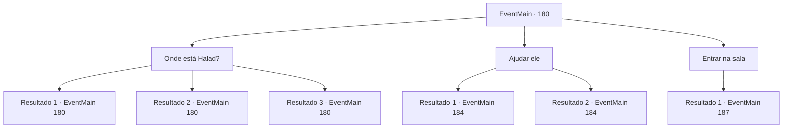

# Eventos principais · 180

[Índice da tabela](index.md) · [Índice geral](../index.md)

ID: `pt:EventMain:180` · Fonte: `EventMain4` · Versão: 1.2.47.

Mapeamento estático dos arquivos; a disponibilidade e a execução dependem do estado da run.

## Texto do evento

*Sem texto no arquivo.*

## Dados de entrada

```json
{
  "id": 180,
  "grade": 1,
  "normalGoal": "",
  "required": ""
}
```

## Mapa das escolhas



## Escolhas e resultados

### Escolha 1

Onde está Halad?

Requisitos e outros campos da escolha:

```json
{
  "required": "5_86_0"
}
```

#### Resultado 1.1

O presidente responde entre seus feitiços. 

 "Halad... está dentro daquele colosso."

 Sua mente está focada em evitar seus golpes.

Continuação registrada: [Evento 180](0180.md) na mesma tabela.

```json
{
  "required": "10_111_1",
  "chance": "1",
  "nextEvent": 180,
  "type": 2,
  "reward": "5_86_1"
}
```

#### Resultado 1.2

O presidente responde entre seus feitiços. 

 "Halad... está dentro daquele colosso."

 Sua mente está focada em evitar seus golpes. Então sua varinha aponta algo. 

 "Vê aquela porta ali? Mana está fluindo por trás dele e para aquela bola-cadáver. Vamos conferir. O velho pode definitivamente se defender."


Continuação registrada: [Evento 180](0180.md) na mesma tabela.

```json
{
  "required": "8_111_1|18_80_3",
  "chance": "1",
  "nextEvent": 180,
  "type": 2,
  "reward": "5_86_1"
}
```

#### Resultado 1.3

O presidente responde entre seus feitiços. 

 "Halad... está dentro daquele colosso."

 Sua mente está focada em evitar seus golpes. Então sua varinha aponta algo. 

 "Vê aquela porta ali, meu senhor? Mana está fluindo por trás dele e para aquela bola-cadáver. Temos que destruir a fonte de mana. O velho pode definitivamente se defender."


Continuação registrada: [Evento 180](0180.md) na mesma tabela.

```json
{
  "required": "8_111_1|5_80_3",
  "chance": "1",
  "nextEvent": 180,
  "type": 2,
  "reward": "5_86_1"
}
```

### Escolha 2

Ajudar ele

Requisitos e outros campos da escolha:

```json
{
  "required": ""
}
```

#### Resultado 2.1

Você decide ajudar o presidente encurralado. Ao sacar sua arma, você ouve a voz dele dentro de sua cabeça. 

 "Um colosso é imune à maioria das magias. Você precisa distraí-lo para mim enquanto eu preparo um longo feitiço."


Continuação registrada: [Evento 184](0184.md) na mesma tabela.

```json
{
  "required": "18_80_4",
  "chance": "1",
  "nextEvent": 184,
  "type": 2,
  "reward": "6_0_83",
  "place": 6
}
```

#### Resultado 2.2

Você decide ajudar o presidente encurralado. Ao sacar sua arma, você ouve a voz dele dentro de sua cabeça. 

 "Um colosso é imune à maioria das magias. Você precisa distraí-lo para mim enquanto eu preparo um longo feitiço."

 Sua varinha mostra a língua para você. 

 "Eu vou sair. Até logo, tolo!"

 Com isso, desaparece.

Continuação registrada: [Evento 184](0184.md) na mesma tabela.

```json
{
  "required": "8_111_1|5_80_4",
  "chance": "1",
  "nextEvent": 184,
  "type": 2,
  "reward": "6_0_83|4_111_1",
  "place": 6
}
```

### Escolha 3

Entrar na sala

Requisitos e outros campos da escolha:

```json
{
  "required": "5_86_1"
}
```

#### Resultado 3.1

Você deixa o presidente encurralado para trás e entra na sala que irradia mana. Surpreso, Halad balança o punho do colosso para você, mas o presidente bloqueia com sua barreira. Ele parece entender o que você está tentando fazer. Sua voz fumega de raiva enquanto ele grita. 

 "Você ousa tirar os olhos de mim em uma briga, Halad?"

 Você consegue entrar na sala com sucesso. |drawing_forbidenBook| Dentro da pequena sala há uma escrivaninha e cadeira de madeira, uma pequena vela e um livro aberto velho e surrado. Você imediatamente o reconhece como o texto proibido de Halad. Você está prestes a rasgá-lo quando ele começa a falar. 

 "Espere! Por favor, não me mate! Eu... eu não fiz nada, fui manipulado! S-poupe-me e eu lhe darei poder!"

 Você sente que o livro contém as almas de todos os encantados por Halad.

Continuação registrada: [Evento 187](0187.md) na mesma tabela.

```json
{
  "required": "",
  "chance": "1",
  "nextEvent": 187,
  "type": 2,
  "reward": ""
}
```

## Referências que chegam a este evento

- [Evento 176 · escolha 1 · resultado 1](0176.md#escolha-1)
- [Evento 176 · escolha 2 · resultado 1](0176.md#escolha-2)
- [Evento 180 · escolha 1 · resultado 1](0180.md#escolha-1)
- [Evento 180 · escolha 1 · resultado 2](0180.md#escolha-1)
- [Evento 180 · escolha 1 · resultado 3](0180.md#escolha-1)
