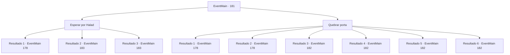

# Eventos principais · 181

[Índice da tabela](index.md) · [Índice geral](../index.md)

ID: `pt:EventMain:181` · Fonte: `EventMain4` · Versão: 1.2.47.

Mapeamento estático dos arquivos; a disponibilidade e a execução dependem do estado da run.

## Texto do evento

*Sem texto no arquivo.*

## Dados de entrada

```json
{
  "id": 181,
  "grade": 1,
  "normalGoal": "",
  "required": ""
}
```

## Mapa das escolhas



## Escolhas e resultados

### Escolha 1

Esperar por Halad

Requisitos e outros campos da escolha:

```json
{
  "required": ""
}
```

#### Resultado 1.1

Você e Edmond prendem a respiração e esperam Halad sair. Momentos depois, a porta se abre e sai Halad e um de seus seguidores. Ela imediatamente lança uma bola de fogo em você. Edmond suspira e a bloqueia com sua barreira. Seus feitiços se desfazem. 

 "Muito mesquinho da sua parte, Sr. Presidente, se esconder em um canto assim com um feitiço de invisibilidade em você. Oh, olá, fracote anônimo."

 Ela ordena que seu seguidor cuide de você. 

 "Vá tirar aquele idiota ali. Eu preciso me divertir com o presidente."

 O fanático ataca você, olhos esbugalhados e cegos.

Continuação registrada: [Evento 178](0178.md) na mesma tabela.

```json
{
  "required": "18_85_1|18_93_1",
  "chance": "1",
  "nextEvent": 178,
  "type": 2,
  "reward": "6_3_71",
  "place": 6
}
```

#### Resultado 1.2

Você prende a respiração e espera Halad sair. Momentos depois, a porta se abre e sai Halad e um de seus seguidores. Ela imediatamente joga uma bola de fogo em você.

Continuação registrada: [Evento 183](0183.md) na mesma tabela.

```json
{
  "required": "5_85_1",
  "chance": "1",
  "nextEvent": 183,
  "type": 2,
  "reward": ""
}
```

#### Resultado 1.3

Você prende a respiração e espera Halad sair. Momentos depois, a porta se abre e sai Halad e um de seus seguidores. Ela imediatamente joga uma bola de fogo em você.

Continuação registrada: [Evento 183](0183.md) na mesma tabela.

```json
{
  "required": "5_93_1",
  "chance": "1",
  "nextEvent": 183,
  "type": 2,
  "reward": ""
}
```

### Escolha 2

Quebrar porta

Requisitos e outros campos da escolha:

```json
{
  "required": ""
}
```

#### Resultado 2.1

Você tenta chutar a porta de madeira. Mas, em vez de quebrar, ele o faz voar para trás. Momentos depois, a porta se abre e sai Halad e um de seus seguidores. 

 "O que traz isso longe, Sr. Presidente? Oh, olá, fracote anônimo."

 Ela ordena que seu seguidor cuide de você. 

 "Vá tirar aquele idiota ali. Eu preciso me divertir com o presidente."

 O fanático ataca você, olhos esbugalhados e cegos.

Continuação registrada: [Evento 178](0178.md) na mesma tabela.

```json
{
  "required": "18_85_1",
  "chance": "10",
  "nextEvent": 178,
  "type": 1,
  "reward": "6_3_71",
  "place": 6
}
```

#### Resultado 2.2

Você chuta a porta de madeira. Ele se estilhaça sob o peso de seu golpe. Você só vê Halad na pequena sala. 

 "O que o traz até aqui, Sr. Presidente? Oh, olá, fracote anônimo."

 Ela grita uma ordem para alguém cuidar de você. 

 "Vá tirar aquele idiota ali. Eu preciso me divertir com o presidente."

 Um fanático surge debaixo dos restos da porta. Ele ataca você, o nariz sangrando como uma fonte.

Continuação registrada: [Evento 178](0178.md) na mesma tabela.

```json
{
  "required": "18_85_1",
  "chance": "1|0_5_1",
  "nextEvent": 178,
  "type": 0,
  "reward": "6_2_71",
  "place": 6
}
```

#### Resultado 2.3

Você tenta chutar a porta de madeira. Mas, em vez de quebrar, ele o faz voar para trás. Momentos depois, a porta se abre e sai Halad e um de seus seguidores. 

 "O que...? Como diabos você chegou aqui?"

 Ela ordena que seu seguidor cuide de você. 

 "Vá tirar aquele intruso, agora."

 O fanático ataca você, olhos esbugalhados e cegos.

Continuação registrada: [Evento 182](0182.md) na mesma tabela.

```json
{
  "required": "5_85_1",
  "chance": "10",
  "nextEvent": 182,
  "type": 1,
  "reward": "6_3_71",
  "place": 6
}
```

#### Resultado 2.4

Você chuta a porta de madeira. Ele se estilhaça sob o peso de seu golpe. Você só vê Halad na pequena sala. 

 "O que...? Como diabos você chegou aqui?"

 Ela grita uma ordem para alguém cuidar de você. 

 "Vá tirar aquele intruso, agora."

 Um fanático surge debaixo dos restos da porta. Ele ataca você, o nariz sangrando como uma fonte.

Continuação registrada: [Evento 182](0182.md) na mesma tabela.

```json
{
  "required": "5_85_1",
  "chance": "1|0_5_1",
  "nextEvent": 182,
  "type": 0,
  "reward": "6_2_71",
  "place": 6
}
```

#### Resultado 2.5

Você tenta chutar a porta de madeira. Mas, em vez de quebrar, ele o faz voar para trás. Momentos depois, a porta se abre e sai Halad e um de seus seguidores. 

 "O que...? Como diabos você chegou aqui?"

 Ela ordena que seu seguidor cuide de você. 

 "Vá tirar aquele intruso, agora."

 O fanático ataca você, olhos esbugalhados e cegos.

Continuação registrada: [Evento 182](0182.md) na mesma tabela.

```json
{
  "required": "5_93_1",
  "chance": "10",
  "nextEvent": 182,
  "type": 1,
  "reward": "6_3_71",
  "place": 6
}
```

#### Resultado 2.6

Você chuta a porta de madeira. Ele se estilhaça sob o peso de seu golpe. Você só vê Halad na pequena sala. 

 "O que...? Como diabos você chegou aqui?"

 Ela grita uma ordem para alguém cuidar de você. 

 "Vá tirar aquele intruso, agora."

 Um fanático surge debaixo dos restos da porta. Ele ataca você, o nariz sangrando como uma fonte.

Continuação registrada: [Evento 182](0182.md) na mesma tabela.

```json
{
  "required": "5_93_1",
  "chance": "1|0_5_1",
  "nextEvent": 182,
  "type": 0,
  "reward": "6_2_71",
  "place": 6
}
```

## Referências que chegam a este evento

- [Evento 177 · escolha 3 · resultado 1](0177.md#escolha-3)
- [Evento 179 · escolha 3 · resultado 1](0179.md#escolha-3)
