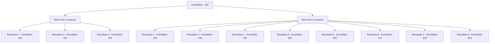

# Eventos principais · 182

[Índice da tabela](index.md) · [Índice geral](../index.md)

ID: `pt:EventMain:182` · Fonte: `EventMain4` · Versão: 1.2.47.

Mapeamento estático dos arquivos; a disponibilidade e a execução dependem do estado da run.

## Texto do evento

*Sem texto no arquivo.*

## Dados de entrada

```json
{
  "id": 182,
  "grade": 1,
  "normalGoal": "",
  "required": ""
}
```

## Mapa das escolhas



## Escolhas e resultados

### Escolha 1

*Sem texto no arquivo; o papel dessa opção depende da interface do jogo.*

Requisitos e outros campos da escolha:

```json
{
  "required": ""
}
```

#### Resultado 1.1

Você derrota o fanático de Halad. Halad geme e pragueja, as veias em sua testa latejando enquanto ela o faz. 

 "Seu pedaço de merda inútil! Agora tenho que sujar minhas próprias mãos..."

 Ela aponta sua varinha para você. De repente, Edmond emerge de um portal próximo. Halad se teletransporta para o topo do colosso de carne. Então ela se torna um com ele. Seu grito perfura seus ouvidos. 

 "Eu não queria fazer isso, mas vou ter que esmagar vocês dois!!"

 O colosso fica de pé, ventos de fedor entorpecente soprando em todas as direções. Edmond explica a você sobre a fera por trás. 

 "Um colosso é imune à maioria das magias. Você precisa distraí-lo para mim enquanto eu preparo um longo feitiço."


Continuação registrada: [Evento 184](0184.md) na mesma tabela.

```json
{
  "required": "18_80_4",
  "chance": "1",
  "nextEvent": 184,
  "type": 2,
  "reward": "6_0_83",
  "place": 6
}
```

#### Resultado 1.2

Você derrota o fanático de Halad. Halad geme e pragueja, as veias em sua testa latejando enquanto ela o faz. 

 "Seu pedaço de merda inútil! Agora tenho que sujar minhas próprias mãos..."

 Ela aponta sua varinha para você. De repente, Edmond emerge de um portal próximo. Halad se teletransporta para o topo do colosso de carne. Então ela se torna um com ele. Seu grito perfura seus ouvidos. 

 "Eu não queria fazer isso, mas vou ter que esmagar vocês dois!!"

 O colosso fica de pé, ventos de fedor entorpecente soprando em todas as direções. Edmond explica a você sobre a fera por trás. 

 "Um colosso é imune à maioria das magias. Você precisa distraí-lo para mim enquanto eu preparo um longo feitiço."

 Sua varinha mostra a língua para você. 

 "Eu vou sair. Até logo, tolo!"

 Com isso, desaparece.

Continuação registrada: [Evento 184](0184.md) na mesma tabela.

```json
{
  "required": "8_111_1|5_80_4",
  "chance": "1",
  "nextEvent": 184,
  "type": 2,
  "reward": "6_0_83|4_111_1",
  "place": 6
}
```

#### Resultado 1.3

Você derrota o fanático de Halad. Halad geme e pragueja, as veias em sua testa latejando enquanto ela o faz. 

 "Seu pedaço de merda inútil! Agora tenho que sujar minhas próprias mãos..."

 Ela aponta sua varinha para você. De repente, Edmond emerge de um portal próximo. Halad se teletransporta para o topo do colosso de carne. Então ela se torna um com ele. Seu grito perfura seus ouvidos. 

 "Eu não queria fazer isso, mas vou ter que esmagar vocês dois!!"

 O colosso fica de pé, ventos de fedor entorpecente soprando em todas as direções. Edmond explica a você sobre a fera por trás. 

 "Um colosso é imune à maioria das magias. Você precisa distraí-lo para mim enquanto eu preparo um longo feitiço."


Continuação registrada: [Evento 184](0184.md) na mesma tabela.

```json
{
  "required": "10_111_1",
  "chance": "1",
  "nextEvent": 184,
  "type": 2,
  "reward": "6_0_83",
  "place": 6
}
```

### Escolha 2

*Sem texto no arquivo; o papel dessa opção depende da interface do jogo.*

Requisitos e outros campos da escolha:

```json
{
  "required": ""
}
```

#### Resultado 2.1

O fanático de Halad bate em você. Ela sorri ao se aproximar de você. 

 "Ah, agora eu me lembro. Eu vou te mostrar o que acontece com as pessoas que ficam no meu caminho, {1}..."

 Ela aponta sua varinha em seu rosto e lança um feitiço. 

 "Ajoelhe-se diante de mim. Dominato Geass!"

 O feitiço te atinge, mas você não sente nada. Assim que você está começando a se perguntar o que está acontecendo, sua varinha sussurra para você. 

 "Eu, uh... desfiz. Apenas finja que você ainda está encantado."

 Halad ordena que você se deite de costas como um cachorro para verificar se seu feitiço funcionou.

Continuação registrada: [Evento 190](0190.md) na mesma tabela.

```json
{
  "required": "1_0_2|1_1_2|8_111_1|18_80_4",
  "chance": "1",
  "nextEvent": 190,
  "type": 2,
  "reward": "0_0_-1|0_1_-1|0_2_1"
}
```

#### Resultado 2.2

O fanático de Halad bate em você. Ela sorri ao se aproximar de você. 

 "Ah, agora eu me lembro. Eu vou te mostrar o que acontece com as pessoas que ficam no meu caminho, {1}..."

 Ela aponta sua varinha em seu rosto e lança um feitiço. 

 "Ajoelhe-se diante de mim. Dominato Geass!"

 O feitiço te atinge, mas você não sente nada. Assim que você está começando a se perguntar o que está acontecendo, sua varinha sussurra para você. 

 "Eu desfiz, senhor. Eu aconselho você fingir que ainda está encantado."

 Halad ordena que você se deite de costas como um cachorro para verificar se seu feitiço funcionou.

Continuação registrada: [Evento 190](0190.md) na mesma tabela.

```json
{
  "required": "1_0_2|1_1_2|8_111_1|5_80_3",
  "chance": "1",
  "nextEvent": 190,
  "type": 2,
  "reward": "0_0_-1|0_1_-1|0_2_1"
}
```

#### Resultado 2.3

O fanático de Halad bate em você. Ela sorri ao se aproximar de você. 

 "Ah, agora eu me lembro. Eu vou te mostrar o que acontece com as pessoas que ficam no meu caminho, {1}..."

 Ela aponta sua varinha em seu rosto e lança um feitiço. 

 "Ajoelhe-se diante de mim. Dominato Geass!"

 O feitiço te atinge, mas você não sente nada, porque você tinha uma resistência à magia. Halad ordena que você se deite de costas como um cachorro para verificar se seu feitiço funcionou.

Continuação registrada: [Evento 190](0190.md) na mesma tabela.

```json
{
  "required": "1_0_2|1_1_2|5_80_4|23_7_1",
  "chance": "1",
  "nextEvent": 190,
  "type": 2,
  "reward": "0_0_-1|0_1_-1|0_2_1"
}
```

#### Resultado 2.4

O fanático de Halad bate em você. Ela sorri ao se aproximar de você. 

 "Ah, agora eu me lembro. Eu vou te mostrar o que acontece com as pessoas que ficam no meu caminho, {1}..."

 Ela aponta sua varinha em seu rosto e lança um feitiço. 

 "Ajoelhe-se diante de mim. Dominato Geass!"


Continuação registrada: [Evento 832](0832.md) na mesma tabela.

```json
{
  "required": "1_0_2|1_1_2|5_80_4|21_55_1|24_7_1",
  "chance": "1",
  "nextEvent": 832,
  "type": 2,
  "reward": "0_0_-1|0_1_-1|15_2_14|25_8_1"
}
```

#### Resultado 2.5

O fanático de Halad bate em você. Ela sorri ao se aproximar de você. 

 "Ah, agora eu me lembro. Eu vou te mostrar o que acontece com as pessoas que ficam no meu caminho, {1}..."

 Ela aponta sua varinha em seu rosto e lança um feitiço. 

 "Ajoelhe-se diante de mim. Dominato Geass!"


Continuação registrada: [Evento 832](0832.md) na mesma tabela.

```json
{
  "required": "1_0_2|1_1_2|10_111_1|24_7_1",
  "chance": "1",
  "nextEvent": 832,
  "type": 2,
  "reward": "0_0_-1|0_1_-1|15_2_14|25_8_1"
}
```

#### Resultado 2.6

O fanático de Halad bate em você. Ela sorri ao se aproximar de você. 

 "Ah, agora eu me lembro. Eu vou te mostrar o que acontece com as pessoas que ficam no meu caminho, {1}..."

 Ela aponta sua varinha em seu rosto e lança um feitiço. 

 "Ajoelhe-se diante de mim. Dominato Geass!"

 O feitiço te atinge, mas você não sente nada, porque você tinha uma resistência à magia. Halad ordena que você se deite de costas como um cachorro para verificar se seu feitiço funcionou.

Continuação registrada: [Evento 211](0211.md) na mesma tabela.

```json
{
  "required": "1_0_2|1_1_2|10_111_1|23_7_1",
  "chance": "1",
  "nextEvent": 211,
  "type": 2,
  "reward": "0_0_-1|0_1_-1|0_2_1"
}
```

#### Resultado 2.7

O fanático de Halad bate em você. Ela sorri ao se aproximar de você. 

 "Ah, agora eu me lembro. Eu vou te mostrar o que acontece com as pessoas que ficam no meu caminho, {1}..."

 Ela aponta sua varinha em seu rosto e lança um feitiço. 

 "Ajoelhe-se diante de mim. Dominato Geass!"


Continuação registrada: [Evento 832](0832.md) na mesma tabela.

```json
{
  "required": "2_0_2",
  "chance": "1",
  "nextEvent": 832,
  "type": 2,
  "reward": "0_0_-1|0_1_-1|15_2_14|25_8_1"
}
```

#### Resultado 2.8

O fanático de Halad bate em você. Ela sorri ao se aproximar de você. 

 "Ah, agora eu me lembro. Eu vou te mostrar o que acontece com as pessoas que ficam no meu caminho, {1}..."

 Ela aponta sua varinha em seu rosto e lança um feitiço. 

 "Ajoelhe-se diante de mim. Dominato Geass!"


Continuação registrada: [Evento 832](0832.md) na mesma tabela.

```json
{
  "required": "2_1_2",
  "chance": "1",
  "nextEvent": 832,
  "type": 2,
  "reward": "0_0_-1|0_1_-1|15_2_14|25_8_1"
}
```

## Referências que chegam a este evento

- [Evento 179 · escolha 1 · resultado 1](0179.md#escolha-1)
- [Evento 179 · escolha 1 · resultado 3](0179.md#escolha-1)
- [Evento 179 · escolha 1 · resultado 4](0179.md#escolha-1)
- [Evento 179 · escolha 2 · resultado 1](0179.md#escolha-2)
- [Evento 179 · escolha 2 · resultado 3](0179.md#escolha-2)
- [Evento 179 · escolha 2 · resultado 4](0179.md#escolha-2)
- [Evento 181 · escolha 2 · resultado 3](0181.md#escolha-2)
- [Evento 181 · escolha 2 · resultado 4](0181.md#escolha-2)
- [Evento 181 · escolha 2 · resultado 5](0181.md#escolha-2)
- [Evento 181 · escolha 2 · resultado 6](0181.md#escolha-2)
- [Evento 183 · escolha 1 · resultado 1](0183.md#escolha-1)
- [Evento 183 · escolha 1 · resultado 3](0183.md#escolha-1)
- [Evento 183 · escolha 2 · resultado 1](0183.md#escolha-2)
- [Evento 183 · escolha 2 · resultado 3](0183.md#escolha-2)
- [Evento 183 · escolha 3 · resultado 1](0183.md#escolha-3)
- [Evento 183 · escolha 3 · resultado 3](0183.md#escolha-3)
- [Evento 183 · escolha 4 · resultado 1](0183.md#escolha-4)
- [Evento 183 · escolha 4 · resultado 3](0183.md#escolha-4)
- [Evento 208 · escolha 2 · resultado 1](0208.md#escolha-2)
- [Evento 208 · escolha 2 · resultado 2](0208.md#escolha-2)
