# Eventos principais · 183

[Índice da tabela](index.md) · [Índice geral](../index.md)

ID: `pt:EventMain:183` · Fonte: `EventMain4` · Versão: 1.2.47.

Mapeamento estático dos arquivos; a disponibilidade e a execução dependem do estado da run.

## Texto do evento

*Sem texto no arquivo.*

## Dados de entrada

```json
{
  "id": 183,
  "grade": 1,
  "normalGoal": "",
  "required": ""
}
```

## Mapa das escolhas

```mermaid
flowchart TD
  E["EventMain · 183"]
  C0["Bloquear"]
  E --> C0
  R0_0["Resultado 1 · EventMain 182"]
  C0 --> R0_0
  R0_1["Resultado 2 · Destino especial -3"]
  C0 --> R0_1
  R0_2["Resultado 3 · EventMain 182"]
  C0 --> R0_2
  C1["Magia: Barreira"]
  E --> C1
  R1_0["Resultado 1 · EventMain 182"]
  C1 --> R1_0
  R1_1["Resultado 2 · Destino especial -3"]
  C1 --> R1_1
  R1_2["Resultado 3 · EventMain 182"]
  C1 --> R1_2
  C2["Rolar"]
  E --> C2
  R2_0["Resultado 1 · EventMain 182"]
  C2 --> R2_0
  R2_1["Resultado 2 · Destino especial -3"]
  C2 --> R2_1
  R2_2["Resultado 3 · EventMain 182"]
  C2 --> R2_2
  C3["Magia: Dissipar"]
  E --> C3
  R3_0["Resultado 1 · EventMain 182"]
  C3 --> R3_0
  R3_1["Resultado 2 · Destino especial -3"]
  C3 --> R3_1
  R3_2["Resultado 3 · EventMain 182"]
  C3 --> R3_2
```



## Escolhas e resultados

### Escolha 1

Bloquear 

Requisitos e outros campos da escolha:

```json
{
  "required": "20_9_1"
}
```

#### Resultado 1.1

Você tenta bloquear a bola de fogo, mas o impacto manda você voando para a parede da caverna. Halad zomba enquanto fala com seu seguidor. 

 "Vá tirar aquele intruso, agora."

 O fanático ataca você, olhos esbugalhados e cegos.

Continuação registrada: [Evento 182](0182.md) na mesma tabela.

```json
{
  "required": "1_0_2",
  "chance": "14",
  "nextEvent": 182,
  "type": 1,
  "reward": "0_0_-1|6_3_71",
  "place": 6
}
```

#### Resultado 1.2

Você tenta bloquear a bola de fogo, mas o impacto manda você voando para a parede da caverna. O mundo fica escuro.

Continuação registrada: [Destino especial `-3`](../destinos-especiais.md).

```json
{
  "required": "2_0_2",
  "chance": "14",
  "nextEvent": -3,
  "type": 1,
  "reward": "0_0_-1"
}
```

#### Resultado 1.3

Você bloqueia com sucesso a bola de fogo. Halad sorri e range os dentes. 

 "Vá tirar aquele intruso, agora."

 O fanático ataca você, olhos esbugalhados e cegos.

Continuação registrada: [Evento 182](0182.md) na mesma tabela.

```json
{
  "required": "",
  "chance": "1|0_5_1",
  "nextEvent": 182,
  "type": 0,
  "reward": "6_3_71|6_3_71",
  "place": 6
}
```

### Escolha 2

Magia: Barreira

Requisitos e outros campos da escolha:

```json
{
  "required": "20_0_2|1_1_2"
}
```

#### Resultado 2.1

Você produz uma barreira, mas a bola de fogo domina você. Seu impacto quebra a barreira e envia você voando para a parede da caverna. Halad zomba enquanto fala com seu seguidor. 

 "Vá tirar aquele intruso, agora."

 O fanático ataca você, olhos esbugalhados e cegos.

Continuação registrada: [Evento 182](0182.md) na mesma tabela.

```json
{
  "required": "1_0_2",
  "chance": "11",
  "nextEvent": 182,
  "type": 1,
  "reward": "0_0_-1|6_3_71|0_1_-1",
  "place": 6
}
```

#### Resultado 2.2

Você produz uma barreira, mas a bola de fogo domina você. Seu impacto quebra a barreira e envia você voando para a parede da caverna. O mundo fica escuro.

Continuação registrada: [Destino especial `-3`](../destinos-especiais.md).

```json
{
  "required": "2_0_2",
  "chance": "11",
  "nextEvent": -3,
  "type": 1,
  "reward": "0_0_-1|0_1_-1"
}
```

#### Resultado 2.3

Você bloqueia com sucesso a bola de fogo com sua barreira. Halad sorri e range os dentes. 

 "Vá tirar aquele intruso, agora."

 O fanático ataca você, olhos esbugalhados e cegos.

Continuação registrada: [Evento 182](0182.md) na mesma tabela.

```json
{
  "required": "",
  "chance": "1|0_7_1|0_12_1",
  "nextEvent": 182,
  "type": 0,
  "reward": "6_3_71|0_1_-1",
  "place": 6
}
```

### Escolha 3

Rolar

Requisitos e outros campos da escolha:

```json
{
  "required": ""
}
```

#### Resultado 3.1

Você tenta rolar para longe da bola de fogo, mas não é rápido o suficiente. O impacto envia você voando para a parede da caverna. Halad zomba enquanto fala com seu seguidor. 

 "Vá tirar aquele intruso, agora."

 O fanático ataca você, olhos esbugalhados e cegos.

Continuação registrada: [Evento 182](0182.md) na mesma tabela.

```json
{
  "required": "1_0_2",
  "chance": "12",
  "nextEvent": 182,
  "type": 1,
  "reward": "6_3_71|0_0_-1",
  "place": 6
}
```

#### Resultado 3.2

Você tenta rolar para longe da bola de fogo, mas não é rápido o suficiente. O impacto envia você voando para a parede da caverna. O mundo fica escuro.

Continuação registrada: [Destino especial `-3`](../destinos-especiais.md).

```json
{
  "required": "2_0_2",
  "chance": "12",
  "nextEvent": -3,
  "type": 1,
  "reward": "0_0_-1"
}
```

#### Resultado 3.3

Você bloqueia com sucesso a bola de fogo com sua barreira. Halad sorri e range os dentes. 

 "Vá tirar aquele intruso, agora."

 O fanático ataca você, olhos esbugalhados e cegos.

Continuação registrada: [Evento 182](0182.md) na mesma tabela.

```json
{
  "required": "",
  "chance": "1|0_6_1",
  "nextEvent": 182,
  "type": 0,
  "reward": "6_3_71",
  "place": 6
}
```

### Escolha 4

Magia: Dissipar 

Requisitos e outros campos da escolha:

```json
{
  "required": "20_0_2|1_1_2"
}
```

#### Resultado 4.1

Você tenta desfechar a bola de fogo. Mas você sente muita pressão e não consegue se concentrar. A bola de fogo bate direto em você. O impacto envia você voando para a parede da caverna. Halad zomba enquanto fala com seu seguidor. 

 "Vá tirar aquele intruso, agora."

 O fanático ataca você, olhos esbugalhados e cegos.

Continuação registrada: [Evento 182](0182.md) na mesma tabela.

```json
{
  "required": "1_0_2",
  "chance": "5",
  "nextEvent": 182,
  "type": 1,
  "reward": "0_0_-1|6_3_71|0_1_-1",
  "place": 6
}
```

#### Resultado 4.2

Você tenta desfechar a bola de fogo. Mas você sente muita pressão e não consegue se concentrar. A bola de fogo bate direto em você. O impacto envia você voando para a parede da caverna. O mundo fica escuro.

Continuação registrada: [Destino especial `-3`](../destinos-especiais.md).

```json
{
  "required": "2_0_2",
  "chance": "5",
  "nextEvent": -3,
  "type": 1,
  "reward": "0_0_-1|0_1_-1"
}
```

#### Resultado 4.3

Você anula com sucesso a bola de fogo de Halad e ela desaparece no ar. Halad parece um pouco surpreso. Então ela grita uma ordem para seu seguidor. 

 "Vá tirar aquele intruso, agora."

 O fanático ataca você, olhos esbugalhados e cegos.

Continuação registrada: [Evento 182](0182.md) na mesma tabela.

```json
{
  "required": "",
  "chance": "1|0_7_1|0_12_1",
  "nextEvent": 182,
  "type": 0,
  "reward": "6_3_71",
  "place": 6
}
```

## Referências que chegam a este evento

- [Evento 181 · escolha 1 · resultado 2](0181.md#escolha-1)
- [Evento 181 · escolha 1 · resultado 3](0181.md#escolha-1)
- [Evento 208 · escolha 1 · resultado 1](0208.md#escolha-1)
