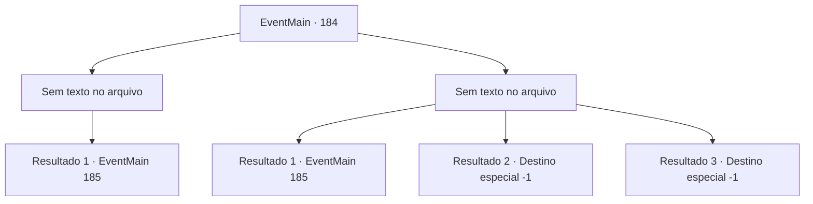

# Eventos principais · 184

[Índice da tabela](index.md) · [Índice geral](../index.md)

ID: `pt:EventMain:184` · Fonte: `EventMain4` · Versão: 1.2.47.

Mapeamento estático dos arquivos; a disponibilidade e a execução dependem do estado da run.

## Texto do evento

*Sem texto no arquivo.*

## Dados de entrada

```json
{
  "id": 184,
  "grade": 1,
  "normalGoal": "",
  "required": ""
}
```

## Mapa das escolhas



## Escolhas e resultados

### Escolha 1

*Sem texto no arquivo; o papel dessa opção depende da interface do jogo.*

Requisitos e outros campos da escolha:

```json
{
  "required": ""
}
```

#### Resultado 1.1

Você derrota o colosso de carne. Ele desmorona com seu próprio peso em uma pilha de carne podre, e Halad olha em desespero. Edmond para no meio de seus movimentos complexos olhar para você incrédulo. Os dois perguntam ao mesmo tempo. 

 "Mas como?"

 Você dá de ombros quando Edmond corre para abraçá-lo. 

 "Magnífico! Nem eu podia contar comigo mesmo contra aquela fera. Vou procurar o texto proibido de Halad agora."

 Ele abre uma pequena porta no canto da caverna e entra. Você se vira para olhar para Halad. Ela está deitada sobre o que resta do colosso.

Continuação registrada: [Evento 185](0185.md) na mesma tabela.

```json
{
  "required": "",
  "chance": "1",
  "nextEvent": 185,
  "type": 2,
  "reward": ""
}
```

### Escolha 2

*Sem texto no arquivo; o papel dessa opção depende da interface do jogo.*

Requisitos e outros campos da escolha:

```json
{
  "required": ""
}
```

#### Resultado 2.1

Você mal se mantém contra o colosso, esquivando, bloqueando e às vezes desviando seus golpes. Um golpe limpo poderia matá-lo instantaneamente. Assim como você fica sem fôlego, incapaz de dar mais um passo, luzes ofuscantes aparecem dentro da caverna. Eles estão vindo de meteoros flamejantes convocados de outra dimensão. |drawing_meteorSwarm| Eles perfuram o colosso e entram no chão da caverna. Quando a poeira baixar, você encontra Halad desmaiado e sangrando entre rochas caídas e pedaços de carne. Edmond está encharcado em seu próprio suor. 

 "Ufa... Graças a Deus o colosso não acabou. Agora... tudo o que precisamos fazer é encontrar aquele texto proibido."

 Ele abre uma pequena porta no canto da caverna e entra.

Continuação registrada: [Evento 185](0185.md) na mesma tabela.

```json
{
  "required": "1_0_2|1_1_2",
  "chance": "1",
  "nextEvent": 185,
  "type": 2,
  "reward": "0_0_-1|0_1_-1|0_2_1"
}
```

#### Resultado 2.2

O colosso te agarra em seus punhos gigantes. Esmaga você antes que alguém possa fazer qualquer coisa.

Continuação registrada: [Destino especial `-1`](../destinos-especiais.md).

```json
{
  "required": "2_0_2",
  "chance": "1",
  "nextEvent": -1,
  "type": 2,
  "reward": "0_0_-1|0_1_-1|15_2_14|25_8_1"
}
```

#### Resultado 2.3

O colosso te agarra em seus punhos gigantes. Esmaga você antes que alguém possa fazer qualquer coisa.

Continuação registrada: [Destino especial `-1`](../destinos-especiais.md).

```json
{
  "required": "2_1_2",
  "chance": "1",
  "nextEvent": -1,
  "type": 2,
  "reward": "0_0_-1|0_1_-1|15_2_14|25_8_1"
}
```

## Referências que chegam a este evento

- [Evento 178 · escolha 1 · resultado 1](0178.md#escolha-1)
- [Evento 180 · escolha 2 · resultado 1](0180.md#escolha-2)
- [Evento 180 · escolha 2 · resultado 2](0180.md#escolha-2)
- [Evento 182 · escolha 1 · resultado 1](0182.md#escolha-1)
- [Evento 182 · escolha 1 · resultado 2](0182.md#escolha-1)
- [Evento 182 · escolha 1 · resultado 3](0182.md#escolha-1)
- [Evento 191 · escolha 1 · resultado 1](0191.md#escolha-1)
- [Evento 191 · escolha 2 · resultado 1](0191.md#escolha-2)
- [Evento 193 · escolha 1 · resultado 1](0193.md#escolha-1)
- [Evento 193 · escolha 2 · resultado 1](0193.md#escolha-2)
- [Evento 204 · escolha 1 · resultado 1](0204.md#escolha-1)
- [Evento 204 · escolha 2 · resultado 1](0204.md#escolha-2)
