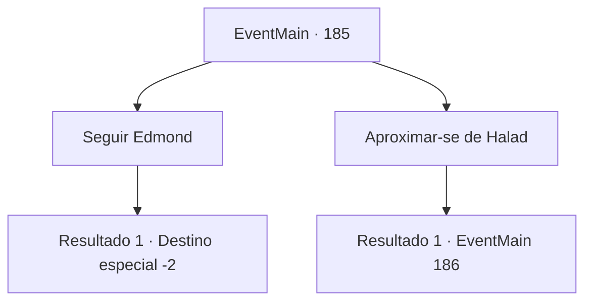

# Eventos principais · 185

[Índice da tabela](index.md) · [Índice geral](../index.md)

ID: `pt:EventMain:185` · Fonte: `EventMain4` · Versão: 1.2.47.

Mapeamento estático dos arquivos; a disponibilidade e a execução dependem do estado da run.

## Texto do evento

*Sem texto no arquivo.*

## Dados de entrada

```json
{
  "id": 185,
  "grade": 1,
  "normalGoal": "",
  "required": ""
}
```

## Mapa das escolhas



## Escolhas e resultados

### Escolha 1

Seguir Edmond

Requisitos e outros campos da escolha:

```json
{
  "required": ""
}
```

#### Resultado 1.1

Você segue Edmond até a pequena sala. |drawing_forbidenBook| Dentro há uma mesa de madeira e uma cadeira, uma pequena vela e um livro velho e surrado que está aberto. Você imediatamente o reconhece como o texto proibido de Halad. Edmond está prestes a destruí-lo quando começa a falar. 

 "He-hey, Edmond, eu... eu fui manipulado! Apenas me dê uma última chance, vamos lá."

 O livro tenta ser amigável, mas não adianta. A varinha de Edmond brilha alaranjada com chamas, queimando-a em pedacinhos. Toda a energia que acumulou das almas encantadas explode em várias direções. 

 "Ufa... acabou agora. Tudo graças a você. Voltemos..."

 Ele balança Halad por cima do ombro e abre um pequeno portal. Ele olha para você enquanto entra. 

 "Estarei esperando na Torre da Magia. Desculpe, este portal só pode transportar duas pessoas ao mesmo tempo. Sem pressa."

 Edmond e Halad desaparecem no portal, e você sai lentamente da caverna.

Continuação registrada: [Destino especial `-2`](../destinos-especiais.md).

```json
{
  "required": "",
  "chance": "1",
  "nextEvent": -2,
  "type": 2,
  "reward": "13_1_23"
}
```

### Escolha 2

Aproximar-se de Halad

Requisitos e outros campos da escolha:

```json
{
  "required": ""
}
```

#### Resultado 2.1

Você caminha até Halad enquanto ela se levanta. Ela está extremamente frustrada. 

 "Eu só... não entendo por que você tem que atrapalhar tudo. Você não tem ideia de como..."

 Ela para e substitui o resto de sua frase com um suspiro. Então ela começa a falar novamente com uma voz derrotada. 

 "Tudo bem, você ganhou. Mate-me já, acabou."


Continuação registrada: [Evento 186](0186.md) na mesma tabela.

```json
{
  "required": "",
  "chance": "1",
  "nextEvent": 186,
  "type": 2,
  "reward": ""
}
```

## Referências que chegam a este evento

- [Evento 184 · escolha 1 · resultado 1](0184.md#escolha-1)
- [Evento 184 · escolha 2 · resultado 1](0184.md#escolha-2)
