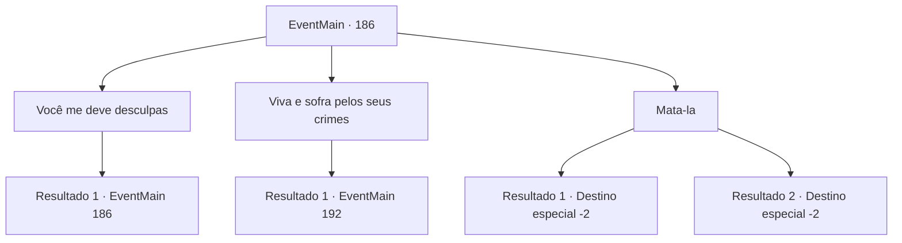

# Eventos principais · 186

[Índice da tabela](index.md) · [Índice geral](../index.md)

ID: `pt:EventMain:186` · Fonte: `EventMain4` · Versão: 1.2.47.

Mapeamento estático dos arquivos; a disponibilidade e a execução dependem do estado da run.

## Texto do evento

*Sem texto no arquivo.*

## Dados de entrada

```json
{
  "id": 186,
  "grade": 1,
  "normalGoal": "",
  "required": ""
}
```

## Mapa das escolhas



## Escolhas e resultados

### Escolha 1

Você me deve desculpas

Requisitos e outros campos da escolha:

```json
{
  "required": "5_87_0"
}
```

#### Resultado 1.1

Você pede a Halad para se desculpar por incriminar você. Ela zomba e revira os olhos 

 "Sim, certo... eu quase esqueci..."

 Ela se levanta, olhos vermelhos e ri. Então ela balança o punho para você. É um soco pateticamente inexperiente. Ela grita 'Sinto muito! Você feliz?' várias vezes enquanto ela bate em você várias vezes, antes de cair de volta e explodir em lágrimas.

Continuação registrada: [Evento 186](0186.md) na mesma tabela.

```json
{
  "required": "",
  "chance": "1",
  "nextEvent": 186,
  "type": 2,
  "reward": "5_87_1"
}
```

### Escolha 2

Viva e sofra pelos seus crimes

Requisitos e outros campos da escolha:

```json
{
  "required": ""
}
```

#### Resultado 2.1

Você diz a ela que ela deve viver para assumir a responsabilidade pelo que ela fez. De repente, a sala em que Edmond entrou irradia uma energia mística. Ele sai pela porta com um livro velho queimado. 

 "Ufa... acabou agora. Tudo graças a você. Vamos voltar... Halad será entregue ao conselho de anciãos. Eles vão decidir o que ela merece."


Continuação registrada: [Evento 192](0192.md) na mesma tabela.

```json
{
  "required": "",
  "chance": "1",
  "nextEvent": 192,
  "type": 2,
  "reward": ""
}
```

### Escolha 3

Mata-la

Requisitos e outros campos da escolha:

```json
{
  "required": "2_3_0"
}
```

#### Resultado 3.1

Você decide acabar com a vida de Halad pelo que ela fez. Pouco depois de sua morte, a sala em que Edmond entrou irradia uma energia mística. Ele sai pela porta com um livro velho queimado. 

 "Ufa... acabou agora. Tudo graças a você. Vamos voltar... Halad... pena que este tinha que ser seu último momento."

 Ele fica ali na frente de seu corpo por um longo tempo, a cabeça baixa. Então ele a balança por cima do ombro e abre um pequeno portal. Ele olha para você enquanto entra. 

 "Estarei esperando na Torre da Magia. Desculpe, este portal só pode transportar duas pessoas ao mesmo tempo. Sem pressa."

 Edmond e Halad desaparecem no portal, e você sai lentamente da caverna.

Continuação registrada: [Destino especial `-2`](../destinos-especiais.md).

```json
{
  "required": "18_87_1",
  "chance": "1",
  "nextEvent": -2,
  "type": 2,
  "reward": "13_1_24"
}
```

#### Resultado 3.2

Você percebe que Halad é incapaz de pensar em ninguém além de si mesma. Você decide acabar com a vida dela pelo que ela fez. Logo após a morte de Halad, a sala em que Edmond entrou irradia uma energia mística. Ele sai pela porta com um livro velho queimado. 

 "Ufa... acabou agora. Tudo graças a você. Vamos voltar... Halad... pena que este tinha que ser seu último momento."

 Ele fica ali na frente de seu corpo por um longo tempo, a cabeça baixa. Então ele a balança por cima do ombro e abre um pequeno portal. Ele olha para você enquanto entra. 

 "Estarei esperando na Torre da Magia. Desculpe, este portal só pode transportar duas pessoas ao mesmo tempo. Sem pressa."

 Edmond e Halad desaparecem no portal, e você sai lentamente da caverna.

Continuação registrada: [Destino especial `-2`](../destinos-especiais.md).

```json
{
  "required": "5_87_1",
  "chance": "1",
  "nextEvent": -2,
  "type": 2,
  "reward": "13_1_24"
}
```

## Referências que chegam a este evento

- [Evento 185 · escolha 2 · resultado 1](0185.md#escolha-2)
- [Evento 186 · escolha 1 · resultado 1](0186.md#escolha-1)
