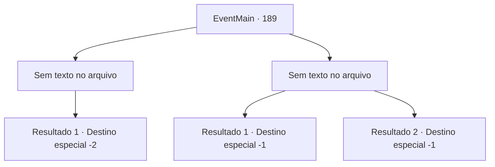

# Eventos principais · 189

[Índice da tabela](index.md) · [Índice geral](../index.md)

ID: `pt:EventMain:189` · Fonte: `EventMain4` · Versão: 1.2.47.

Mapeamento estático dos arquivos; a disponibilidade e a execução dependem do estado da run.

## Texto do evento

*Sem texto no arquivo.*

## Dados de entrada

```json
{
  "id": 189,
  "grade": 1,
  "normalGoal": "",
  "required": ""
}
```

## Mapa das escolhas



## Escolhas e resultados

### Escolha 1

*Sem texto no arquivo; o papel dessa opção depende da interface do jogo.*

Requisitos e outros campos da escolha:

```json
{
  "required": ""
}
```

#### Resultado 1.1


 "Como... um mero mortal..."

 O cérebro derrete e você sente sua energia carregando dentro de você. Você pisca, e de repente você está de volta na torre. Então você sente um enorme estrondo lá fora, quase como um terremoto. Você abre a porta para encontrar o colosso de carne em pedaços, com Halad deitado no topo da pilha. Edmond dá-lhe um polegar para cima. 

 "Eu sabia que voce poderia fazer isso. Ótimo trabalho."

 Ele balança Halad por cima do ombro e abre um pequeno portal. Ele olha para você enquanto entra. 

 "Estarei esperando na Torre da Magia. Desculpe, este portal só pode transportar duas pessoas ao mesmo tempo. Sem pressa."

 Edmond e Halad desaparecem no portal, e você sai lentamente da caverna.

Continuação registrada: [Destino especial `-2`](../destinos-especiais.md).

```json
{
  "required": "",
  "chance": "1",
  "nextEvent": -2,
  "type": 2,
  "reward": "0_3_20|13_1_25"
}
```

### Escolha 2

*Sem texto no arquivo; o papel dessa opção depende da interface do jogo.*

Requisitos e outros campos da escolha:

```json
{
  "required": ""
}
```

#### Resultado 2.1

O cérebro gigante te derrota e te suga em sua boca repulsiva. Dentes afiados de repente saem de dentro. A boca se fecha atrás de você, e essa é a última coisa que você vê.

Continuação registrada: [Destino especial `-1`](../destinos-especiais.md).

```json
{
  "required": "24_1_1",
  "chance": "1",
  "nextEvent": -1,
  "type": 2,
  "reward": "15_2_7"
}
```

#### Resultado 2.2

O cérebro gigante te derrota e te suga em sua boca repulsiva. Dentes afiados de repente saem de dentro. A boca se fecha atrás de você, e essa é a última coisa que você vê.

Continuação registrada: [Destino especial `-1`](../destinos-especiais.md).

```json
{
  "required": "23_1_1",
  "chance": "1",
  "nextEvent": -1,
  "type": 2,
  "reward": "15_2_7|25_8_1"
}
```

## Referências que chegam a este evento

- [Evento 188 · escolha 1 · resultado 3](0188.md#escolha-1)
- [Evento 188 · escolha 2 · resultado 1](0188.md#escolha-2)
- [Evento 188 · escolha 3 · resultado 1](0188.md#escolha-3)
