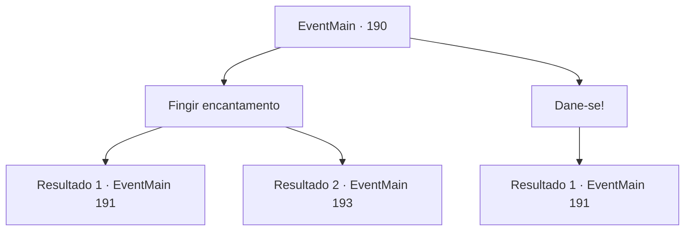

# Eventos principais · 190

[Índice da tabela](index.md) · [Índice geral](../index.md)

ID: `pt:EventMain:190` · Fonte: `EventMain4` · Versão: 1.2.47.

Mapeamento estático dos arquivos; a disponibilidade e a execução dependem do estado da run.

## Texto do evento

*Sem texto no arquivo.*

## Dados de entrada

```json
{
  "id": 190,
  "grade": 1,
  "normalGoal": "",
  "required": ""
}
```

## Mapa das escolhas



## Escolhas e resultados

### Escolha 1

Fingir encantamento

Requisitos e outros campos da escolha:

```json
{
  "required": ""
}
```

#### Resultado 1.1

Você lentamente se deita no chão com as costas contra ele. Mas Halad vê através de sua atuação abaixo da média. 

 "Como... você não está encantado?"

 A varinha solta um suspiro sarcástico. 

 "Cara, até eu poderia fazer melhor do que isso."

 Oh bem, ele diz, antes de disparar fogo de sua boca. As chamas engolem Halad e seu seguidor inteiros. <link=shake>

 "GRAAAAAH!!"

</link> O fanático torna-se uma pilha de cinzas, mas não Halad. Ela aponta a varinha para você com um olhar irritado no rosto. 

 "Você é carne morta ..!"


Continuação registrada: [Evento 191](0191.md) na mesma tabela.

```json
{
  "required": "",
  "chance": "10",
  "nextEvent": 191,
  "type": 1,
  "reward": "6_0_79",
  "place": 6
}
```

#### Resultado 1.2

Você imediatamente se deita no chão com as costas apoiadas nele. Halad sorri com satisfação. Só então, Edmond entra na caverna. 

 "O que você está...?"

 Halad o cumprimenta com um sorriso agradável. 

 "Oh olá, Sr. Presidente. Seu aprendiz é meu agora."

 Então ela ordena que você mate Edmond. Ela virou as costas para você.

Continuação registrada: [Evento 193](0193.md) na mesma tabela.

```json
{
  "required": "",
  "chance": "1|0_12_1",
  "nextEvent": 193,
  "type": 0,
  "reward": ""
}
```

### Escolha 2

Dane-se!

Requisitos e outros campos da escolha:

```json
{
  "required": ""
}
```

#### Resultado 2.1

Isso é uma questão de sua dignidade.
 Você ignora o conselho de sua varinha e imediatamente dá um soco em Halad. Ela é imediatamente jogada para trás. Sua força física empalidece em comparação com sua magia. 

 "Ma... Mestre Halad!"

 Assustada, seu seguidor corre e a ajuda a se levantar. 

 "Seu... bastardo... você é carne morta!"

 Halad limpa o sangue de seus lábios e olha para você. Ela pega sua varinha.

Continuação registrada: [Evento 191](0191.md) na mesma tabela.

```json
{
  "required": "",
  "chance": "1",
  "nextEvent": 191,
  "type": 2,
  "reward": "6_2_79",
  "place": 6
}
```

## Referências que chegam a este evento

- [Evento 182 · escolha 2 · resultado 1](0182.md#escolha-2)
- [Evento 182 · escolha 2 · resultado 2](0182.md#escolha-2)
- [Evento 182 · escolha 2 · resultado 3](0182.md#escolha-2)
